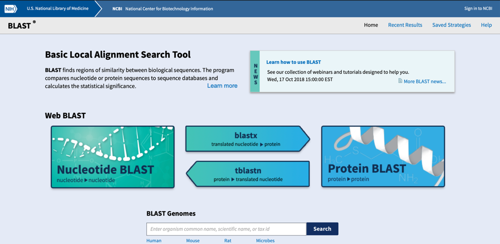
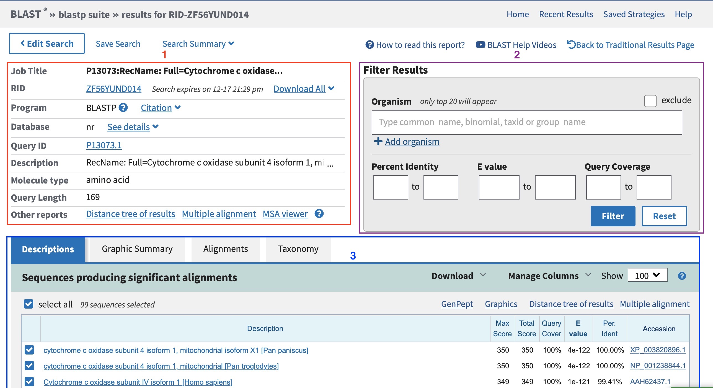
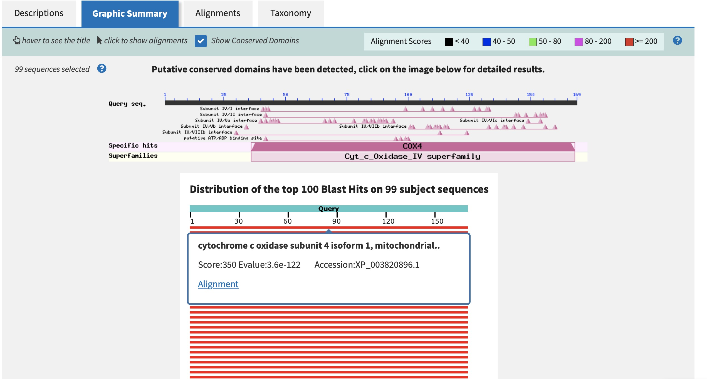

# ALLINEAMENTO DI SEQUENZE   
L’allineamento di due o più sequenze riporta la rappresentazione di un’ipotesi di omologia posizionale tra le basi o gli aminoacidi delle sequenze considerate.  
Esso, infatti, presuppone che le sequenze da allineare siano omologhe e quindi filogeneticamente correlate.  
L’allineamento viene rappresentato sotto forma di una tabella costituita da righe (che corrispondono alle sequenze omologhe considerate) e da colonne (che corrispondono a ciascun sito dell’allineamento).   
L’allineamento può essere realizzato utilizzando algoritmi di **allineamento globale**, che quindi considerano l’intera lunghezza delle sequenze in esame, o **algoritmi di allineamento locale**.   

## Caratterizzazione di una sequenza mediante ricerca di similarità in banche dati: Applicazione di BLAST per la ricerca di sequenze omologhe  
Il programma **BLAST** può essere utilizzato per trovare in banca dati sequenze simili (spesso anche omologhe) a quella che stiamo esaminando.  
Come abbiamo visto in precedenza (Ricerca in Banche dati mediante “parole chiave”) l’interrogazione di una banca dati può essere effettuata anche attraverso “sistemi di retrieval” ricercando criteri testuali nelle annotazioni contenute nelle entries delle sequenze.  
Talvolta, però, le sequenze collezionate nella banca dati non sono correttamente annotate e quindi potrebbe non essere possibile selezionarle mediante la ricerca di parole chiave.  
In questo caso è possibile eseguire la ricerca sulla base della similarità di sequenza utilizzando programmi di “database searching” come il **BLAST (Basic Local Alignment Search Tool)** che confronta una sequenza sonda (per convenzione definita **QUERY**) con tutte le sequenze di una banca dati.    
Supponiamo di voler cercare le sequenze simili alla *sub-unità IV della citocromo c ossidasi umana* (Accession Number: **P13073**).  
Per fare questa ricerca dobbiamo disporre della sequenza sonda in formato FASTA:  
1.	Collegati al sito [www.ncbi.nlm.nih.gov](https://www.ncbi.nlm.nih.gov);  
2.	Seleziona **Protein** come database nel menù a tendine del campo `search` e inserisci l ́ID della sequenza da estrarre;  
3.	Clicca su **FASTA** (in alto a sinistra);  
4.	Copia la sequenza aminoacidica in un file di testo;  
5.	Collegati nuovamente al sito del **BLAST** [https://blast.ncbi.nlm.nih.gov/Blast.cgi](https://blast.ncbi.nlm.nih.gov/Blast.cgi).  

6.	Seleziona **Protein BLAST** e nella finesta che si apre incolla la sequenza proteica nella finestra. Lascia le impostazioni di base:   
    -   _Database_: **Non-redundant protein sequences (nr)**  
    -   _Algorithm_: **blastp (protein-protein BLAST)**  
    Premi il bottone *BLAST*.    
    NB: (É anche possibile inserire direttamente l'**Accession Number** invece della sequenza stessa);  


7.	E’ possibile visualizzare il risultato dell’analisi BLAST.  
    Nella pagina che si apre possiamo disingure tre macro sezioni:  
        - Pannello 1 (rosso): _sezione generale_. Abbiamo tra opzione per cambiare la tipologia di report;  
        - Pannello 2 (viola): _sezione di filtering_: possiamo filtrare i dati sulla base dell' **organismo**, **percentuale di similarità**, **e-value** e **query coverage**;  
        - Pannello 3 (blue): _sezione dei risultati_: possiamo comabiare la modalità in cui sono visualizzati i risultati.   
    La modalità di visualizzazione di base è definita **Descriptions**, dove troviamo le seguenti informazioni:
        * _Description_: Non è altro che la descrizione della sequenza contro cui abbiamo ottenuto un match;  
        * _Max Score_: il punteggio massimo ottenuto dall'allineamento;  
        * _Total Score_: il punteggio totale ottenuto dall'allineamento;
        * _Query Coverage_: porzione della sequenza query interessata dall'allineamento;     
        * _E value_: è una misura che ci dice l'affibabolità dell'allineamento;  
        * _Per. Ident_: percentuale di indentità tra la sequena query e quella match;
        * _Accession_: accession number della sequenza oggetto.  
    Se selezioniamo la modalità di visualizzasione dei risultati **Graphic Summary**, noteremo che il Pannello 1 e 2 rimarranno invariati ma cambierà il 3.  

    Nel riquadro in alto viene rappresenta la presenza dei domini conservati nella proteina query. Nel riquadro in basso è, invece, rappresento graficamente lo score ottenuto dagli allienamenti.  
    Se seleziona una delle barre, verrà aperto un pop-up contenente le informazioni generali ed il **link** diretto al panello dove sono disponibili gli allineamenti (terza modalità di visualizzazione dei risultati).


8.	Esamina i risultati e osserva le sequenze omologhe di COX4 relative a specie di mammiferi.
9.	Seguendo i links delle diverse sequenze trovate si viene rimandati alla pagina contenente l‘intera entry. È così possibile ricavare diverse informazioni, tra cui l‘AC delle sequenze nucleotidiche corrispondenti alla sequenza proteica. 
10.	Prova a ripetere l’esercizio utilizzando la sequenza di mRNA della subunità IV della citocromo c ossidasi umana (ricercandola con una ricerca testuale). In questo caso, quale tipo di BLAST si dovrebbe utilizzare? 
ESERCIZI DA SVOLGERE 
ESERCIZIO 1 
Data questa sequenza:
```
> Sequenza Ignota
MTTASTSQVRQNYHQDSEAAINRQINLELYASYVYLSMSYYFDRDDVALKN
FAKYFLHQSHEEREHAEKLMKLQNQRGGRIFLQDIKKPDCDDWESGLNAME
CALHLEKNVNQSLLELHKLATDKNDPHLCDFIETHYLNEQVKAIKELGDHVT
NLRKMGAPESGLAEYLFDKHTLGDSDNES
``` 
Cercate di scoprire, utilizzando BlastP, 
1)	Di che proteina si potrebbe trattare, e da quale specie probabilmente proviene
2)	Contiene un dominio funzionale? Se si, quale? 
3)	Esistono sequenze che si possono supporre ortologhe in altri organismi? 
(per rispondere a questa domanda potete utilizzare il link “Taxonomy Report” nella pagina dei risultati). 
ESERCIZIO 2 
Ricerca la sequenza dell’mRNA di p53 di Cavia porcellus. Utilizza questa sequenza come query per una ricerca con blastn e blastx e confronta i risultati.
