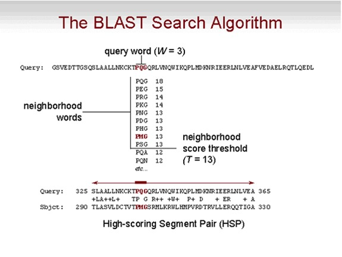
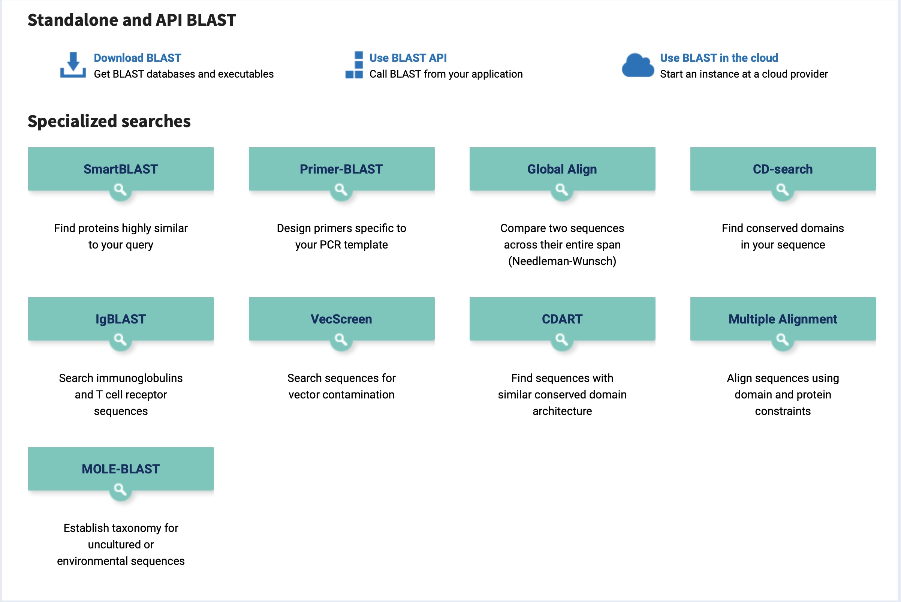
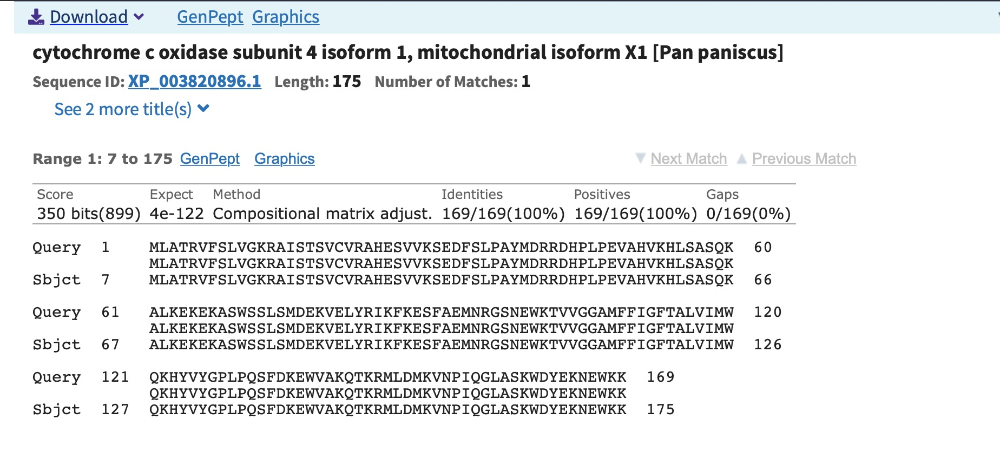

# ALLINEAMENTO DI SEQUENZE   
**L' assunzione di base su cui fondiamo il confronto tra sequenze è che se due sequenze sono identiche, avranno un comportamento identico nelle cellule viventi**.  
  
Possiamo generalizzare questo concetto, dicendo che **più due sequenze sono similari tra di loro, maggiore sarà la probabilità che abbiano una funzione similare**.  
Questo principio ci permette di desumere le proprietà di una sequenza nucleotidica o aminoacidica ignota, basandosi sulle caratteristiche della sequenza nota con cui riusciamo a ottenere un allineamento.  

L’allineamento di due o più sequenze riporta **la rappresentazione di un’ipotesi di omologia posizionale** tra le basi o gli aminoacidi delle sequenze considerate.  
Esso, infatti, presuppone che le sequenze da allineare siano **omologhe** e quindi **filogeneticamente correlate**.  
_Allineare_ due sequenze significa rappresentarle una sotto l' altra, incolonnando i residui in modo da formare una matrice.  
In generale distinguiamo due tipologie di allieneamento:  
a) **Allineamento Globale**: le sequenze sono allineate per la loro intera lunghezza;  
```
FTFTALILLAVAV
|  ||| ||| ||
F--TAL-LLA-AV
```  
b) **Allineamento Locale**: in questo caso privilegiamo porzioni di similitudine tra le due sequenze allo scopo di massimizzare la similarità tra queste porzioni di sequenze.
```
FTFTALILLA-VAV
  |||| ||| | 
--FTAL-LLAAV-
```   

## Caratterizzazione di una sequenza mediante ricerca di similarità in banche dati: Applicazione di BLAST per la ricerca di sequenze omologhe  
Il programma **BLAST (Basic Local Alignment Search Tool)** può essere utilizzato per trovare in banca dati sequenze simili (spesso anche omologhe) a quella che stiamo esaminando.  
Come abbiamo visto in precedenza (Ricerca in Banche dati mediante “parole chiave”) l’interrogazione di una banca dati può essere effettuata anche attraverso “sistemi di retrieval” ricercando criteri testuali nelle annotazioni contenute nelle entries delle sequenze.  
Talvolta, però, le sequenze collezionate nella banca dati non sono correttamente annotate e quindi potrebbe non essere possibile selezionarle mediante la ricerca di parole chiave.  
In questo caso è possibile eseguire la ricerca sulla base della similarità̀ di sequenza utilizzando programmi di “database searching” come il **BLAST (Basic Local Alignment Search Tool)** che confronta una sequenza sonda (per convenzione definita **QUERY**) con tutte le sequenze di una banca dati.  
  
[https://www.ncbi.nlm.nih.gov/books/NBK62051/**](https://www.ncbi.nlm.nih.gov/books/NBK62051/)  
  
Esistono diverse versioni del BLAST:  
- **blastp**: permette di allineare QUERY aminoacidiche contro un database di riferimento proteico;  
- **blastn**: permette di allineare QUERY nucleotidiche contro un database di riferimento nucleotidico;  
- **blastx**: permette di allineare QUERY nucleotidiche tradotte contro un database di riferimento proteico :sob:;   
- **tblastn**: permette di allineare QUERY aminoacidica contro un database di riferimento nucleotidico tradotto :astonished:;  
- **tblastx**: sia la QUERY che il database sono nucleotidici e vengono tradotti :scream:;   
- **Gapped blast**: versione aggiornata dell'algoritmo in cui sono ammessi gap durante la fase di estensione :scream:;
- **PSI-BLAST**: Algoritmo che ricalcola gli score di allineamento interattivamente sulla base dei match osservati :scream:;

Da qualche anno sono disponibili anche versioni ancora più ottimizzate dell' algoritmo pensate per rispondere a specifiche necessità:  



Supponiamo di voler cercare le sequenze simili alla *sub-unità IV della citocromo c ossidasi umana* (Accession Number: **P13073**).  
Per fare questa ricerca dobbiamo disporre della sequenza sonda in formato FASTA:  
1.	Collegati al sito [www.ncbi.nlm.nih.gov](https://www.ncbi.nlm.nih.gov);  
2.	Seleziona **Protein** come database nel menù a tendine del campo `search` e inserisci l ́ID della sequenza da estrarre;  
3.	Clicca su **FASTA** (in alto a sinistra);  
4.	Copia la sequenza aminoacidica in un file di testo;  
5.	Collegati nuovamente al sito del **BLAST** [https://blast.ncbi.nlm.nih.gov/Blast.cgi](https://blast.ncbi.nlm.nih.gov/Blast.cgi).  

6.	Seleziona **Protein BLAST** e nella finesta che si apre incolla la sequenza proteica nella finestra. Lascia le impostazioni di base:   
    -   _Database_: **Non-redundant protein sequences (nr)**  
    -   _Algorithm_: **blastp (protein-protein BLAST)**  
    Premi il bottone *BLAST*.    
    NB: (É anche possibile inserire direttamente l'**Accession Number** invece della sequenza stessa);  


7.	E’ possibile visualizzare il risultato dell’analisi BLAST.  
    Nella pagina che si apre possiamo disingure tre macro sezioni:  
        - Pannello 1 (rosso): _sezione generale_. Abbiamo tra opzione per cambiare la tipologia di report;  
        - Pannello 2 (viola): _sezione di filtering_: possiamo filtrare i dati sulla base dell' **organismo**, **percentuale di similarità**, **e-value** e **query coverage**;  
        - Pannello 3 (blue): _sezione dei risultati_: possiamo cambiare la modalità in cui sono visualizzati i risultati.  
    La modalità di visualizzazione di base è definita **Descriptions**, dove troviamo le seguenti informazioni:
        * _Description_: Non è altro che la descrizione della sequenza contro cui abbiamo ottenuto un match;  
        * _Max Score_: il punteggio massimo ottenuto dall' allineamento;  
        * _Total Score_: il punteggio totale ottenuto dall' allineamento;
        * _Query Coverage_: porzione della sequenza query interessata dall' allineamento;     
        * _E value_: è una misura che ci dice l' affidabilità dell' allineamento;  
        * _Per. Ident_: percentuale di indentità tra la sequenza query e quella match;
        * _Accession_: accession number della sequenza oggetto.  
    Se selezioniamo la modalità di visualizzasione dei risultati **Graphic Summary**, noteremo che il Pannello 1 e 2 rimarranno invariati ma cambierà il 3.  

    Nel riquadro in alto viene rappresenta la presenza dei domini conservati nella proteina query. Nel riquadro in basso è, invece, rappresento graficamente lo score ottenuto dagli allienamenti.  
    Se si seleziona una delle barre, verrà aperto un pop-up contenente le informazioni generali ed il **link** diretto al panello dove sono disponibili gli allineamenti (terza modalità di visualizzazione dei risultati).  

    Seguendo i links delle diverse sequenze trovate si viene rimandati alla pagina contenente l‘intera entry. È così possibile ricavare diverse informazioni, tra cui l‘AC delle sequenze nucleotidiche corrispondenti alla sequenza proteica.  

# ESERCIZI DA SVOLGERE    
## ESERCIZIO 1  
Esamina i risultati e osserva le sequenze omologhe di COX4 relative a specie di mammiferi.  

## ESERCIZIO 2
Seguendo i links delle diverse sequenze trovate si viene rimandati alla pagina contenente l‘intera entry. È così possibile ricavare diverse informazioni, tra cui l‘AC delle sequenze nucleotidiche corrispondenti alla sequenza proteica.  
Prova a ripetere l’esercizio utilizzando la sequenza di mRNA della sub-unità IV della citocromo c ossidasi umana (ricercandola con una ricerca testuale). In questo caso, quale tipo di BLAST si dovrebbe utilizzare?  
Suggerimenti:
 - Il **gene name** è COX4I1  
 - Restringete la ricerca (*limits*) per **mRNA** e **RefSeq**  
 - selezionate la **Transcript Variant 5**      

# ESERCIZI DA SVOLGERE 
## ESERCIZIO 3
Data questa sequenza:
```
> Sequenza Ignota
MTTASTSQVRQNYHQDSEAAINRQINLELYASYVYLSMSYYFDRDDVALKN
FAKYFLHQSHEEREHAEKLMKLQNQRGGRIFLQDIKKPDCDDWESGLNAME
CALHLEKNVNQSLLELHKLATDKNDPHLCDFIETHYLNEQVKAIKELGDHVT
NLRKMGAPESGLAEYLFDKHTLGDSDNES
``` 
Utilizzando il Protein BLAST, cercate di rispondere alle seguenti domande:  
    1)	Di che proteina si potrebbe trattare, e da quale specie probabilmente proviene  
    2)	Contiene un dominio funzionale? Se si, quale?  
    3)	Esistono sequenze che si possono supporre ortologhe in altri organismi?   
(per rispondere a questa domanda potete utilizzare il link “Taxonomy Report” nella pagina dei risultati). 

## ESERCIZIO 4 
Ricerca la sequenza dell’mRNA di p53 di Cavia porcellus. Utilizza questa sequenza come query per una ricerca con blastn e blastx e confronta i risultati.  
Suggerimenti:  
    - **gene name**: **tp53**  
    - restringere la ricerca per **mRNA** 

Letture consigliate:    
- Citterich M. et al. Fondamenti di Bioinformatica (Zanichelli) - Capitolo 5  

[Utilizzo di BLAST e BLAT per l'analisi genomica](blast_genomico.md)                            

[Back to the top](../README.md)