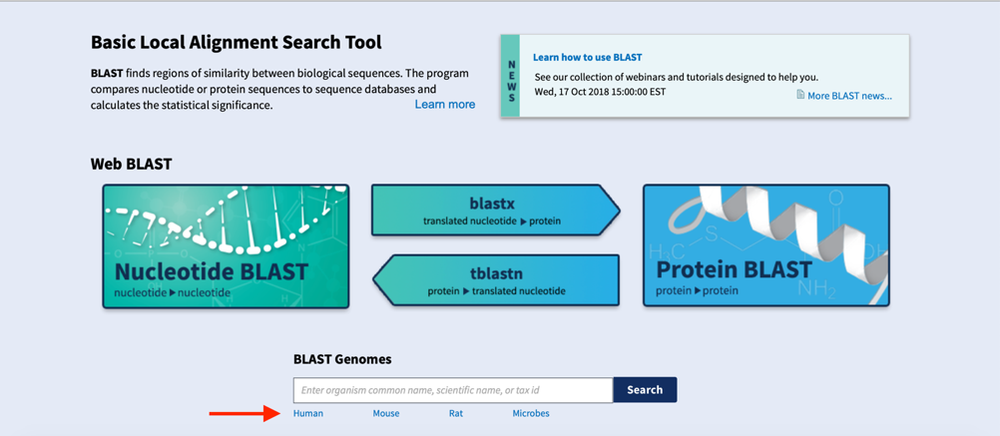
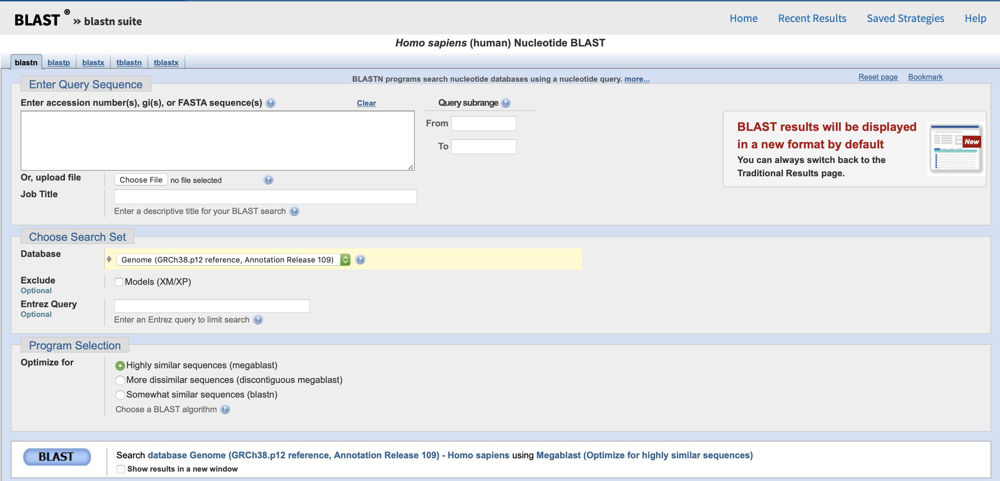
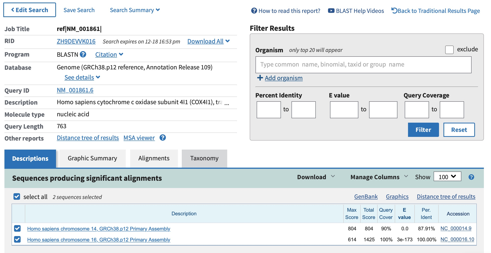
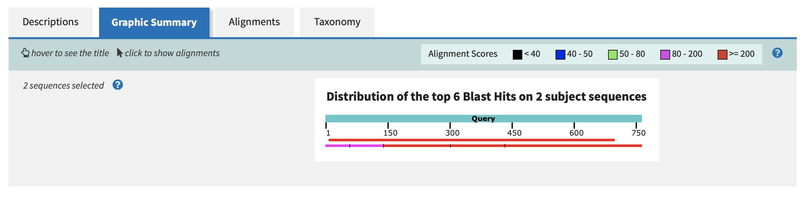
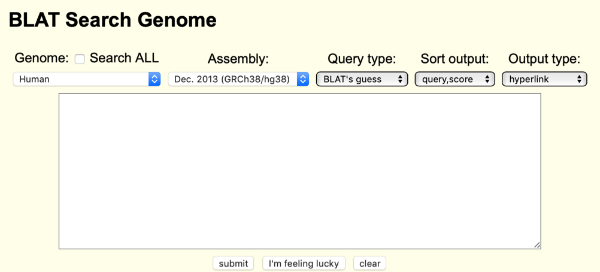

# UTILIZZO DI BLAST E BLAT PER L'ANALISI GENOMICA
Negli esempi che abbiamo appena visto, abbiamo utilizzato il **BLAST** per effettuare ricerche nelle banche dati come se stessimo facendo una ricerca testuale.  
Se ci pensate, lo stesso concetto (e, quindi, lo stesso strumento) può essere usato per confrontare sequenze anche di dimensioni estremamente differenti.  
Immaginate di confrontare una sequenza di 100 bp con un intero cromosoma umano: quello che il **BLAST** vi potrà dire è se esiste una regione del cromosoma “abbastanza simile” alla vostra sequenza di 100 bp, o addirittura ad una parte di essa.  

Le applicazioni di questo tipo di analisi sono diverse:
1.	Dato un trascritto, si può cercare da quale regione del genoma corrispondente proviene (e quindi, dove si trova il rispettivo gene);  
2.	Data una proteina, si può cercare una regione del genoma corrispondente che codifichi per questa proteina (**Nel caso dei genomi eucariotici, non è però possibile ricostruire l’intera struttura genica o il trascritto che ha prodotto quella proteina. Per quale motivo?**);  
3.	Dato un trascritto (o una proteina) di una specie, si può usare il BLAST sul genoma di un’altra specie per cercare qualcosa che sia “simile” (**mentre nei due casi precedenti ci si poteva aspettare l’identità nelle regioni allineate, Perché?**), sia a livello di sequenza nucleotidica (produce un trascritto simile a quello dato) sia a livello di traduzione (tradotta, produce un peptide simile a quello dato).  
In effetti, l’analisi al punto `3)` viene applicata, ad esempio, dallo staff di **ENSEMBL** ogni qual volta viene annotato un genoma appena assemblato, partendo da specie sufficientemente “vicine” (e le annotazioni di **“omologia/ortologia”** provengono proprio da BLAST “incrociati”).  

Mentre per allineare i trascritti ad una sequenza genomica si può usare **nucleotide BLAST**  (query nucleotidi vs. database nucleotidico, anche nella variante **“MEGABLAST”** che suppone che le vostre sequenze siano “identiche a pezzi”), per “mappare” proteine su potenziali geni che le codificano o si può tradurre la proteina “all’indietro” in nucleotidi e “blastarla” sul genoma. 
Per fare questo c’è una variante di BLAST apposita (**tblastn**).  

Virtualmente tutti i **browser genomici** (_che vedremo nella prossima esercitazione_) “offrono” un servizio di blast sui diversi genomi, che producono i medesimi  risultati.  
In questa esercitazione utilizzeremo (per motivi puramente estetici e di leggibilità dei risultati) quello disponibile con il **BLAST**, accessibile tramite il “solito” link:  
[https://blast.ncbi.nlm.nih.gov/Blast.cgi](https://blast.ncbi.nlm.nih.gov/Blast.cgi)  

Come potete vedere, c’è una sezione dedicata ai genomi completi (o in fase di completamento). Cliccando sul link corrispondente a **human** (attenzione, ciascuna specie linka a una pagina diversa... quindi occorre “centrare” human!) venite portati a questa pagina:  
Che, appunto vi dice che potete effettuare un BLAST sulle sequenze umane, ristretto a un tipo di sequenza (menù vicino a Database).   

Potete, inoltre, scegliere quale versione del blast utilizzare (blastn, blastx, tblastn, ecc. ecc.) e, nel caso un cui utilizziate blastn, se volete il **megablast**, che potete selezionare se attendete che la vostra sequenza sia identica (per lo meno, a pezzi, ad una o più regioni del genoma).  
Tra le altre cose, è possibile selezionare la versione del database in cui effettuare la ricerca, che in questo caso è rappresnetato da diverse versioni del genoma umano o collezioni di mRNA. Se cliccate sul :question: sarà possibile visualizzare una descrizione del database.  
 
Sopra, c’è la casella in cui potete incollare una sequenza o semplicemente l’**Accession Number** della sequenza che volete “blastare”, e infine il pulsante BLAST. 
Come primo esperimento cercheremo nel genoma dell’uomo il gene della COX4 isoforma 1 (il solito COX4I1). L’accession number dell’mRNA corrispondente è **NM_001861**, mettetelo nella casella, selezionate **megablast** e come database **genome (GRCh38.p12 reference, Annotation Release 109)**.  
Infine avviate il blast. 

Quello che il programma farà, è un “blast” del trascritto confrontandolo con il genoma umano (quindi confrontandolo con la sequenza nucelotidica di ciascun cromosoma). 
La procedura successiva è quella che abbiamo già visto.
 

Come si può vedere il programma ha trovato due match (in questo caso, due cromosomi) in cui esistono regioni simili alla sequenza query.    
Nel pannello **Description** notiamo che abbiamo due match: uno sul cromosoma 14 ed uno sul cromosoma 16.  
Nel pannello **Graphic Summary** vediamo la rappresentazione grafica degli allineamenti: le righe rosse mostrano la “copertura” della sequenza query (ovvero, per quali parti della sequenza query è stata riscontrata similarità) e le stanghette nere indicano che l’allineamento non è continuo sul reference ma è spezzato.  

A questo punto proviamo a rispondere a queste domande:  
    1.	A quale dei due “hit” corrisponde effettivamente il gene COX4I1? Perché?  
    2.	E’ quello con score più alto (o E-value più basso)?  
Per verificare le risposte, è sufficiente osservare gli allineamenti ed utilizzare “Genome data Viewer” dell’NCBI, che vi mostra le annotazioni della regione in cui sono stati trovati gli hits.  

    

    <b>Aguzzando un po’ la vista è possibile vedere che sul cromosoma 16 effettivamente gli “hit” cadono in una regione annotata con COX4I1, ed inoltre corrispondono agli esoni annotati per il gene.</b>
    

Un altro programma molto efficiente e veloce per confrontare una sequenza data contro un intero genoma è il **BLAT**.
[BLAT](http://genome.ucsc.edu/cgi-bin/hgBlat?command=start) è accessibile presso i server dell' UCSC.  

Una volta selezionato il genoma e la versione dell' assembly è possibile condurre la ricerca dopo aver incollato nell'apposito riquadro la sequenza nucleotidica o proteica in esame.  
Ad esempio, provate a cercare nel genoma umano la proteina corrispondente al gene COX4I1 precedentemente considerato (ricercate la sequenza nel database **nucleotide** su **NCBI** e copiate la sequenza in formato FASTA. Usate l’AC **NM_001861**!!!).   
Il risultato della ricerca è una tabella che mostra gli "hits" in ordine descrescente di score. E' possibile visualizzare i risultati nel "Browser" oppure direttamente l'allineamento.  
Potete ricavare le coordinate cromosomiche del gene cox4? 

## ESERCIZIO 1   
Provate a cercare nel genoma dell’uomo il gene della ferritina “heavy” (FTH1) a partire dal trascritto (NM_002032). Su che cromosoma è localizzato?   

## ESERCIZIO 2  
Ripetete l’esperimento sul genoma del topo (usando la sequenza dell’uomo). In questo caso, **non selezionate megablast**.  
Su che cromosoma si trova il gene omologo a COX4I1 (idem: provate a rispondere e solo dopo a guardare le annotazioni)? 
 

[Back to the top](../README.md)

