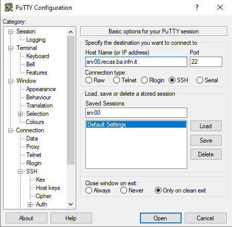

# Accesso al Server
Il resto delle Esercitazioni richiedere l'utilizzo di uno dei server disponibili presso l'**IBIOM (Istituto di Biomembrane, Bioenergetica e Biotecnologie molecolari)** del **CNR** di Bari.  
Il server che andremo ad utilizzare è raggiungile al seguente indirizzo `srv00.recas.ba.infn.it`.  

Per accedervi dovrete tutti scaricare il file chiave che trovate in questa cartella. 
- Per gli utenti dei sistemi UNIX-based (mac) scaricate il file `bmmm1920` nella cartella **Downloads**.  
- Per gli utenti windows dovrete scaricare il file `bmmm1920.ppk` e non è un problema dove lo scaricherete.  

## Sistemi operativi UNIX-BASED
Gli utilizzatori di sistemi operativi UNIX-based dovranno utilizzare direttamente il terminale e digitare i seguenti comandi:  
```
chmod 600 /path/to/the/key/bmmm1920.ppk

ssh -i /path/to/the/key/bmmm1920.ppk epigen@srv00.recas.ba.infn.it 
```
Se avete scaricato il file in Downloads:  
```
chmod 600 ~/Downloads/bmmm1920.txt

ssh -i ~/Downloads/bmmm1920.txt epigen@srv00.recas.ba.infn.it 
```
Alla prima connessione il sistema vi chiederà se il server sia "fidato" e dovrete digitare `yes`.  
Di seguito vi chiederà la **password** (vi verrà comunicata al momento) e dovrete inserirla. **Notate che il cursore non si muoverà mentre digitate la password!!!**.  
Se avrete digitato la password correttamente avre avuto accesso al server.  

## WINDOWS
In windows dovremo utilizzare **Putty**.  
1. Avviate Putty con un doppio click del mouse sul file `putty.exe`.  

2. Cliccate su ``SSH`` e successivamente su ``Auth``. Nella finestra di immissione della key cliccate su ``Browse..``e selezionate il file `bmmm1920.ppk`.

3. A questo punto selezionate ``Session``:
    - Nel panello ``Host Name (or IP address)`` scrivete l'indirizzo del server;  
    - In `Saved Sessions` scrivete **srv00** e cliccate su `save`(in questo modo creiamo un profilo di connessione);  
    - Cliccate su **open**.  
        * Il sistema vi chiederà l'utente di login: scrivete `epigen`  
        * di seguito vi chiederà la password e scriverete quella che vi sarà comunicata.  
Se avete salvato la sessione al prossimo utilizzo vi basterà selezionare `srv00 e cliccare su `load`.  


# Configurazion FileZilla
**FileZilla** è un tool che ci permette di scambiare file tra il nostro computer ed il server.  
Occorre configurarlo in modo appropriato:
* Su `File` selezionate `Site Manager`;  
* Selezionate `New Site` si aprirà una nuova scheda in cui potrete indicare un nome a vostra scelta;  
* Nel pannello a sinistra vanno inseriti i seguenti parametri:  
    - **Protocols**: `SFTP SSH File Transfert Protocol`  
    - **Host**: `srv00.recas.ba.infn.it`
    - **Port**: `22`    
    - **Logon Type**: ``key file``  
    - **User**: ``epigen``
    - **Key file**: selezionate il file `bmmm1920.ppk`
* Cliccate su ``Connect``.  


# Il formato FASTA
Il formato FASTA è un formato testuale comunemente utilizzato in bioinformatica per annotare le sequenze biologiche, sia nucleotidiche che aminoacidiche.  
Di seguito è riportato un esempio:
```
>gi|46048717|ref|NM_205264.1| Gallus gallus tumor protein p53
(TP53), mRNA
GAATTCCGAACGGCGGCGGCGGCGGCGGCGAACGGAGGGGTGCCCCCCCAGGGACCCCCCAACATGGCGG
AGGAGATGGAACCATTGCTGGAACCCACTGAGGTCTTCATGGACCTCTGGAGCATGCTCCCCTATAGCAT
GCAACAGCTGCCCCTCCCTGAGGATCACAGCAACTGGCAGGAGCTGAGCCCCCTGGAACCCAGCGACCCC
CCCCCACCACCGCCACCACCACCTCTGCCATTGGCCGCCGCCGCCCCCCCCCCATTAAACCCCCCCACCC
CCCCCCGCGCTGCCCCCTCCCCGGTGGTCCCATCCACGGAGGATTATGGGGGGGACTTCGACTTCCGGGT
GGGGTTCGTGGAGGCGGGCACAGCCAAATCGGTCACCTGCACTTACTCCCCGGTGCTGAATAAGGTCTAT
TGCCGCCTGGCCAAGCCGTGCCCGGTGCAGGTGAGGGTGGGGGTGGCGCCCCCCCCCGGTTCCTCCCTCC
GCGCCGTGGCCGTCTATAAGAAATCAGAGCACGTGGCCGAAGTGGTGCGGCGCTGCCCCCACCACGAGCG
CTGCGGGGGGGGCACCGACGGCCTGGCCCCCGCACAGCACCTCATCCGGGTGGAGGGGAACCCCCAGGCG
CGTTACCACGACGACGAGACCACCAAACGGCACAGCGTCGTCGTCCCCTATGAGCCCCCCGAGGTGGGCT
CTGACTGTACCACGGTGCTGTACAACTTCATGTGCAACAGTTCCTGCATGGGGGGGATGAACCGCCGCCC
CATCCTCACCATCCTTACACTGGAGGGGCCGGGGGGGCAGCTGTTGGGGCGGCGCTGCTTCGAGGTGCGC
GTGTGCGCATGTCCGGGGAGGGACCGCAAGATCGAGGAGGAGAACTTCCGCAAGAGGGGCGGGGCCGGGG
GCGTGGCTAAGCGAGCCATGTCGCCCCCAACCGAAGCCCCCGAGCCCCCCAAGAAGCGCGTGCTGAACCC
CGACAATGAGATATTCTACCTGCAGGTGCGCGGGCGCCGCCGCTATGAGATGCTGAAGGAGATCAATGAG
GCGCTGCAGCTCGCCGAGGGGGGGTCCGCACCGCGGCCTTCCAAAGGCCGCCGTGTGAAGGTGGAGGGAC
CCCAACCCAGCTGCGGGAAGAAACTGCTGCAAAAAGGCTCGGACTGACCACGCCCCCTTTTTCCTTTAGC
CACGCCCCTTTCCCTTCAGGCCCGGCCCATTTCCCTTCAGCCCCGGCCCCATTTCCCTTCAGCCACGCCC
AATTTCCCCTTTACCACGCCCCCTTTCCCTTCAGCCACGCCCCCTTTCCCCTTAGCCACTCCCCTTCCCC
CGCGAAAGCCCCGCCCACCCCCGCCGTAACCACGCCCACGCTTCCCACCCCCCTCCCAATCTGACCACGC
CCCCTTTACGCCTTAACCACGCCCCCTCTCTCCTGGCCCCGCCCCCCTCCGCTTTGGCCATGCGTAAATC
CCCCCCCCCGCCCCCCCCCGGCTCATTTTTAATGCTTTTTTTGATACAATAAAACTTCTTTTTTTACTGA
AAAAAAAAGGAATTC
```
Presenta la riga iniziale che comincia con il simbolo di maggiore “>”, a cui fa seguito un identificativo unico, seguito da una opzionale corta definizione.  
Le linee a seguire contengono la sequenza amminoacidica o nucleotidica. La sequenza biologica è rappresentata con un alfabeto con un codice a singola lettera per indicare il nucleotide o l’aminoacido (per avere ulteriori informazioni circa il formato FASTA consultare la relativa pagina [Wikipedia](https://en.wikipedia.org/wiki/FASTA_format)).

#Il formato FASTQ
Il formato FASTQ è formato testuale utilizzato per annotare le sequenze biologiche nucleotiche ed i quality-score associati a seguito di una procedura di sequenziamento del DNA.    
E’ il formato utilizzato per i dati di sequenziamento (per ulteriori informazioni circa il formato FASTQ potete consultare la relativa pagina [Wikipedia](https://en.wikipedia.org/wiki/FASTQ_format)).  
```
@EAS54_6_R1_2_1_413_324
CCCTTCTTGTCTTCAGCGTTTCTCC
+
;;3;;;;;;;;;;;;7;;;;;;;88
```
Questo formato presenta una struttura suddivisa in 4 righe:  
1. Riga di intestazione che inizia con “@”;  
2. Sequenza biologica;  
3. Riga di separazione che inizia con un “+”. Talora può contenere una descrizione;  
4. Quality score in formato ASCII.

Il **Quality Score** o **Phred Socre** è una misura della probabilità che la base letta sia erronea ed è calcolato utilizzando questa formula:  
  
Si fatto maggiore è il **Quality score** minore è la probabilità che la base chiamata sia erronea:  

|Q|P|  
|:-:|:-:|  
|0|1|  
|10|0.1|  
|20|0.01|  
|30|0.001|  
|40|0.0001|  


# Breve introduzione alla linea di comando Bash
Alcuni comandi che potrebbero esserci utili durante il tutorial:  
* `pwd`: restituisce il path relativo alla directory in cui ci troviamo;  
* `cd`: permette di spostarci tra le differenti directory;  
* `ls`: elenca il contenuto di una directory;   
   Opzioni: 
    * `-l` (mostra più informazioni)  
    * `-a` (mostra i file nascosti)  
    * `-t` (elenca i file in base alla data di creazione)   
    * `-r` (mostra prima il più vecchio);  
* `mkdir`: permette di creare una nuova cartella;  
* `df`: evidenzia lo spazio disponibile;  
* `cp`: per effettuare la copia dei file;  
* `rm`: eliminare un file;  
* `man`: richiedere il manuale di un comando;  
* `less`: mostra il contenuto di un file;  
* `whoami`: mostra lo user name dell’utilizzatore corrente;  
* `ssh`: permette di collegare la nostra macchina con un server remoto  

[Back to the top](../README.md) 