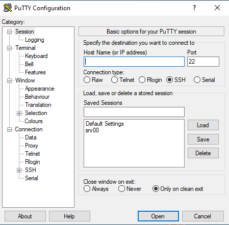
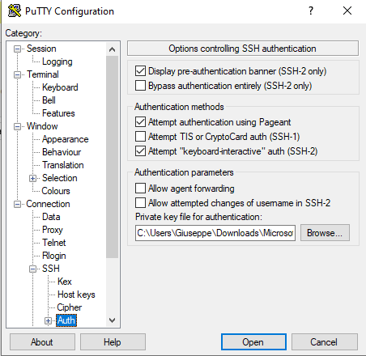

# Accesso al Server
Il resto delle Esercitazioni richiedere l'utilizzo di uno dei server disponibili presso l'**IBIOM (Istituto di Biomembrane, Bioenergetica e Biotecnologie molecolari)** del **CNR** di Bari.  
Il server che andremo ad utilizzare è raggiungile al seguente indirizzo `srv00.recas.infn.it`.  

Per accedervi dovrete tutti scaricare il file `bmmm1920.ppk` che trovate in questa cartella. 
- Per gli utenti dei sistemi UNIX-based (mac) scaricate il file nella cartella **Downloads**.  
- Per gli utenti windows non è un problema dove scaricherete il file.  

## Sistemi operativi UNIX-BASED
Gli utilizzatori di sistemi operativi UNIX-based dovranno utilizzare direttamente il terminale e digitare il seguente comando:  
```
ssh -i /path/to/the/key/bmmm1920.ppk epigen@srv00.recas.ba.infn.it 
```
Se avete scaricato il file in Downloads:  
```
ssh -i ~/Downloads/bmmm1920.ppk epigen@srv00.recas.ba.infn.it 
```
Alla prima connessione il sistema vi chiederà se il server sia "fidato" e dovrete digitare `yes`.  
Di seguito vi chiederà la **password** (vi verrà comunicata al momento) e dovrete inserirla. **Notate che il cursore non si muoverà mentre digitate la password!!!**.  
Se avrete digitato la password correttamente avre avuto accesso al server.  

## WINDOWS
In windows dovremo utilizzare **Putty**.  
1. Avviate Putty con un doppio click del mouse sul file `putty.exe`.  

2. Cliccate su ``SSH`` e successivamente su ``Auth``. Nella finestra di immissione della key cliccate su ``Browse..``e selezionate il file `bmmm1920.ppk`.

3. A questo punto selezionate ``Session``:
    - Nel panello ``Host Name (or IP address)`` scrivete l'indirizzo del server;  
    - In `Saved Sessions` scrivete **srv00** e cliccate su `save`(in questo modo creiamo un profilo di connessione;  
    - Cliccate su **open**.  
        * Il sistema vi chiederà l'utente di login: scrivete `epigen`  
        * di seguito vi chiederà la password e scriverete quella che vi sarà comunicata.  
Se avete salvato la sessione al prossimo utilizzo vi basterà selezionare srv00 e cliccare su `load`.  

