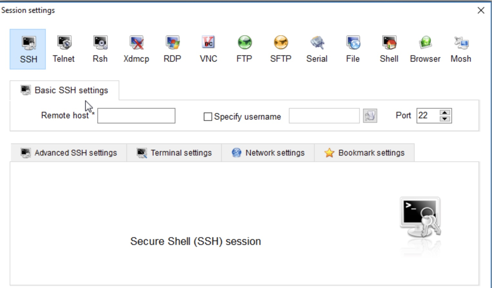
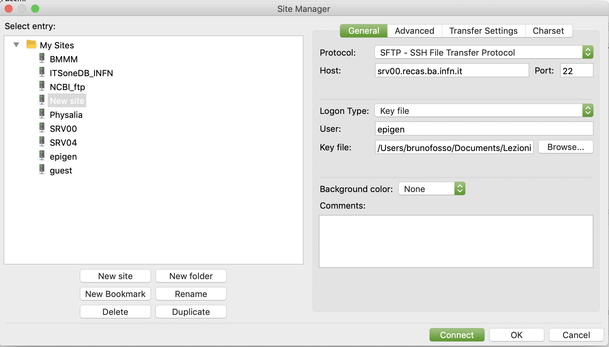

Accesso al server e Introduzione al BASH
===================  
- [Accesso al Server](#accesso-al-server)
- [Configurazione FileZilla](#configurazione-filezilla)
- [Breve introduzione alla linea di comando Bash](#breve-introduzione-alla-linea-di-comando-bash)
- [Il formato FASTA](#il-formato-fasta)
- [Il formato FASTQ](#il-formato-fastq)


# Accesso al Server
Il resto delle **Esercitazioni** richiederà l' utilizzo di server messi a disposizione dal Datacenter **ReCaS**.  
A ognuno di voi è stato assegnato un utente che utilizzerete per collegarvi sulle macchine che andremo a utilizzare.  
Le macchine per le esercitazioni hanno i seguenti indirizzi:  
- **212.189.205.77**  
- **90.147.102.58**  
- **90.147.102.38**  

Per accedervi dovrete accedere alla tabella disponibile a questo [link](https://docs.google.com/spreadsheets/d/1HQAnOIkwrdo4EIX2OIB1Xxv2i_V4bet-W7BJyGeQq1g/edit?usp=sharing).  
Dovrete scaricare il file chiave corrispondente al vostro user da questa [cartella](https://drive.google.com/drive/folders/1VAo4zdzec7UPPXLgJJsv8qWhNbvZMfy8?usp=sharing).  

Una volta completato il download del file non lo dovete aprire. Al massimo spostatelo nella cartella che trovate più comoda.  
***Soprattutto per chi di voi utilizza sistemi UNIX-based consiglio di non spostare il file, così lo troverà direttamente
in download quando dovrà utilizzare il terminale.***  

## Sistemi operativi UNIX-BASED
Gli utilizzatori di sistemi operativi UNIX-based dovranno utilizzare direttamente il **terminale** (cercate l' applicazione terminale tra quelle disponibili) e digitare i seguenti comandi:  
Il comando generale è:  
```
chmod 600 /path/to/the/key/userX

ssh -i /path/to/the/key/userX userX@srv00.recas.ba.infn.it 
```

Se avete scaricato il file in Downloads:  
```
chmod 600 ~/Desktop/user5

ssh -X -i ~/Desktop/user5 user5@212.189.205.77 
```
Alla prima connessione il sistema vi chiederà se il server sia "fidato" e dovrete digitare `yes`.  
Di seguito vi chiederà la **password** (vi verrà comunicata al momento) e dovrete inserirla.  
**Notate che il cursore non si muoverà mentre digitate la password!!!**.  
Se avrete digitato la password correttamente potrete accedere al server.  

## WINDOWS
In windows dovremo utilizzare **MobaXterm**.  
1. Avviate `MobaXterm`;  
2. Cliccate su **Session**;  
   
3. Cliccate su `SSH`:  
    - in `Remote host` inserite l' indirizzo del server a voi assegnato;  
    - Spuntate `Specific username` e nel campo adiacente scrive lo user che vi è stato assegnato;  
    - in `advanced SSH settings` spuntate `Use private key` e dal menù a tendina selezionate il file che avete scaricato.  
    - Cliccate su *OK* e avviate la connessione.  


# Configurazione FileZilla
**FileZilla** è un tool che ci permette di scambiare file tra il nostro computer e il server.  
Occorre configurarlo in modo appropriato:
* Su `File` selezionate `Site Manager`;  
* Selezionate `New Site` si aprirà una nuova scheda in cui potrete indicare un nome a vostra scelta;  
* Nel pannello a sinistra vanno inseriti i seguenti parametri:  
    - **Protocols**: `SFTP SSH File Transfert Protocol`  
    - **Host**: `l'indirizzo del server che vi è stato assegnato`
    - **Port**: `22`    
    - **Logon Type**: `key file`  
    - **User**: `lo user name che vi è stato assegnato`
    - **Key file**: selezionate il file che avete scaricato.  
* Cliccate su `Connect`.  



# Breve introduzione alla linea di comando Bash
Alcuni comandi che potrebbero esserci utili durante il tutorial:  
* `pwd`: restituisce il path relativo alla directory in cui ci troviamo;  
* `cd`: permette di spostarci tra le differenti directory;  
* `ls`: elenca il contenuto di una directory;  
   Opzioni: 
    * `-l` (mostra più informazioni)  
    * `-a` (mostra i file nascosti)  
    * `-t` (elenca i file in base alla data di creazione)   
    * `-r` (mostra prima il più vecchio);  
* `mkdir`: permette di creare una nuova cartella;  
* `df`: evidenzia lo spazio disponibile;  
* `cp`: per effettuare la copia dei file;  
* `rm`: eliminare un file;  
* `man`: richiedere il manuale di un comando;  
* `less`: mostra il contenuto di un file;  
* `whoami`: mostra lo user name dell’utilizzatore corrente;  
* `ssh`: permette di collegare la nostra macchina con un server remoto  

[Indice](#accesso-al-server)

# Il formato FASTA
Il formato FASTA è un formato testuale comunemente utilizzato in bioinformatica per annotare le sequenze biologiche, sia nucleotidiche che aminoacidiche.  
Di seguito è riportato un esempio:
```
>gi|46048717|ref|NM_205264.1| Gallus gallus tumor protein p53
(TP53), mRNA
GAATTCCGAACGGCGGCGGCGGCGGCGGCGAACGGAGGGGTGCCCCCCCAGGGACCCCCCAACATGGCGG
AGGAGATGGAACCATTGCTGGAACCCACTGAGGTCTTCATGGACCTCTGGAGCATGCTCCCCTATAGCAT
GCAACAGCTGCCCCTCCCTGAGGATCACAGCAACTGGCAGGAGCTGAGCCCCCTGGAACCCAGCGACCCC
CCCCCACCACCGCCACCACCACCTCTGCCATTGGCCGCCGCCGCCCCCCCCCCATTAAACCCCCCCACCC
CCCCCCGCGCTGCCCCCTCCCCGGTGGTCCCATCCACGGAGGATTATGGGGGGGACTTCGACTTCCGGGT
GGGGTTCGTGGAGGCGGGCACAGCCAAATCGGTCACCTGCACTTACTCCCCGGTGCTGAATAAGGTCTAT
TGCCGCCTGGCCAAGCCGTGCCCGGTGCAGGTGAGGGTGGGGGTGGCGCCCCCCCCCGGTTCCTCCCTCC
GCGCCGTGGCCGTCTATAAGAAATCAGAGCACGTGGCCGAAGTGGTGCGGCGCTGCCCCCACCACGAGCG
CTGCGGGGGGGGCACCGACGGCCTGGCCCCCGCACAGCACCTCATCCGGGTGGAGGGGAACCCCCAGGCG
CGTTACCACGACGACGAGACCACCAAACGGCACAGCGTCGTCGTCCCCTATGAGCCCCCCGAGGTGGGCT
CTGACTGTACCACGGTGCTGTACAACTTCATGTGCAACAGTTCCTGCATGGGGGGGATGAACCGCCGCCC
CATCCTCACCATCCTTACACTGGAGGGGCCGGGGGGGCAGCTGTTGGGGCGGCGCTGCTTCGAGGTGCGC
GTGTGCGCATGTCCGGGGAGGGACCGCAAGATCGAGGAGGAGAACTTCCGCAAGAGGGGCGGGGCCGGGG
GCGTGGCTAAGCGAGCCATGTCGCCCCCAACCGAAGCCCCCGAGCCCCCCAAGAAGCGCGTGCTGAACCC
CGACAATGAGATATTCTACCTGCAGGTGCGCGGGCGCCGCCGCTATGAGATGCTGAAGGAGATCAATGAG
GCGCTGCAGCTCGCCGAGGGGGGGTCCGCACCGCGGCCTTCCAAAGGCCGCCGTGTGAAGGTGGAGGGAC
CCCAACCCAGCTGCGGGAAGAAACTGCTGCAAAAAGGCTCGGACTGACCACGCCCCCTTTTTCCTTTAGC
CACGCCCCTTTCCCTTCAGGCCCGGCCCATTTCCCTTCAGCCCCGGCCCCATTTCCCTTCAGCCACGCCC
AATTTCCCCTTTACCACGCCCCCTTTCCCTTCAGCCACGCCCCCTTTCCCCTTAGCCACTCCCCTTCCCC
CGCGAAAGCCCCGCCCACCCCCGCCGTAACCACGCCCACGCTTCCCACCCCCCTCCCAATCTGACCACGC
CCCCTTTACGCCTTAACCACGCCCCCTCTCTCCTGGCCCCGCCCCCCTCCGCTTTGGCCATGCGTAAATC
CCCCCCCCCGCCCCCCCCCGGCTCATTTTTAATGCTTTTTTTGATACAATAAAACTTCTTTTTTTACTGA
AAAAAAAAGGAATTC
```
Presenta la riga iniziale che comincia con il simbolo di maggiore “>”, a cui fa seguito un identificativo unico, seguito da una opzionale corta definizione.  
Le linee a seguire contengono la sequenza amminoacidica o nucleotidica. La sequenza biologica è rappresentata con un alfabeto con un codice a singola lettera per indicare il nucleotide o l’aminoacido (per avere ulteriori informazioni circa il formato FASTA consultare la relativa pagina [Wikipedia](https://en.wikipedia.org/wiki/FASTA_format)).

[Indice](#accesso-al-server)

# Il formato FASTQ
Il formato FASTQ è formato testuale utilizzato per annotare le sequenze biologiche nucleotidiche e i quality-score associati con il base-calling.   
E’ il formato utilizzato per i dati di sequenziamento (per ulteriori informazioni circa il formato FASTQ potete consultare la relativa pagina [Wikipedia](https://en.wikipedia.org/wiki/FASTQ_format)).  
```
@M03156:25:000000000-AGC3U:1:1101:10602:1714 1:N:0:82
CCTACGGGAGGCAGCAGTAGGGAATCTTCGGCAATGGGGGCAACCCTGACCGAGCAACGCCGCGTGAGTGAAGAAGGTTTTCGGATCGTAAAGCTCTGTTGTAAGTCAAGAACGAGTGT
+
CCCCCGGGGGGGGGGGGGGGGGGGGGGGGGGGGGGGGGGGGGGGGGGGGGGGDGGGGGGEEGGGGGCEFGFGGFGGGGFGGGGDEFCEFFCFDFFFGCFGCFCCCFGGGFDFEC@CFDF
```
Questo formato presenta una struttura suddivisa in 4 righe:  
1. Riga d' intestazione che inizia con “@”;  
2. Sequenza biologica;  
3. Riga di separazione che inizia con un “+”. Talora può contenere una descrizione;  
4. Quality score in formato [ASCII](https://support.illumina.com/help/BaseSpace_OLH_009008/Content/Source/Informatics/BS/QualityScoreEncoding_swBS.htm).  
Nella riga d' intestazione possiamo visualizzare alcune [informazioni tecniche](https://support.illumina.com/help/BaseSpace_OLH_009008/Content/Source/Informatics/BS/FileFormat_FASTQ-files_swBS.htm):  
* M03156: è l' identificativo del sequenziatore. Possiamo dire che è stata utilizzata una MiSeq.  
* 25: questo è un contatore progressivo che conteggia il numero di sequenziamenti eseguiti. In questo caso il 25imo.    
* 000000000-AGC3U: identificativo della flow-cell.  
* 1: flowcell line;  
* 1101: tile number nella flowcell;  
* 10602:1714: coordinate cartesiane del cluster;  
* 1: read della coppia PE. Può assumere 2 valori 1 o 2;  
* N: indica se la read è stata filtrata (Y) o meno (N);  

Il **Quality Score** o **Phred Score** è una misura della probabilità che la base letta sia erronea ed è calcolato utilizzando questa formula:  
  
Di fatto maggiore è il **Quality score** minore è la probabilità che la base chiamata sia erronea:  

|  Q  |   P    | ASCII |
|:---:|:------:|:-----:|
|  0  |   1    |   !   |
| 10  |  0.1   |   +   |
| 20  |  0.01  |   5   |
| 30  | 0.001  |   ?   |
| 40  | 0.0001 |   I   | 

Conoscendo il quality score associato a ciascuna base delle sequenze ottenute durante il sequenziamento è possibile calcolare l'**Expected Error (EE)**, come:

  
Di fatto, l'**EE** è dato dalla sommatoria delle *Probabilità di errore P* osservate. In modo estremamente empirico, data una sequenza stima il numero di basi che ci aspettiamo siano state chiamate in modo erroneo nella sequenza nella sequenza.  

## Come valutare la qualità dei dati
Una volta ottenuti dei dati di sequenziamento la prima cosa che va fatta è una valutazione della loro qualità.  
A questo scopo utilizzeremo un tool ampiamente utilizzato [`FastQC`](https://www.bioinformatics.babraham.ac.uk/projects/fastqc/).  
Eseguiamo le seguenti operazioni:  
1. Colleghiamoci al server;   
2. Attiviamo l' ambiente virtuale che andremo a utilizzare:  
   `source /opt/miniconda3/bin/activate qiime2-2020.11`
3. Creiamo una cartella dove scaricheremo i dati per questo tutorial ed eseguiremo le analisi:  
    `mkdir fastqc_test && cd fastqc_test`   
4. Copiamo il file:  
   `cp /home/share/fastqc_test/T216P_S82_L001_R1_001.fastq.gz .`
5. Eseguiamo il FastQC:  
    `fastqc --noextract  /home/share/fastqc_test/T216P_S82_L001_R1_001.fastq.gz`  
6. Scarichiamo sui nostri computer i seguenti file i seguenti file:  
    * `T216P_S82_L001_R1_001_fastqc.html`

Per avere una descrizione dei boxplot potete utilizzare la relativa pagina [Wikipedia](https://en.wikipedia.org/wiki/Box_plot).  

### Esercizio 1
Applicate il `FastQC` sui seguenti file `Sample1_S2_L001_R1_001.fastq.gz` e `Sample1_S2_L001_R1_001.fastq.gz` che trovate 
nella cartella `/home/share/fastqc_test`.  
  
    *Suggerimento*: il comando base per eseguire **fastqc** è `fastqc --noextract NOMEFILE`

[Indice](#accesso-al-server)

[Programma Esercitazioni](../README.md) 