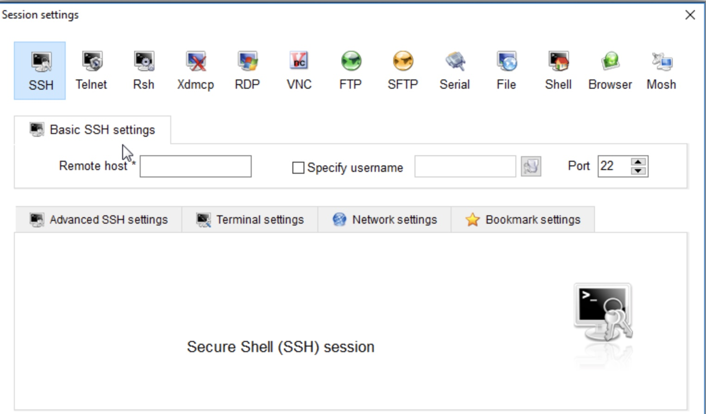
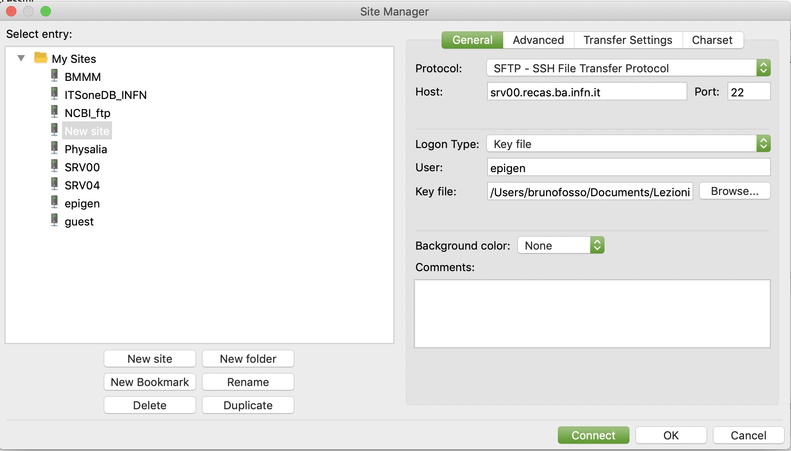

Server login and BASH introduction
===================  
- [Server login](#server-login)
- [FileZilla Configuration](#filezilla-configuration)
- [Brief introduction to the Bash command line](#a-brief-introduction-to-the-bash-command-line)
- [The FASTA file format](#the-fasta-file-format)
- [The FASTQ file format](#the-fastq-file-format)


# Server login
This **Hands-on part** will require the use of servers provided by the **RECAS** Datacenter.  
Each of you will use an assigned *user name* and *server IP*.  
These machines are accessible through the following addresses:  
- **212.189.205.77**  
- **90.147.102.58**  
- **90.147.102.38**  

Please use the table available at this [link](https://docs.google.com/spreadsheets/d/1gBqln4anHbXGrjI3H_vHCIQBChlOfqgCZQ9Me7ou89s/edit?usp=sharing) to identify your assigned machine address and user name.  
Then you should download the key-file corresponding to your user from this [folder](https://drive.google.com/drive/folders/1vhDFZR-QM19KI2zLqB_N7L39sjMBi5X9?usp=sharing).  

Once download ends you should not open it. You can move this file into you preferred folder.
***Warning for UNIX-based users: my advice is to not move that file, in oder to easily find it in download folder when you will use it to login.***  

## For UNIX-BASED operative systems (MacOS, Ubuntu, Fedora)
The UNIX-based users must use the **Terminal** application (find it from those available in your operative system) and type the following lines:
Overall the command lines we are going to use are:  
```
chmod 600 /path/to/the/key/userX

ssh -i /path/to/the/key/userX userX@SERVER-ADDRESS 
```

If supposing you have downloaded your key-file in Downloads and the assigned username and server IP are _user9_ and _212.189.205.77_,respectively:  
```
chmod 600 ~/Downloads/user9

ssh -X -i ~/Downloads/user9 user9@212.189.205.77 
```
where **userX**  and **SERVER-ADDRESS** correspond to the assigned username server IP, respectively.

During the first login, the system will ask you if the server is "trusted" then you should type `yes`.  
Then, it will ask you the **password** and you should type it. **Warning: The pointer will not move during the password typing!!!**.  
If you have typed correctly you will logged into the server.  

## WINDOWS
Windows users should use **MobaXterm**.  
1. Launch `MobaXterm`;  
2. Click on **Session**;  
   
3. Click on `SSH`:  
    - in `Remote host` type the assigned server address;  
    - Check `Specific username` and fill the adjacent field with the assigned user name;  
    - in `advanced SSH settings` check `Use private key` and from the drop-down menu (light blue icon in the adjacent field) select the downloaded key-file.
    - Click *OK* to start the connection.


# FileZilla configuration
**FileZilla** is a tool that allows us to share files between our laptop and server.
We need to configure it appropriately:
* Click on `File` and select `Site Manager`;  
* Selecting `New Site` it will open a new data sheet in which you can choose and type a name;
* In the left sided panel we must insert the following parameters:
    - **Protocols**: `SFTP SSH File Transfert Protocol`  
    - **Host**: `The assigned machine address`
    - **Port**: `22`    
    - **Logon Type**: `key file`  
    - **User**: `the assigned user name`
    - **Key file**: select the downloaded key file.  
* Click on `Connect`.  



# A brief introduction to the Bash command line
Following a short list of useful **BASH** commands:  
* `pwd`: returns the path to the directory in which you are;  
* `cd`: allows to change our position from a directory to another;  
* `ls`: returns the list of elements contained in directory;  
   Options: 
    * `-l` (for more info)  
    * `-a` (shows hidden files)  
    * `-t` (lists files by creation time order)   
    * `-r` (shows the oldest first);  
* `mkdir`: allows to create a new folder;  
* `df`: shows the available space;  
* `cp`: to create a file copy;  
* `rm`: to eliminate a file;  
* `man`: to consult a command handbook;  
* `less`: shows the content of a textual file;  
* `whoami`: shows the username of the current user;  
* `ssh`: allows to login our machine with another remote server  

[Indice](#server-login)

# The FASTA file format
The FASTA file format is commonly used in bioinformatics to store biologic sequences, both nucleotide and amino acids.  
Following, an example is reported:
```
>gi|46048717|ref|NM_205264.1| Gallus gallus tumor protein p53
(TP53), mRNA
GAATTCCGAACGGCGGCGGCGGCGGCGGCGAACGGAGGGGTGCCCCCCCAGGGACCCCCCAACATGGCGG
AGGAGATGGAACCATTGCTGGAACCCACTGAGGTCTTCATGGACCTCTGGAGCATGCTCCCCTATAGCAT
GCAACAGCTGCCCCTCCCTGAGGATCACAGCAACTGGCAGGAGCTGAGCCCCCTGGAACCCAGCGACCCC
CCCCCACCACCGCCACCACCACCTCTGCCATTGGCCGCCGCCGCCCCCCCCCCATTAAACCCCCCCACCC
CCCCCCGCGCTGCCCCCTCCCCGGTGGTCCCATCCACGGAGGATTATGGGGGGGACTTCGACTTCCGGGT
GGGGTTCGTGGAGGCGGGCACAGCCAAATCGGTCACCTGCACTTACTCCCCGGTGCTGAATAAGGTCTAT
TGCCGCCTGGCCAAGCCGTGCCCGGTGCAGGTGAGGGTGGGGGTGGCGCCCCCCCCCGGTTCCTCCCTCC
GCGCCGTGGCCGTCTATAAGAAATCAGAGCACGTGGCCGAAGTGGTGCGGCGCTGCCCCCACCACGAGCG
CTGCGGGGGGGGCACCGACGGCCTGGCCCCCGCACAGCACCTCATCCGGGTGGAGGGGAACCCCCAGGCG
CGTTACCACGACGACGAGACCACCAAACGGCACAGCGTCGTCGTCCCCTATGAGCCCCCCGAGGTGGGCT
CTGACTGTACCACGGTGCTGTACAACTTCATGTGCAACAGTTCCTGCATGGGGGGGATGAACCGCCGCCC
CATCCTCACCATCCTTACACTGGAGGGGCCGGGGGGGCAGCTGTTGGGGCGGCGCTGCTTCGAGGTGCGC
GTGTGCGCATGTCCGGGGAGGGACCGCAAGATCGAGGAGGAGAACTTCCGCAAGAGGGGCGGGGCCGGGG
GCGTGGCTAAGCGAGCCATGTCGCCCCCAACCGAAGCCCCCGAGCCCCCCAAGAAGCGCGTGCTGAACCC
CGACAATGAGATATTCTACCTGCAGGTGCGCGGGCGCCGCCGCTATGAGATGCTGAAGGAGATCAATGAG
GCGCTGCAGCTCGCCGAGGGGGGGTCCGCACCGCGGCCTTCCAAAGGCCGCCGTGTGAAGGTGGAGGGAC
CCCAACCCAGCTGCGGGAAGAAACTGCTGCAAAAAGGCTCGGACTGACCACGCCCCCTTTTTCCTTTAGC
CACGCCCCTTTCCCTTCAGGCCCGGCCCATTTCCCTTCAGCCCCGGCCCCATTTCCCTTCAGCCACGCCC
AATTTCCCCTTTACCACGCCCCCTTTCCCTTCAGCCACGCCCCCTTTCCCCTTAGCCACTCCCCTTCCCC
CGCGAAAGCCCCGCCCACCCCCGCCGTAACCACGCCCACGCTTCCCACCCCCCTCCCAATCTGACCACGC
CCCCTTTACGCCTTAACCACGCCCCCTCTCTCCTGGCCCCGCCCCCCTCCGCTTTGGCCATGCGTAAATC
CCCCCCCCCGCCCCCCCCCGGCTCATTTTTAATGCTTTTTTTGATACAATAAAACTTCTTTTTTTACTGA
AAAAAAAAGGAATTC
```
It is easy to recognize the header row that starts with “>” symbol, followed by an unique identifier and optionally by a small definition.  
The following lines contain nucleotide or amino acid sequence.  
The biological sequence is reported by using a single-letter code to indicate nucleotide or amino acid (for more [Wikipedia](https://en.wikipedia.org/wiki/FASTA_format)).

[Indice](#server-login)

# The FASTQ file format
The FASTQ file format is used to store nucleotide and the related quality-scores obtained by DNA sequencing.    
It is a file format used to store sequencing data (for more [Wikipedia](https://en.wikipedia.org/wiki/FASTQ_format)).  
```
@M03156:25:000000000-AGC3U:1:1101:10602:1714 1:N:0:82
CCTACGGGAGGCAGCAGTAGGGAATCTTCGGCAATGGGGGCAACCCTGACCGAGCAACGCCGCGTGAGTGAAGAAGGTTTTCGGATCGTAAAGCTCTGTTGTAAGTCAAGAACGAGTGT
+
CCCCCGGGGGGGGGGGGGGGGGGGGGGGGGGGGGGGGGGGGGGGGGGGGGGGDGGGGGGEEGGGGGCEFGFGGFGGGGFGGGGDEFCEFFCFDFFFGCFGCFCCCFGGGFDFEC@CFDF
```
In a FASTQ file each sequence is characterized by 4 lines:  
1. The header row starts with “@”;  
2. the biological sequence;  
3. a separating row starting with “+”. Sometimes it may contain a description;  
4. Quality score in [ASCII](https://support.illumina.com/help/BaseSpace_OLH_009008/Content/Source/Informatics/BS/QualityScoreEncoding_swBS.htm) format.  
The header row contains some [technical information](https://support.illumina.com/help/BaseSpace_OLH_009008/Content/Source/Informatics/BS/FileFormat_FASTQ-files_swBS.htm):  
* M03156: sequencing machine identifier. We can deduce that a Miseq has been used.  
* 25: progressive counter indicates the number of sequencing executed. In the example it is the 25th sequencing run.    
* 000000000-AGC3U: flow-cell identifier.  
* 1: flowcell line;  
* 1101: flowcell number;  
* 10602:1714: Cartesian coordinates of cluster;  
* 1: PE pair read. It could assume 1 or 2 values;  
* N: indicates whether the read has been filtered (Y) or not (N);  

The **Quality Score** or **Phred Score** is a measure of the probability that a base is erroneously called and it is computed with this formula:  
  
The higher the **Quality score** is the lower is the probability of an erroneous base call:  

|  Q  |   P    | ASCII |
|:---:|:------:|:-----:|
|  0  |   1    |   !   |
| 10  |  0.1   |   +   |
| 20  |  0.01  |   5   |  
| 30  | 0.001  |   ?   |  
| 40  | 0.0001 |   I   |  

By knowing the quality score associated to each sequenced base, it is possible to compute the **Expected Error (EE)**:

  
The **EE** is the sum of the observed *Probability errors P*.  
The EE estimates the number of bases that are expected as erroneous in the analysed sequence.  

## Quality evaluation of sequencing data
Once the sequencing data have been obtained the first step is to evaluate their quality.  
For this purpose we use a widely employed tool called [`FastQC`](https://www.bioinformatics.babraham.ac.uk/projects/fastqc/).  
We perform the following operation:  
1. Server login;   
2. Virtual environment activation:  
   `source /opt/miniconda3/bin/activate qiime2-2020.11`
3. Create a folder where we will download data for this tutorial and execute the analysis:  
    `mkdir fastqc_test && cd fastqc_test`  
4. Then download data we would like to analyse:  
    `wget --no-check-certificate 'https://docs.google.com/uc?export=download&id=1n6mrvGO0_dS-hkICDnIFZNkUFCWbtEhl' -O T216P_S82_L001_R1_001.fastq.gz`  
5. Execute FastQC:  
    `fastqc --noextract  T216P_S82_L001_R1_001.fastq.gz`  
6. Download the following files on your laptop:  
    * `T216P_S82_L001_R1_001_fastqc.html`  
    * `T216P_S82_L001_R1_001_fastqc.zip`  

For more about boxplot [Wikipedia](https://en.wikipedia.org/wiki/Box_plot).  

### Exercise 1
Execute `FastQC` on these files:   
* Download 2 fastq files by using the following commands:  
  ```
  wget --no-check-certificate 'https://docs.google.com/uc?export=download&id=142ipR5m5ELJVpto6EGH8BNbJA9Ur5DAx' -O Sample1_S2_L001_R1_001.fastq.gz
  ```
  ```
  wget --no-check-certificate 'https://docs.google.com/uc?export=download&id=1zGEWBk29KEijLUyZdrq-lLRyN7ikD2Ng' -O Sample1_S2_L001_R2_001.fastq.gz
   ```
* launch `FastQC` on downloaded files and comment the obtained results.
*hint*: the basic command line to execute **fastqc** is `fastqc --noextract FILENAME`

[Indice](#server-login)

[Back to the top](../README.md) 