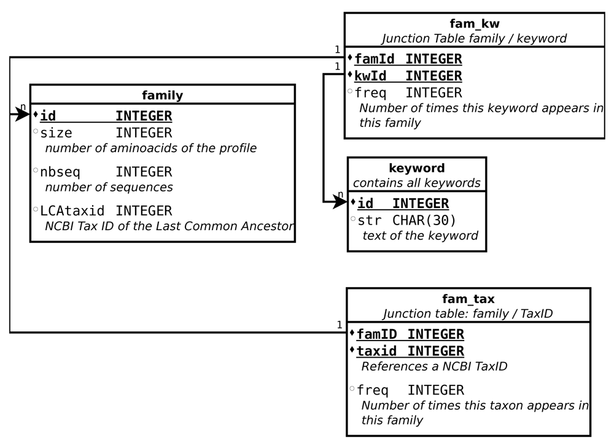

# Banche Dati
Definizione: **Un Database (Base di Dati) è un sistema di archiviazione di dati organizzati per consentirne una facile consultazione.**   
**Possiamo, inoltre, definirlo come un insieme di dati tra loro correlati, memorizzati su un supporto di memoria di massa che possono essere manipolati da programmi chiamati Database Management System (DBMS).**

In generale, possiamo identificare due tipologie di database: **DB non-relazionali** e **DB relazionali**.  
I primi hanno una struttara semplice che non permette operazioni avanzate. I DB che utilizzeremo sono tutti di tipo __relazionale__.    
Un **DB relazionale** è costituito da una serie di tabelle, ognuna delle quali è composta da una serie di righe che sono unicamente definite da un codice, denominato __chiave__.    
Le tabelle sono tra loro connesse tramite **legami logici**.    

  
*Ref: https://f1000research.com/articles/8-530*

Ogni tabella è costistuta da diverse righe e colonne:  
- le righe rappresentano i **record**, cioè i dati raccolti per ogni singolo elemento del DB;  
- le colonne rappresentano i **campi**. Per ogni tabella, almeno uno dei campi deve identificare il singolo elemento in modo univoco. Suddetta chiave è detta **chiave primaria**.    

Tale strutturazione rende più semplice l’immagazzinamento dei dati e più efficace la successiva ricerca che viene effettuata con sistemi di retrieval che possono essere accomunati ai comuni motori di ricerca (es. Google) che normalmente usiamo per consultare la rete.  
  
Consideriamo ora le banche dati di *sequenze nucleotidiche*. La vita di una entry inizia non appena un ricercatore ottiene una sequenza e ne richiede l’archiviazione nella banca dati.  
Questo normalmente viene fatto con dei sistemi automatici di sottomissione che ne guidano le varie fasi (vedi ad esempio [*“How to: Submit sequence data to NCBI”*:](https://www.ncbi.nlm.nih.gov/guide/howto/submit-sequence-data/)./)).  
Ogni entry, prima di essere archiviata, riceve un codice d’identificazione univoco, detto **accession number**.  
Le tre banche dati di sequenze nucleotidiche originariamente create (la banca dati europea **EMBL** (1981), l’americana **GENBANK** (1982) e la giapponese **DDBJ** (1986)) contengono attualmente esattamente gli stessi dati, grazie all' **International Nucleotide Sequence Database Collaboration** (**INSDC 1992** [PMID: 29190397](https://pubmed.ncbi.nlm.nih.gov/29190397/)).  
Come si può osservare dal confronto di una stessa entry in formato *([GenBank](https://www.ncbi.nlm.nih.gov/nucleotide/4884045))* e in formato *([EMBL](http://www.ebi.ac.uk/cgi-bin/sva/sva.pl?session=%2Febi%2Fextserv%2Fold-work%2FSESSION19317-1109270160-1&view=233600243&index=1))*, la differenza di formato è costituita principalmente dal nome degli identificativi dei diversi campi.  
La parte più importante della entry è la cosiddetta **Feature Table** che riporta le proprietà di specifiche regioni contenute all’interno della entry (ad es. la localizzazione di una sequenza codificante, ecc.).  
Da notare i riferimenti crociati con altre banche dati (bibliografiche come Medline, proteiche o nucleotidiche).  

  
## Esercizio 1: scaricare il file utilizzando il seguente [LINK](https://drive.google.com/open?id=1QHFJoZXIZp0OgWflGrcLEaKJIdXwTRmMK_tmW_YVihI)
Immagina di aver prodotto una sequenza di un mRNA umano di un gene di tuo interesse e di doverla sottomettere a GenBank. Avendo presente il formato di una entry GenBank completa i campi di questa ENTRY1 con “punto interrogativo” in modo che i dati siano coerenti e biologicamente corretti.
 

## Esercizio 2: scaricare il file utilizzando il seguente [LINK](https://drive.google.com/open?id=1ttFY1BhOFBtxeisEXG1evapwyhMnPl7yNLU7cDmaoJA)
Devi sottomettere la sequenza di un gene proteico di topo. Il gene è composto da due esoni: la sequenza per la ORF è completa. Sulla base delle informazioni suddette, completa la seguente ENTRY2 in formato Genbank.

[Sistemi di Retrieval](./retrieval.md)                            

[Back to the top](../README.md)