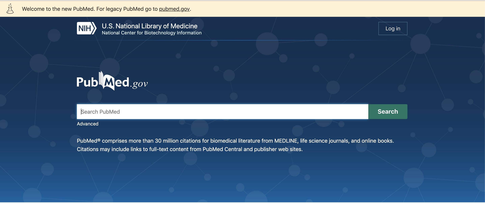

# Ricerca bibliografica nella banca dati PubMed 
  
La consultazione della **Letteratura Scientifica** inerente la tematica che si sta affrontando è una delle fasi essenziali di ogni progetto di ricerca.  
La banca dati ***PubMed***, sviluppata presso il [**National Center for Biotechnology Information (NCBI)**](https://www.ncbi.nlm.nih.gov/pmc/about/intro/) raccoglie circa **30 milioni** di lavori (articoli, review, e libri) scientifici pubblicati.  
Oltre all'NCBI, il suo mantenimento, è supportato dalla [**U.S. Library of Medicine**](https://www.ncbi.nlm.nih.gov/pmc/about/intro/). Attualmente, ricerca e raccoglie articoli da oltre 5.400 riviste internazionali a carattere biomedico.    
Per interrogare questa banca dati, utilizzando il proprio browser (e.g. Safari, Explorer, Chrome, Opera, Firefox…) ci si deve collegare al sito: [https://www.ncbi.nlm.nih.gov/pubmed/](https://www.ncbi.nlm.nih.gov/pubmed/).  
  
  
La ricerca è effettuata inserendo nella casella *Search* il termine o i termini di interesse, eventualmente connettendoli con gli operatori logici **AND**, **OR** e **NOT**.  
Cliccando su Search si ottiene il risultato della ricerca costituito da una serie di citazioni ad articoli che comprendono il titolo del lavoro, il primo autore, la rivista, l'anno di pubblicazione ed il numero identificativo della citazione (***PubMed IDentifier, PMID***).     
Cliccando sul titolo del lavoro (__in blu__) si ottiene una descrizione più dettagliata della citazione, che generalmente include l'**abstract**, la cui lettura è molto utile per avere un’idea più precisa del contenuto dell’articolo.   
L'interfaccia grafica ci permette di "ordinare" le risposte del sistema di retrieval sulla base della __pertinenza__ alla ricerca (*Best Match*) oppure sulla base della più recente data di pubblicazione (*Most Recent*).  
Cliccando su :gear: è possibile modificare la modalità con cui sono mostrati i risultati.

Dopo aver effettuato la ricerca è possibile selezionare un sottoinsieme di articoli. Inoltre gli articoli selezionati possono essere ordinati secondo svariati criteri (es. data della pubblicazione), a cui è possibile avere accesso utilizzando la funzione Sort By dal menù a tendina Display Settings. 
  
Per combinare precedenti ricerche ed eventualmente restringere l’insieme dei risultati combinando più criteri è possibile adottare la seguente opzione: 

**Advanced** mostra un elenco storico di tutte le ricerche effettuate che possono essere combinate con operatori logici per effettuare nuove ricerche. 

Proviamo ora a svolgere alcuni semplici esercizi.  
i)         Quanti articoli nella banca dati PubMed contengono la parola `Bioinformatics`?  
ii)        Quanti articoli trattano del gene `p53`?  Quanti riguardano anche i `mitocondri`?  
iii)       Quanti articoli ha pubblicato il prof. G. `Pesole` nel `2005?  
  
Una volta che sono stati selezionati gli articoli di nostro interesse la banca dati PubMed offre altre due opzioni molto utili:    
•	**Find related data**. Quest’opzione contiene i riferimenti incrociati con altre banche dati curate dall’NCBI come quelle di acidi nucleici e proteine.     
•	E’ possibile, anche in Pubmed, selezionare tutti gli articoli che in qualche modo sono correlati a quello selezionato. Questa correlazione è stabilita sulla base del numero di parole condivise e della loro rilevanza.     
•	Particolarmente interessante è il campo Books dove si trovano, per alcune delle parole chiave presenti nella scheda dell’articolo in esame, i riferimenti a paragrafi o capitoli di libri presenti nella banca dati PubMed.      

i)	Quante sequenze nucleotidiche (del database GenBank) di Homo sapiens sono riportate in articoli pubblicati nel `2010` che trattano del gene `MTERF`?  

[GISAID](./gisaid.md)  

[Back to the top](../README.md)