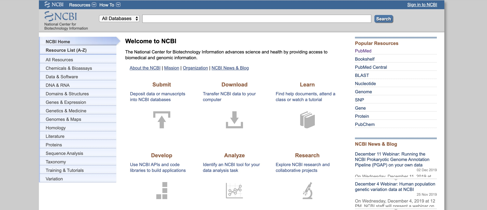
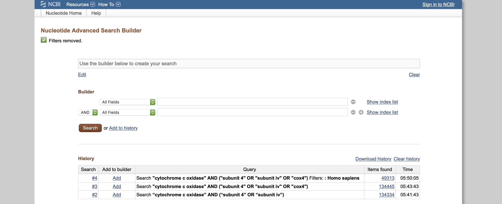

# Sistemi di retrieval
Ci eserciteremo adesso ad utilizzare il sistema di retrieval **ENTREZ** per l’interrogazione delle Banche Dati ospitate presso l'**NCBI**.  
Il sistema permette di combinare i criteri di ricerca utilizzando gli operatori logici l’intersezione (**AND**), l’unione (**OR**) o l’esclusione (**NOT**).  

Riferiremo le nostre ricerche ad un particolare esempio, la **Citocromo C ossidasi**, che come saprete, è un complesso multimerico localizzato nella membrana mitocondriale interna, partecipante al trasporto degli elettroni nella catena respiratoria mitocondriale.  
Essa è costituita da **13 peptidi** di cui **3** codificati dal **genoma mitocondriale** e **10** dal **genoma nucleare**.  
  
L’obiettivo dell’esercitazione è quello di selezionare i geni e le proteine corrispondenti alla **subunità 4 umana** utilizzando il sistema di interrogazione **ENTREZ**.  
 
__Nota preliminare__: ricorda che le virgolette consentono di delimitare più parole da ricercare insieme e che più operatori logici possono essere utilizzati in una stessa ricerca usando le parentesi tonde come in un’espressione matematica.  
  
1.	Collegati al sito [https://www.ncbi.nlm.nih.gov/](https://www.ncbi.nlm.nih.gov/);   
2.	Nel menù a tendina accando alla casella di ricerca seleziona **Nucleotide**;  
  

3.	Richiedi la sequenza nucleotidica desiderata attraverso l’uso del seguente termine di ricerca: `"cytochrome c oxidase"`;  
    

    

    <b>896.384</b>
    

    

4.	Prova ad inserire degli errori nella nomenclatura (es: `"cytochrome c oxydase"` oppure `"cytocrome c oxidase"`). Nota le differenze nel risultato e prova a dedurne il motivo;  
    

    

    `"cytochrome c oxydase"` <b>158</b>
    

    
  
    `"cytochrome c oxydase"` <b>220</b>
    

    
   

5.	Restringiamo la selezione richiedendo solo le sequenze nucleotidiche della subunità 4. Utilizzeremo l'operatore logico **AND**;   
    a.	`"cytochrome c oxidase"` AND `"subunit 4"` 
    

    

    <b>95.059</b>
    

    

    
    b.	`"cytochrome c oxidase"` AND `"subunit iv"`  
    

    

    <b>43.409</b>
    

    

NB: entrambe le nomenclature sono corrette, ma otteniamo un numero di entries diverso.  

6.	Per includere tutte le sequenze usa l’operatore logico **OR** 
    a.	`"cytochrome c oxidase" AND ("subunit 4" OR "subunit iv")`  
    

    

    <b>134.334</b>
    

    
  

7.	Puoi aumentare il numero di sequenze per la cytocrome c oxidase anche utilizzando la sigla “cox4”:  
    a.	`"cytochrome c oxidase" AND ("subunit 4" OR "subunit iv" OR "cox4")`
    

    

    <b>134.445</b>
    

    

     
8.	Se siamo interessati a restringere le ricerche ad una specifica specie, ad esempio solo alle sequenze “umane”, possiamo modificare le opzioni note come **Limits** che trovate in alto a sinistra della pagina contenente la vostra ricerca. Se non è già presente `Homo sapiens` clicchiamo su **customize** e scriviamo “Homo sapiens” nel menù che si aprirà.  
    Infine clicchiamo su “add”. In questo modo otterremo tutte le sequenze nucleotidiche specifiche dell’uomo.  
    

    

    <b>49.313</b>
    

    

Prima di procedere al prossimo punto cliccare su “clear” per eliminare i limiti imposti precedentemente.  

9.	Alternativamente possiamo sfruttare uno strumento più potente per selezionare le sole sequenze cox4 umane selezionando l’opzione **Advanced**: 
    a.	Nel primo campo di ricerca aggiungere la ricerca `""cytochrome c oxidase" AND ("subunit 4" OR "subunit iv" OR "cox4")"`;  
    b.	Selezionare l’operatore **AND**;    
    c.	Selezionare il field `organism` e scrivere “Homo sapiens”.  

  
    

    

    <b>49.313</b>
    

    

    
10.	 Scorrendo le sequenze potremmo notare che alcune corrispondono a **Pseudogeni**. Escludi le sequenze nucleotidiche annotate come "pseudogene" selezionando le sequenze attraverso la chiave `Pseudogene`:  
    a.	Ritorna su Advanced e interseca la query **#?** (derivata dalla ricerca precendente) con la query **#?** (corrispondente all’ultima ricerca) questa volta utilizzando l’operatore **NOT**: #? NOT #?   
    NB: Il numero di sequenze trovate si è ridotto.
    

    

    <b>49.300</b>
    

    

    
11.	Ottenute le nostre sequenze possiamo selezionare la sequenza che interessa (es: **AF017115**) e visualizzare le informazioni contenute nella entry.  
  

 
## Esercizio 1. 
Utilizzando ENTREZ prova a selezionare la entry relativa all’**mRNA** per la proteina **p53** di cane.  
Suggerimenti: 
- Il simbolo ufficiale del gene è `tp53`;  
- il nome scientifico è `Canis familiaris`;  
 
## Esercizio 2. 
Esamina la entry selezionata nell’esercizio 1:  
- Determinate la lunghezza del trascritto, della regione codificante, del 5’UTR e del 3’UTR.  
   
### Esercizio 3.
Esamina la entry selezionata nell’esercizio 1.  
- Sei in grado di individiare la proteina associata?  
- Qual è il suo accession number?  
- Quanto è lunga la proteina?  
- Osservando la **Feature Table** cosa potete annotare?  

## Esercizio 4. 
Utilizzando ENTREZ prova a selezionare la entry **RefSeq** relativa alla proteina `"ATP synthase subunit 8"`, il cui **gene name** è `ATP8` di [Ciona robusta](https://invasions.si.edu/nemesis/calnemo/SpeciesSummary.jsp?TSN=-701). 
  
## Esercizio 5. 
Esamina la entry selezionata nell’esercizio 3 (YP_009357191.1).    
Determina:  
- l’accession number della sequenza nucleotidica da cui è stata ricavata la entry;  
- la lunghezza della proteina;  
- della sequenza nucleotidica che codifica per questa proteina.  

## Esercizio 6. 
Determina il numero di proteine umane presenti nella banca dati.  
Di queste proteine quante sono codificate dal genoma mitocondriale? 

## Esercizio 7. 
Determina il numero di sequenze di rRNA 16S appartenenti al genere Escherichia sono disponibili nella banca dati.  
Quante di queste non sono parziali?
  
## Esercizio 7. 
Interrogate la banca dati “Genome”.  
- Quanti genomi di `Escherichia coli` sono disponibili?  
- Quanti di `Fusobacterium nucleatum`?  
   

Letture consigliate:  
Valle G. et al. Introduzione alla Bioinformatica (Zanichelli Ed.) – pag. 7-12   
Citterich M. et al. Fondamenti di Bioinformatica (Zanichelli)  

[Ricerca bibliografica nella banca dati PubMed ](./pubmed.md)                            

[Back to the top](../README.md)