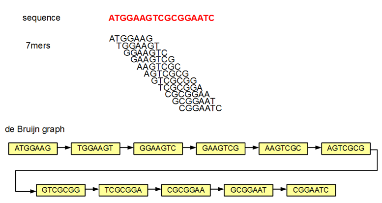
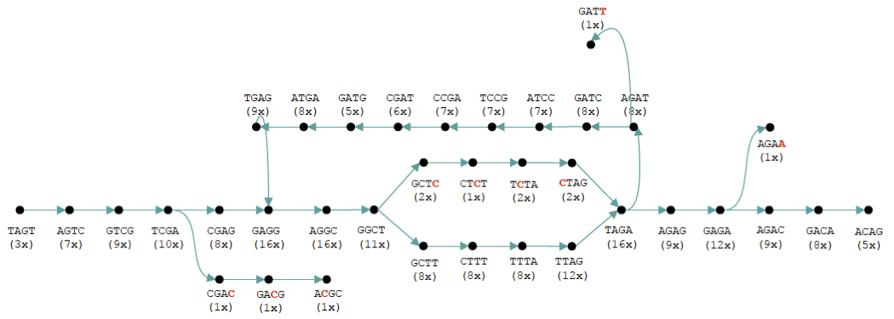
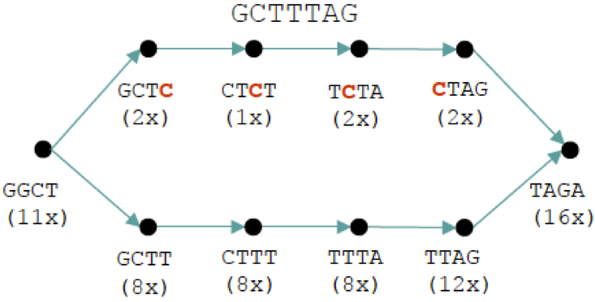
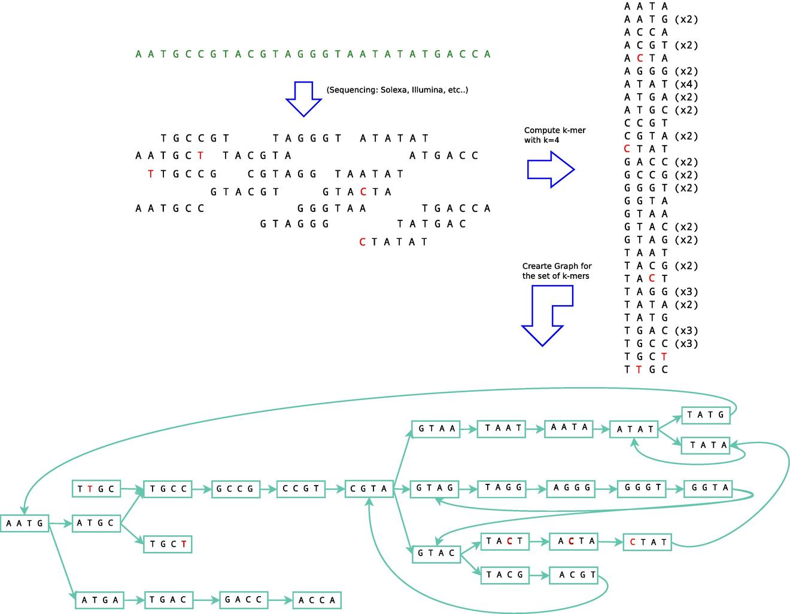
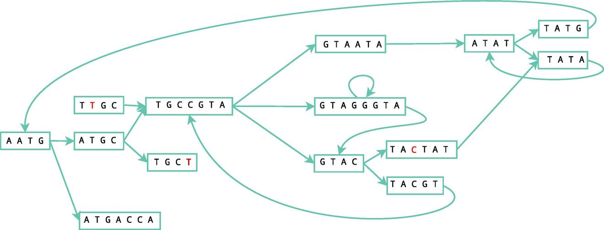
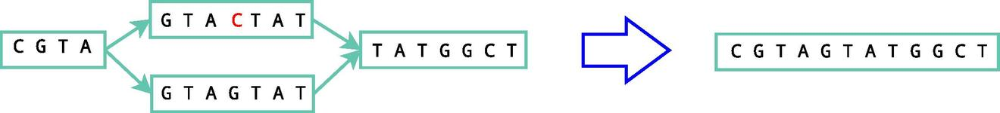
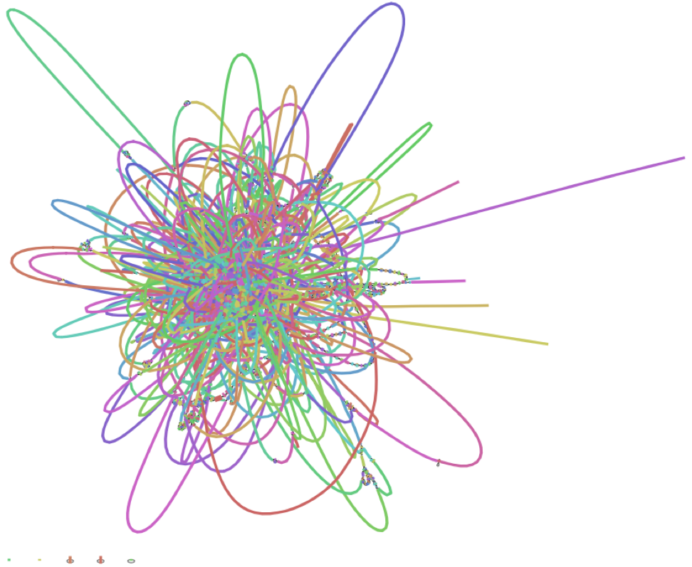
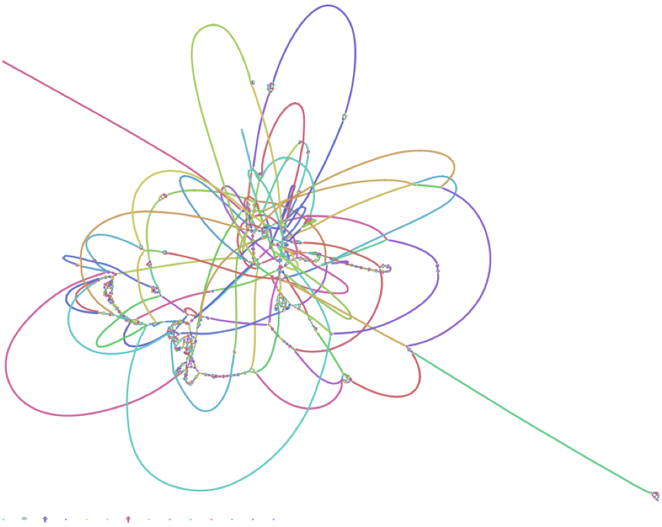
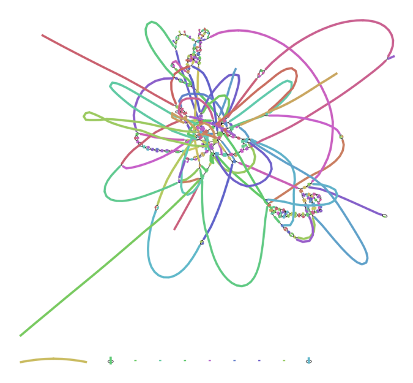

# GENOME ASSEMBLY

- [Introduzione](#introduzione)
- [APPROCCI BIOINFORMATICI PER L’ASSEMBLAGGIO DELLE READ: I GRAFI DI DE BRUIJN](#approcci-bioinformatici-per-lassemblaggio-delle-read-i-grafi-di-de-bruijn)
- [VALUTAZIONE DELL’ASSEMBLAGGIO OTTENUTO](#valutazione-dellassemblaggio-ottenuto)
- [SCOPO DELL'ESERCITAZIONIE](#scopo-dellesercitazione)
    * [Valutazione preliminare della qualità delle sequenze e trimming](#valutazione-preliminare-della-qualit-delle-sequenze-e-trimming)  
      * [Velvet](#velvet)
          * [Meccanismo di funzionamento di Velvet](#meccanismo-di-funzionamento-di-spadeshttpswwwncbinlmnihgovpmcarticlespmc3342519po138889)
          * [Applicazione di Velvet](#applicazione-di-velvet)
    * [SPAdes](#spades)
        * [Meccanismo di funzionamento di SPAdes](#meccanismo-di-funzionamento-di-spadeshttpswwwncbinlmnihgovpmcarticlespmc3342519po138889)
        * [Applicazione di SPAdes](#applicazione-di-spades)
- [Annotazione funzionale del Genoma](#annotazione-funzionale-del-genoma)
    

## INTRODUZIONE
Il sequenziamento di un genoma segue principalmente quattro fasi:  
1. **Isolamento del genoma d' interesse**. La qualità del DNA di partenza influenza profondamente il processo di sequenziamento e assemblaggio del genoma. La qualità del DNA di partenza si misura in termini di **Purezza** e **Integrità strutturale**.  
    * **Purezza**: l’utilizzo di una procedura di estrazione del DNA non appropriata per la matrice di partenza può portare alla presenza di contaminanti come *polisaccaridi*, *proteoglicani*, *proteine*, *metaboliti*, *pigmenti*, etc. Questi influenzano negativamente le procedure di preparazione delle librerie soprattutto per gli approcci PCR-free (**PacBio** e **Nanopore**) e **Mate-Pair** e riducono l’efficienza gli approcci che prevedono passaggi di amplificazione in PCR.  
    * **Integrità strutturale**: la presenza di *fenoli*, *etanolo* e *Sali* (e.g. EDTA) possono danneggiare il DNA. Una inappropriata conservazione del DNA a -20°C in acqua favorisce la degradazione per idrolisi. L’utilizzo di buffer per la conservazione a pH inadeguato favoriscono la formazione di nick.  
2. **Frammentazione del DNA**: La frammentazione può essere ottenuta per *sonicazione*, *nebulizzazione* o *taglio enzimatico*. E’ un passaggio fondamentale perché il DNA presente nelle cellule deve essere frammentato nel modo più casuale possibile al fine di leggere ogni nucleotide ogni nucleotide del genoma ottenendone la migliore rappresentazione;  
3. **Sequenziamento**. La profondità del sequenziamento influenza profondamente la qualità di un assemblaggio. Si utilizza il concetto di **coverage** per indicare che il numero medio di volte che una base del genoma viene osservata. Quindi una stima della dimensione del genoma è fondamentale per settare adeguatamente i parametri di sequenziamento.  
4. **Analisi Bioinformatica e assemblaggio del genoma**.  

Con il termine **assemblaggio** intendiamo l’operazione di ricostruzione della sequenza completa delle molecole di DNA (cromosomi, organelli e plasmidi) presenti in una cellula.  
Tecnicamente l’operazione consiste nella concatenazione delle read ottenute con il sequenziamento al fine di ottenere dei contigui (**contig** in inglese) di dimensione maggiore.  
Due approcci di sequenziamento ed assemblaggio del genoma sono stati sviluppati nel corso degli ultimi 20 anni, il **“Clone by Clone”** ed il **“Whole Genome Sequencing (WGS)”**.  
Il WGS è oggigiorno il principale approccio utilizzato per il sequenziamento dei genomi, soprattutto a seguito dell’avvento delle tecnologie di sequenziamento di nuova generazione (**Next Generation Sequencing, NGS** o **High Throughput Sequencing, HTS**).  
Nel corso dell’ultimo decennio sono state sviluppate diverse tecnologie per il sequenziamento degli acidi nucleici, distinte in tecnologie di seconda e terza generazione (Buermans and den Dunnen, 2014):  
    *	**II generazione**: **Roche 454** (Dismessa nel 2016), **SOLiD** ed **Illumina**;  
    *	**III generazione**: **PacBio** e **Oxford Nanopore**.  
    
Per questo tutorial utilizzeremo delle sequenze prodotte utilizzando la tecnologia [Illumina](https://www.illumina.com).  
Con questa tecnologia è possibile produrre tre tipologie di read: 
- single-end (SE);  
- paired-end (PE);  
- mate-pair (MP).  
  
***Figura 1: PE e MP reads.** [REF](https://www.ecseq.com/support/ngs/what-is-mate-pair-sequencing-useful-for)*  

In **Figura 1** è riporta schematicamente la procedura per la produzione delle PE e MP reads. Come è possibile osservare con le PE è possibile sequenziare frammenti le cui dimensioni variano tra le 200 e 800 bp, mentre con le MP è possibile sequenziare le estremità di frammenti molto più grandi (2-5 Kb).  
  
***Figura 2: utilizzo di PE e MP nel “Genome Sequencing”.** [REF](https://www.ecseq.com/support/ngs/what-is-mate-pair-sequencing-useful-for)*  

[Indice](#genome-assembly)

## APPROCCI BIOINFORMATICI PER L’ASSEMBLAGGIO DELLE READ: I GRAFI DI DE BRUIJN
I programmi che permettono di assemblare le WGS read utilizzano l’approccio basato sulla costruzione e la successiva risoluzione dei [**grafi di de Bruijn**](https://en.wikipedia.org/wiki/De_Bruijn_graph).  
In parole semplici, un grafo di de Brujin descrive le sovrapposizioni di stringe di simboli.  
Nel nostro caso le stringhe dei simboli sono costituite da sequenze di nucleotidi di una determinata lunghezza, dette **k-mer**, dove il **k** indica la lunghezza della parola.  
I k-mer vengono ottenuti a partire dalle read di sequenziamento. Nella **Figura 3** e **Figura 4** sono mostrati i grafi di de Bruijn generati a partire da due sequenza di 17 nucleotidi suddivise in k-mer lunghi 7 (7mer).  
In particolare, la Figura 3 rappresenta un grafo per un set di k-mer che non contengono alcuna ripetizione, mentre la Figura 4, rappresenta il un grafo contente un k-mer ripetuto.  
  
***FIGURA 3: GRAFO DI DE BRUIJN IN UNA SEQUENZA CHE NON CONTIENE K-MER RIPETUTI.** [REF](HTTP://WWW.HOMOLOG.US/TUTORIALS/INDEX.PHP?P=2.1&S=1)*  

  
***FIGURA 4: GRAFO DI DE BRUIJN IN UNA SEQUENZA CHE CONTIENE K-MER RIPETUTI.** [REF](HTTP://WWW.HOMOLOG.US/TUTORIALS/INDEX.PHP?P=2.1&S=1)*  

In un grafo di de Bruijn i k-mer rappresentano gli archi che connettono due vertici **V<sub>a</sub>** e **V<sub>b</sub>**, qualora **V<sub>a</sub>** sia prefisso di **V<sub>b</sub>** (tolta la prima base) o **V<sub>b</sub>** sia suffisso di **V<sub>a</sub>** (tolta l’ultima base).  
Il vantaggio di questo approccio consta nel fatto di non dover calcolare la similarità tra tutte le coppie di k-mer.
Per la risoluzione del grafo si applica un metodo definiti **Percorso Euleriano**, che prevede esattamente un passaggio per ciascun arco.  
La presenza di regioni ripetute o errori di sequenziamento la individiazione di un percorso Euleriamo diventa più complessa per cui si accettano percorsi per cui un arco è visitato almeno una volta.  
Gli esempi riportati nelle figure 3 e 4 mostrano una estrema semplificazione del problema, ma già la presenza di una ripetizione nella figura 4, fa si che la risoluzione del grafo (identificazione della sequenza biologica) diventi più complessa.  

  

  
***FIGURA 5: ESEMPIO DI GRAFO DI DE BRUIJN COMPLESSO***  

In **Figura 5** è riportato un grafo di de Bruijn più complesso, che mostra delle biforcazioni dovute a polimorfismi e/o errori (nt in rosso) e un bubble (regione rappresentata in grande in 5b). Per esempio la risoluzione del bubble in figura 5b è possibile tenendo conto del coverage dei k-mer, in pratica il numero di volte che uno specifico k-mer è osservato nelle nostre reads.  
K-mer con una bassa rappresentazione probabilmente presentano degli errori di sequenziamento. Bubble e biforcazioni si possono generare anche in presenza di regioni ripetute che rendono più complesso il processo di ricostruzione del genoma.  

La scelta della lunghezza del k-mer influenza la costruzione e la risoluzione dei grafi. Programmi di assemblaggio, come **Velvet** +([Zerbino and Birney, 2008](https://www.ncbi.nlm.nih.gov/pmc/articles/PMC2336801/)) e **SPAdes** ([Bankevich et al., 2012](https://www.ncbi.nlm.nih.gov/pmc/articles/PMC3342519/)), utilizzano un approccio a più step, in cui utilizzano k-mer di diversa lunghezza variabile (e.g. 25 – 31) e poi assemblano le read andando a utilizzare i grafi generati.   

Non ci sono regole particolari per la scelta della lunghezza dei k-mer ma possiamo assumere alcunu principi di base:
* la lunghezza dei k-mer deve essere dispari per evitare la formazione di palindromi;
    ```
        8mer: ATTCCTTA
        8mer complement: TAAGGAAT
        8mer reverse complement TAAGGAAT
    ```  
* deve essere inferiore alla lunghezza delle read, altrimenti sarà difficile osservare overlap.  

In linea generale k-mer corti aumentano la connettività ma (ottimo per regioni del genoma a basso coverage) ma aumentano le connessioni ambigue (regioni ripettute).     
I kmer più lunghi permettono di aumentare la specificità (ridurre il rumore durante l’assemblaggio) ma tendono a ridurre la connettività.    
*Parliamo di coverage del kmer: non ci si riferisce al numero di volte in cui un singolo nt viene osservato ma al numero di volte in cui uno specifico k-mer è osservato. Come abbiamo precedentemente visto quest’ultima osservazione può essere utilizzata per risolvere le bubble nei grafi di de Bruijn.*

[Indice](#genome-assembly)

## VALUTAZIONE DELL’ASSEMBLAGGIO OTTENUTO
Il risultato ottimale di un assemblaggio è costituito da una serie di contig che rappresentano in rapporto 1:1 le molecole di DNA presenti nel genoma.  
Questo goal è difficile da raggiungere per le caratteristiche intrinseche dei genomi come la presenza di regioni ripetute.  
Per descrivere un assemblaggio possiamo utilizzare:  
* la lunghezza totale combinata dei contig o degli scaffold;  
* la media e la deviazione standard della lunghezza dei contig;  
* **N50**: definisce la qualità dell’assemblaggio in termini di continuità. Operativamente si può considerare come la **mediana ponderata della lunghezza dei contig osservati**.  
    Dato un set di contig ognuno con la sua lunghezza, N50 è definito come la lunghezza minima al 50% del genoma (se nota) o dell’assemblaggio.  
    Se consideriamo 9 contig ordinati per lunghezza in modo decrescente 10, 9, 8, 7, 6, 5, 4, 3, 2 la dimensione totale del genoma è pari a 54.  
    Metà della lunghezza del genoma è data da 10 + 9 + 8 = 27. Ne consegue che l’ N50 è pari a 8.  
    Valori auspicabili di N50 sono nell’ordine di  decine di Kbp.  
* **L50**: il numero minimo di contig la cui lunghezza è pari a N50.  
    Considerando l’esempio precedente L50 = 3.  
    
## SCOPO DELL'ESERCITAZIONE
Lo scopo delle esercitazioni è l'assemblaggio del genoma  di ***Escherichia coli str. K-12 substr. MG1655***.  
Utilizzeremo read prodotte con sequenziamento **Illumina** in modalità paired-end 2x100.  

### Valutazione preliminare della qualità delle sequenze e trimming
Prima di procedere con l' assembly delle reads ottenute occorre valutarne la qualità.  
1.	Collegatevi al server.  
2.	Attiviamo l'ambiente virtuale che sarà necessario per l' esercitazione.  
    `source /opt/miniconda3/bin/activate kallisto`  
3.	Creiamo la cartella contenente i dati del genome assembly e spostiamoci al suo interno:  
    `mkdir genome_assembly && cd genome_assembly`        
4.	Eseguiamo il [FastQC](https://www.bioinformatics.babraham.ac.uk/projects/fastqc/) per valutare la qualità delle sequenze:  
    `mkdir pre_trimming`   
    poi:   
    ```
    fastqc --noextract -t 2 \
    /home/share/genome_assembly/s_6_1.fastq.gz \
    /home/share/genome_assembly/s_6_2.fastq.gz -o pre_trimming
    ```  
    Scaricate i risultati del FastQC.  
5.	effettuiamo il trimming delle sequenze:  
    ```
    sickle pe -f /home/share/genome_assembly/s_6_1.fastq.gz \
    -r /home/share/genome_assembly/s_6_2.fastq.gz \
    -t sanger -o Sample_1.fastq -p Sample_2.fastq \
    -s Sample_s.fastq -q 25 -l 45
    ```  
6.	riutilizziamo il FastQC per valutare le sequenze trimmate:  
    ```
    mkdir post_trimming
    ```    
    poi:
    ```   
    fastqc Sample_* --noextract -t 2 -o post_trimming
    ```    
    Scaricate i risultati del FastQC.  
    
### VELVET
Velvet è un programma di assemblaggio di genomi basato sulla costruzione e risoluzione dei grafi di de Bruijn.  
In particolare, le read di sequenziamento sono scomposte in k-mer, che vengono poi utilizzati per la costruzione dei grafi.  
Le informazioni relative alla rappresentazione i ciascun k-mer (coverage) sono utilizzate per la risoluzione di strutture complesse nei grafi, come ad esempio le bubbles.  

#### [Meccanismo di funzionamento di Velvet](https://www.ncbi.nlm.nih.gov/pmc/articles/PMC2336801/?report=reader#!po=31.8182)
1. Velvet converte le read in kmer della lunghezza predefinita dall'utente.  
2. Ogni Kmer rappresenta un nodo del grafico. Due nodi sono connessi presentano una sovrapposizione della loro sequenza pari a k-1.  
   Formalmente diremo che due nodi **N<sub>A</sub>** e **N<sub>B</sub>** sono connessi se gli ultimi `k-1`nt di **N<sub>A</sub>** corrispondono ai primi `k-1` nt di **N<sub>B</sub>**.  
   Questo processo è effettuato contemporaneamente sul **revertito complementare** delle sequenze.  
     
3. Semplificazione: Tutti i nodi che non interessano la generazione del path (non contengono biforcazioni) vengono uniti per ridurre l' utilizzo di memoria.  
   
4. Rimozione degli errori. Abbiamo principalmente 3 tipologie di errori:
    * Tips (errori di sequenziamento). Un nodo è considerato un tip se ricade in queste 3 casistiche:  
        - è disconnesso da uno dei due lati;  
        - l'arco che connette questo nodo ha una bassa *multiplicità* (multiplicity, il numero di volte in cui l'arco è osservato).
        
    * Bubbles: Utilizza un algoritmo che pesa le informazioni tra i nodi e considera quale sia il path più probabile.  
      
    * Connessioni errate: sono eliminati tutti quei path che hanno una bassa multiplicità.  
  
#### Applicazione di Velvet
Valuteremo la qualità dell’assemblaggio ottenuto con Velvet utilizzando dei kmer di lunghezza pari a 25nt.  
*** NB: per questioni di tempo e di capacità computazioni non potremo applicare Velvet***  
1. Creaimo una cartella che conterrà i dati di Velvet:  
    `mkdir velvet && cd velvet`
2.	Prima di lanciare Velvet è necessario utilizzare uno dei suoi applicativi per convertire le sequenze i un formato adeguato:  
    
        > shuffleSequences_fastq.pl Sample_1.fastq Sample_2.fastq Sample_alternate.fastq  
      
3.	Iniziamo ad utilizzare Velvet per assemblare le nostre read. Utilizzeremo k-mer lunghi 25 nt.  
    Velvet si compone di due applicativi. Il primo è **velveth** e prepara i dati di partenza in un formato adeguato per le successive analisi:  
    
        > velveth run_25 25 fastq -shortPaired Sample_alternate.fastq  
      
4.	Adesso applichiamo **velvetg** che si occuperà di costruire i grafi e creare i contig.  

        > velvetg run_25  
                                                                                                   
5.	Calcoliamo le statistiche per valutare l’assemblaggio con **quast**:  
    `quast.py -s /home/share/genome_assembly/velvet_25/contigs.fa -o quast_25 -r /home/share/genome_assembly/NC_000913.3.fasta.gz`  
    Scarichiamo la cartella generata da quast.  
Possiamo, inoltre, valutare il grafo che programma ha generato per procedere all' assemblaggio, utilizzando il programma [**Bandage** (Bioinformatics Application for Navigating De novo Assembly Graphs Easily)](http://rrwick.github.io/Bandage/) (**Figura 6**).  
  
***FIGURA 6: DE BRUIJN GRAPH OTTENUTO CON VELVET E K-MER LUNGHI 25NT.***  

Come potete notare dalla complessità del grafico conferma che la lunghezza dei K-mer scelta non è stata sufficiente per ottenere un assemblaggio ottimale, anche in considerazione dell’elevato numero di bubbles generati.  

### SPAdes
SPAdes è un altro algoritmo per l’assembly dei genomi che utilizza un approccio automatico per definire i grafi di de Bruijn partendo da k-mer di differente lunghezza (i.e 21, 33 e 55).

#### [Meccanismo di funzionamento di SPAdes](https://www.ncbi.nlm.nih.gov/pmc/articles/PMC3342519/#!po=13.8889)
SPAdes applica un processo a 4 stadi:  
**Stadio 1**: SPAdes costruisce il grado di de Bruijn utilizzando k-mer di lunghezza multipla in modo da rimuovere il rumore introdotto da read chimeriche e bubble.  
    In particolare, l'utilizzo di k-mer di diversa lunghezza permette di usare quelli più corti per caratterizzare regioni a basso coverage per ridurre la frammentazione e kmer più lunghi per regioni ad elevato coverage e risolvere eventuali errori del grafo.  
**Stadio 2**: calcola la distanza esatta tra 2 k-mer nel genoma.  
    Questo approccio permette di stimare correttamente la distanza tra due k-mer indipendentemente dalla dimensione settata durante la preparazione della libreria.        
**Stadio 3**: Costruisce il *paired assembly graph*.  
**Stadio 4**: genera i contig.  
    
#### Applicazione di SPAdes   
La riga di comando per laciare SPAdes è la seguente:
1. Creiamo una cartella per i dati di SPAdes:  
    `cd .. && mkdir spades && cd spades`  
***Per questioni di natura prettamente computazionale l’esecuzione di SPAdes è già stata effettuata. Però possiamo valutare la qualità dell'assemblaggio ottenuto.***  

> spades.py --careful -o spades_application -1 Sample_1.fastq -2 Sample_2.fastq -s Sample_s.fastq  

Applichiamo quast sui dati generati con SPAdes:  
1. Eseguiamo quast sull'assemby generato da SPAdes:  
    `quast.py -s /home/share/genome_assembly/spades_application/contigs.fasta -o quast_spades -r /home/share/genome_assembly/NC_000913.3.fasta.gz`   
    Scarichiamo la cartella generata da quast.   
Anche in questo caso valutiamo il grafo generato (**Figura 7**).  
  
***FIGURA 7: DE BRUIJN GRAPH OTTENUTO CON SPADES***  
Il grafo conferma i dati ottenuti con quast.  

Benché l’assemblaggio sia sicuramente migliore rispetto a quello ottenuto precedentemente può essere ancora migliorato.  
Infatti, il grafo mostra ancora dei bubbles e dei contig che non sono stati assemblati (nodi in basso).  

Possiamo provare a migliorare l’assemblaggio aggiungendo altri k-mer nella costruzione del grafi di de Bruijn:  
>spades.py --careful -o spades_application_multikmer -1 Sample_1.fastq -2 Sample_2.fastq -s Sample_s.fastq -k 21,33,55,67,71,81,91  

Infine, ne valutiamo la qualità con quast:  
 `quast.py -s /home/share/genome_assembly/spades_application_multikmer/contigs.fasta -o quast_spades_multikmer -r /home/share/genome_assembly/NC_000913.3.fasta.gz`  
 Scarichiamo la cartella generata da quast.  

  
***Figura 8: DE BRUIJN GRAPH OTTENUTO CON SPADES utilizzando 7 differenti lunghezze di k-mer.***  

## Annotazione funzionale del Genoma
Una volta assemblato un genoma ed essere giunti alla conclusione che la qualità dell'assemblaggio e soddisfacente, possiamo procedere alla sua **annotazione**.  
Con **annotazione** di un genoma intendiamo la procedura bioinformatica attraverso la quale identifichiamo i geni, i prodotti di questi geni e cerchiamo di associare una funziona a questi prodotti.  
In questo caso utilizzeremo un programma chiamato [**PROKKA**](https://academic.oup.com/bioinformatics/article/30/14/2068/2390517). Questo programma utilizza una serie di altri tool per identificare le "feature" le loro coordinate e associare una annotazione funzionale.  

|   Tool   |          Funzione          |
|:--------:|:--------------------------:|
| Prodigal |   Coding sequence (CDS)    |
| RNAmmer  | Ribosomal RNA genes (rRNA) |
| Aragorn  |     Transfer RNA genes     |  
| SignalP  |   Signal leader peptides   |
| Infernal |       Non-coding RNA       |

A scopo esemplificativo andremo a visualizzare o dati di annotazione ottenti con la prima applicazione di SPAdes.  
Di seguito la linea di comando utilizzata da PROKKA:  

> prokka --outdir genome_annotation --genus Escherichia --mincontiglen 200 --cpus 5 /home/share/genome_assembly/spades_application/contigs.fasta  

Adesso possiamo copiare i dati nella nostra cartella ed iniziare a visualizzare i prodotti ottenuti:  
```
cp -r /home/share/genome_assembly/genome_annotation/ spades_basic_prokka_annotation

cd spades_basic_prokka_annotation
```
All'interno della cartella troveremo i file con le seguenti estensioni:  

| Suffix |                   Description of file contents                    |
|:------:|:-----------------------------------------------------------------:|
|  .fna  |            FASTA file contente i contigs (nucleotide)             |
|  .faa  |           FASTA file la traduzione delle CDS (protein)            | 
|  .ffn  | FASTA file contenente tutte le annotazioni genomiche (nucleotide) | 
|  .fsa  | Contig formattati per la sottomissione in banca dati (nucleotide) | 
|  .tbl  |         Feature table per la sottomissione in banca dati          | 
|  .sqn  |             Sequin per la sottomissione in banca dati             | 
|  .gbk  |          Genbank file contenente sequenze e annotazionie          | 
|  .gff  |          GFF v3 file contenente sequenze e annotazionie           | 
|  .log  |                        Log file di Prokka                         | 
|  .txt  |          statistiche relative al processo di annotazione          |
|  .err  |     file che riporta le problematiche associate al file .sqn      | 

[Programma Esercitazioni](../README.md) 

  

    

