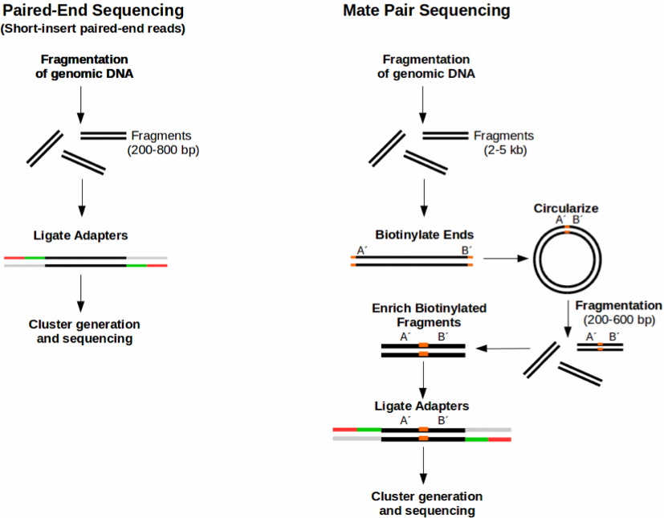
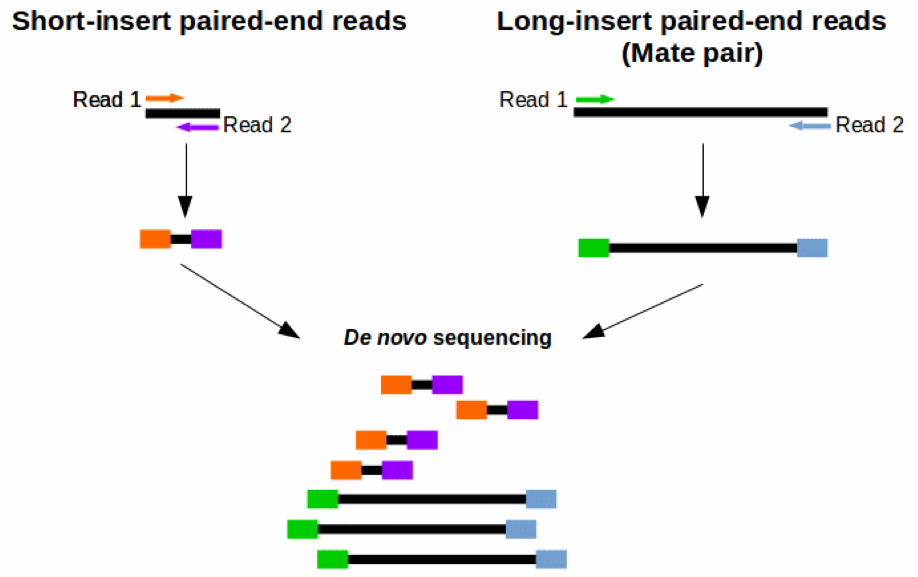
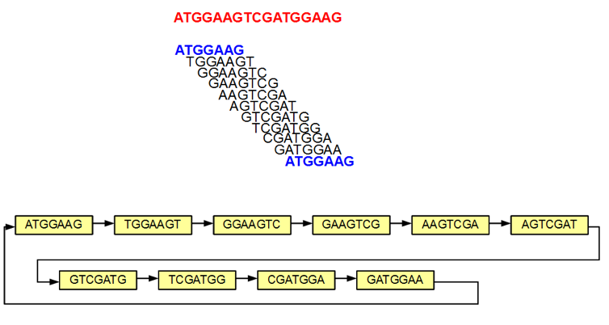

# GENOME ASSEMBLY

## Introduzione
Il sequenziamento di un genoma segue principalmente 4 fasi:  
1. **Isolamento del genoma di interesse**. La qualità del DNA di partenza influenza profondamente il processo di sequenziamento ed assemblaggio del genoma. La qualità del DNA di partenza si misura in termini di **Purezza** e **Integrità strutturale**.  
    * **Purezza**: l’utilizzo di una procedura di estrazione del DNA non appropriata per la matrice di partenza può portare alla presenza di contaminanti come *polisaccaridi*, *proteoglicani*, *proteine*, *metaboliti*, *pigmenti*, etc. Questi influenzano negativamente le procedure di preparazione delle librerie soprattutto per gli approcci PCR-free (**PacBio** e **Nanopore**) e **Mate-Pair** e riducono l’efficienza gli approcci che prevedono passaggi di amplificazione in PCR.  
    * **Integrità strutturale**: la presenza di *fenoli*, *etanolo* e *Sali* (e.g. EDTA) possono danneggiare il DNA. Una inappropriata conservazione del DNA a -20°C in acqua favorisce la degradazione per idrolisi. L’utilizzo di buffer per la conservazione a pH inadeguato favoriscono la formazione di nick.  
2. **Frammentazione del DNA**: La frammentazione può essere ottenuta per *sonicazione*, *nebulizzazione* o *taglio enzimatico*. E’ un passaggio fondamentale perché il DNA presente nelle cellule deve essere frammentato nel modo più casuale possibile al fine di leggere ogni nucleotide ogni nucleotide del genoma ottenendone la migliore rappresentazione;  
3. **Sequenziamento**. La profondità del sequenziamento influenza profondamente la qualità di un assemblaggio. Si utilizza il concetto di coverage per indicare che il numero di volte che in media viene osservato un nt. Quindi una stima della dimensione del genoma è fondamentale per settare adeguatamente i parametri di sequenziamento.  
4. **Analisi Bioinformatica e assemblaggio del genoma**.  

Con il termine **assemblaggio** intendiamo l’operazione di ricostruzione della sequenza completa delle molecole di DNA (cromosomi, organelli e plasmidi) presenti in una cellula.  
Tecnicamente l’operazione consiste nella concatenazione delle read ottenute con il sequenziamento al fine di ottenere dei contigui (**contig** in inglese) di dimensione maggiore.  
Due approcci di sequenziamento ed assemblaggio del genoma sono stati sviluppati nel corso degli ultimi 20 anni, il **“Clone by Clone”** ed il **“Whole Genome Sequencing (WGS)”**.  
Il WGS è oggigiorno il principale approccio utilizzato per il sequenziamento dei genomi, soprattutto a seguito dell’avvento delle tecnologie di sequenziamento di nuova generazione (**Next Generation Sequencing, NGS** o **High Throughput Sequencing, HTS**).  
Nel corso dell’ultimo decennio sono state sviluppate diverse tecnologie per il sequenziamento degli acidi nucleici, distinte in tecnologie di seconda e terza generazione (Buermans and den Dunnen, 2014):  
    *	**II generazione**: **Roche 454** (Dismessa nel 2016), **SOLiD** ed **Illumina**;  
    *	**III generazione**: **PacBio** e **Oxford Nanopore**.  
    
Per questo tutorial utilizzeremo delle sequenze prodotte utilizzando la tecnologia [Illumina](https://www.illumina.com).  
Con questa tecnologia è possibile produrre tre tipologie di read: 
- single-end (SE);  
- paired-end (PE);  
- mate-pair (MP).  
  
***Figura 1: PE e MP reads.** [REF](https://www.ecseq.com/support/ngs/what-is-mate-pair-sequencing-useful-for)*  

In **Figura 1** è riporta schematicamente la procedura per la produzione delle PE e MP reads. Come è possibile osservare con le PE è possibile sequenziare frammenti le cui dimensioni variano tra le 200 e 800 bp, mentre con le MP è possibile sequenziare le estremità di frammenti molto più grandi (2-5 Kb).  
  
***Figura 2: utilizzo di PE e MP nel “Genome Sequencing”.** [REF](https://www.ecseq.com/support/ngs/what-is-mate-pair-sequencing-useful-for)*  

## APPROCCI BIOINFORMATICI PER L’ASSEMBLAGGIO DELLE READ: I GRAFI DI DE BRUIJN
I programmi che permettono di assemblare le WGS read utilizzano l’approccio basato sulla costruzione e la successiva risoluzione dei [**grafi di de Bruijn**](https://en.wikipedia.org/wiki/De_Bruijn_graph).  
In parole semplici, un grafo di de Brujin descrive le sovrapposizioni di stringe di simboli.  
Nel nostro caso le stringhe dei simboli sono costituite da sequenze di nucleotidi di una determinata lunghezza, dette **k-mer**, dove il **k** indica la lunghezza della parola.  
I k-mer vengono ottenuti a partire dalle read di sequenziamento. Nella **Figura 3** e **Figura 4** sono mostrati i grafi di de Bruijn generati a partire da due sequenza di 17 nucleotidi suddivise in k-mer lunghi 7 (7mer).  
In particolare, la Figura 3 rappresenta un grafo per un set di k-mer che non contengono alcuna ripetizione, mentre la Figura 4, rappresenta il un grafo contente un k-mer ripetuto.  
  
***FIGURA 3: GRAFO DI DE BRUIJN IN UNA SEQUENZA CHE NON CONTIENE K-MER RIPETUTI.** [REF](HTTP://WWW.HOMOLOG.US/TUTORIALS/INDEX.PHP?P=2.1&S=1)*  

  
***FIGURA 4: GRAFO DI DE BRUIJN IN UNA SEQUENZA CHE CONTIENE K-MER RIPETUTI.** [REF](HTTP://WWW.HOMOLOG.US/TUTORIALS/INDEX.PHP?P=2.1&S=1)*    

    

