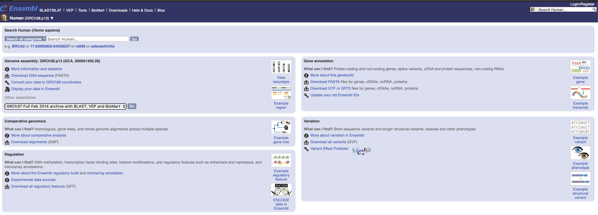
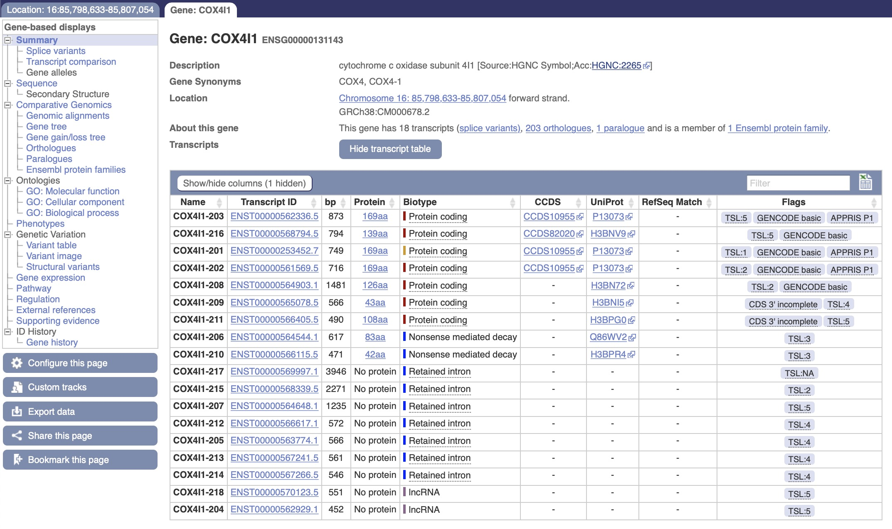
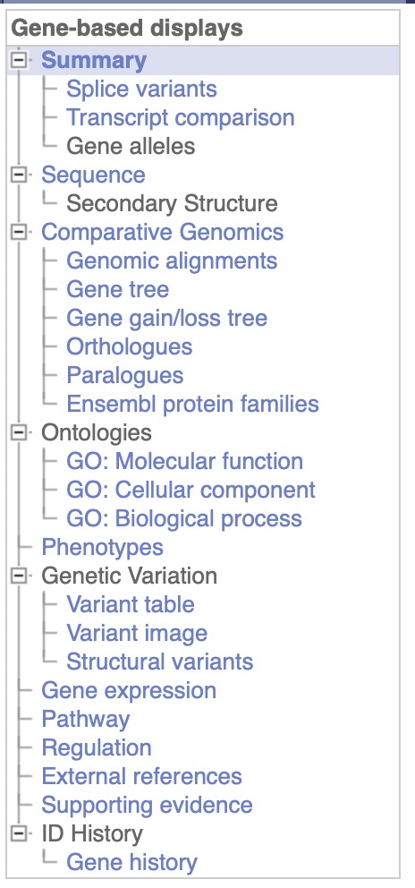
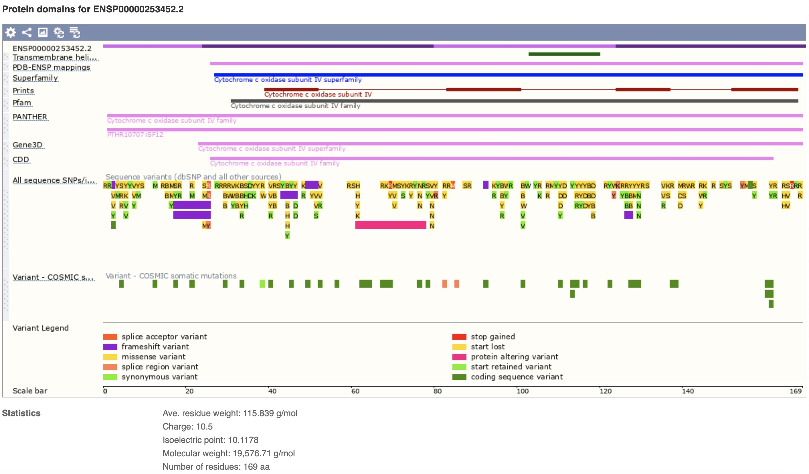
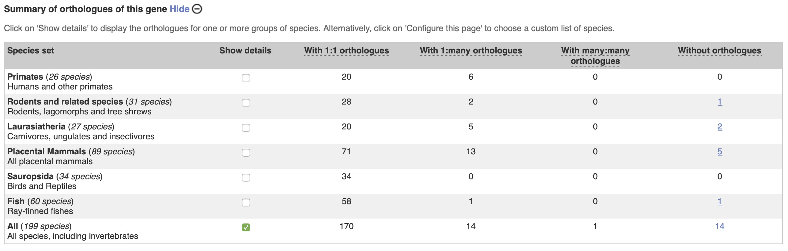
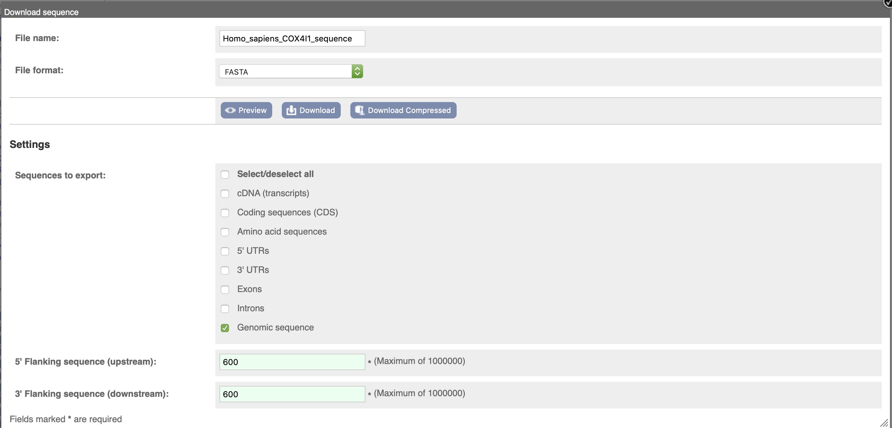

# ENSEMBL

I dati dei principali progetti genomici sono organizzati in banche dati specializzate che integrano tutta una serie di annotazioni, di natura eterogenea, in modo che il ricercatore, utilizzando un apposito **"browser"**, ottenga facilmente tutte le informazioni disponibili relative ad una determinata regione genomica.  
I due browser genomici più diffusi sono **ENSEMBL** e **UCSC**, di cui vedremo le principali caratteristiche.  

Collegati al sito della banca dati Ensembl:
[http://www.ensembl.org](http://www.ensembl.org)  
Noterai che questa banca dati contiene i dati genomici e le relative annotazioni di diversi metazoi, dall'uomo al nematode *C. elegans* (apri il menu a tendina select a species).  

La banca dati **Ensembl** viene continuamente aggiornata e quindi è opportuno, quando la si consulta, **prendere nota della versione del genoma che stiamo consultando.**  
Cliccando sull’icona corrispondente al genoma umano si accede ad una pagina specifica dalla quale è possibile scaricare anche l’intera sequenza in formato FASTA.  

Alcuni dati statistici relativi all'attuale versione (release) del genoma sono accessibili al sito seguente: [http://www.ensembl.org/Homo_sapiens/Info/Annotation](http://www.ensembl.org/Homo_sapiens/Info/Annotation)  
Esamina con attenzione le informazioni contenute in questa pagina:
- Quanti geni codificanti per proteine sono annotati?  
- Quanti pseudogeni?  
- Qual è l’attuale lunghezza del genoma?  

Sono disponibili anche due versioni di Ensembl per:  
*	Piante: [http://plants.ensembl.org/index.html](http://plants.ensembl.org/index.html)   
*	Procarioti: [http://bacteria.ensembl.org/index.html](http://bacteria.ensembl.org/index.html)  

## Ricerca in Ensembl mediante parole chiave o coordinate genomiche.
A questo punto possiamo "*navigare*" nel *genoma umano* per esaminarne una particolare regione.  
Inizieremo ad esaminare la regione genomica nella quale è localizzato il gene che codifica per la **Subunità 4 della Citocromo C ossidasi**.  
La ricerca può essere effettuata utilizzando differenti modalotà di interrogazione della banca dati:  
* **parole chiave**  
* **similarità**  
* **coordinate genomiche**  
* **nome ufficiale del gene**  
* **accession number** di sequenze nucleotidiche e proteiche  

La denominazione dei geni presenta enormi problemi di standardizzazione della nomenclatura. Ad uno stesso gene vengono spesso assegnati nomi diversi in specie diverse e questo accade spesso anche all'interno della stessa specie.  
Nel caso dei geni umani è stata creata una nomenclatura ufficiale dei geni accessibile attraverso la pagina del consorzio internazionale [**Human Genome Organization (HuGO)**](http://www.genenames.org/).  

Consulta questo sito per ottenere il nome ufficiale del gene cox4, ed in particolare, il nome ufficiale associato all'isoforma 1:  
* Selezione **Genes**  
* Nella barra di ricerca scrivi **cox4**  
* Seleziona il risultato più appropriato.  

    

    <b>COX4I1</b>
    

    

Ritorna alla pagina di Ensembl relativa all' **Homo sapiens**, nel campo relativo ala ricerca inserisci il nome ufficiale (simbolo approvato) del gene appena determinato e limita la ricerca ai geni selezionando “Gene”.  
Cliccando su **go** esamina i risultati:  
- Quanti geni vengono trovati?  
- Quanti pseudogeni?  
- **Indica qual è l’accession del gene identificato.**  
Seguendo il link relativo al gene ENSEMBL si ottiene una scheda sul gene in esame nella quale sono riportate diverse informazioni circa:  
* la localizzazione del gene; 
* come pure i riferimenti incrociati a trascritti e proteine.    

Nella sezione **Summary** sono riportate delle informazioni relative all'annotazione del gene:
* Name: simbolo ufficiale;  
* [CCDS](http://www.ensembl.org/info/genome/genebuild/ccds.html):  
    > L'annotazione di geni sul genoma umano e di topo è fornita da più risorse pubbliche, usando metodi diversi e dando come risultato informazioni simili ma non sempre identiche.   
    > Attualmente, le sequenze del genomiche umane e murine sono sufficientemente stabili per iniziare a identificare quelle localizzazioni geniche identiche tra i tre principali browser pubblici del genoma.
    > A tal fine, è stato istituito il progetto **Consensus CDS (CCDS)**. Il progetto CCDS è uno sforzo collaborativo per identificare un insieme centrale di regioni codificanti proteine ​​che sono costantemente annotate e di alta qualità. 
    >I risultati iniziali del progetto Consensus CDS (CCDS) sono ora disponibili attraverso le pagine del gene Ensembl  e dalla pagina del progetto CCDS presso l'NCBI.
    > Il set CCDS è stato realizzato tra **Ensembl**, il **National Center for Biotechnology Information (NCBI)** e il **HUGO Gene Nomenclature Committee (HGNC)**.  
* UniProtKB: se disponibile il link alla banca dati **UniProtKB**;  
* RefSeq: se disponibile il link alla banca dati **RefSeq**;  
* Ensembl version: versione dell'annotazione ENSEMBL;  
* Other assemblies: altre versioni dell'assembly;  
* Gene type: tipologia di gene;  
* Annotation method: metodo di [annotazione](http://www.ensembl.org/info/genome/genebuild/genome_annotation.html.  

E', inoltre, possibile osservare una rappresentazione schematica della struttura del gene ed il contesto genomico in cui si trova.    
Sono rappresentate entrambe le strand (bianco e nero) e al centro il contig genomico in cui si trovano.  
Relativamente ad entrambe le strand è riportata la posizione degli elementi trascritti ed eventualmente codificanti per proteine.  
- Utilizzando il menù di configurazione  possiamo selezionare le “track” da visualizzare e gestirne le opzioni di visualizzazione: 
 >ad esempio possiamo includere la rappresentazione relativa alle modificazioni Istoniche: selezioniamo la modifica **H3K27Ac**.  

Possiamo visualizzare a questo punto l'informazione relativa a trascritti e proteine, cliccando sui link corrispondenti. Poi se vogliamo avere indicazioni più dettagliate sulla struttura in esoni ed introni e sulla loro localizzazione, possiamo cliccare sul box 
a sinistra, dalla pagina relativa al trascritto:  

* Selezioniamo il trascritto, **ENST00000253452** e usiamo il box laterale per cercare di rispondere alle seguenti domande:  
    * da quanti esoni è costituito il gene?  
    * qual è la loro lunghezza?  
    * l'introne più lungo?  
    * oltre alle coordinate assolute del gene, degli esoni e degli introni.  
    
La sezione "Protein Summary" fornisce informazioni circa la struttura proteica, le proprietà chimico fisiche e la presenza di domini funzionali. Scegliamo la prima proteina codificata **ENSP00000253452**.  
Comparirà una descrizione grafica della proteina e dei domini funzionali o strutturali riconosciuti in essa e una serie di informazioni chimico fisiche.  

Tornando alla scheda relativa al gene, possiamo anche determinare i geni **ortologhi** (e **paraloghi**) in altri organismi selezionando la voce **"Orthologues"** nel box a sinistra, nella sezione **Comparative Genomics**.    
Notare che per ciascun organismo corrispondente è mostrato il rapporto quantitativo tra gli ortologhi.  

Al di sotto è riportata una lista delle specie in cui sono stati identificati dei geni ortogologhi. 
Nello **“Species set”** è possibile restringere la visualizzazione degli ortologhi ad uno specifico gruppo (ad es. i roditori `Rodents`).  
Utilizzando il campo “Filter” in alto a destra è possibile ricercare una specie.

## Esportazione Sequenze
Se desideriamo esportare una qualunque sequenza relativa a questo gene (nucleotidica o proteica) dobbiamo selezionare la voce "Sequence" (sulla sinistra sotto il box).  
Automaticamente la pagina verrà aggiornata e cliccando sull’opzione “Download sequence”, si aprirà una form che consente l'estrazione di varie tipologie di sequenza (gene, regione codificante, regioni non tradotte, etc.) in modo da salvarle sul nostro computer per effettuare ulteriori analisi.  
Proviamo a salvare la sequenza del gene in formato FASTA, includendo 100 bp a monte e a valle e selezionando solo l’opzione genomic (quindi deselezionare tutti gli altri tipi di sequenza). Visualizzare la sequenza in formato text.

## Analisi del contesto genomico di un gene
Se clicchiamo sulla scheda **"Location"** possiamo esaminare la sezione **"Region in detail"** e ottenere informazioni sul contesto genomico del gene in esame.  
* Ad esempio, quali sono i geni adiacenti a monte e a valle?  
* A quale distanza si trovano?  
* Qual è la composizione in basi?  

# Esercizi
### Esercizio 1
Determina la lunghezza del trascritto `ENST00000253452` e della proteina relativa al trascritto in esame.  
Guardare la pagina relativa al gene.  
* Lunghezza trascritto:  
* Lunghezza proteina:  

### Esercizio 2
Esamina le informazioni dei geni ortologhi a quello umano.  
* Quanti esoni ha il gene di topo (filtrate per `Mus musculus`)?  
* Qual’è la lunghezza totale del gene umano e di quello di topo?  
* Qual’è la lunghezza complessiva degli introni umani e di topo (considerare per entrambi il trascritto codificante proteina più lungo)?   

### Esercizio 3
Tra gli ortologhi cerca l'identificativo Ensembl del gene di Danio rerio.  
Tra le informazioni disponibili individua:  
Cromosoma in cui mappa il gene []  
Lunghezza trascritto []  
Lunghezza proteina []  

### Esercizio 4
Ricerca il nome ufficiale del gene `Dystrophin` dell'uomo.  
Cerca questo gene in ENSEMBL, utilizzando il nome ufficiale.   
1.	Qual è l'identificatore del gene?  
2.	Su quale cromosoma è localizzato il gene?  
3.	Su quali coordinate?  
4.	Su quale strand?   
5.	Quanti trascritti alternativi sono annotati?  
6.	Quanto sono lunghi il trascritto più lungo e quello più corto?  
7.	Quanti introni ed esoni hanno?  
8.	Quanto sono lunghe la proteina più lunga e quella più corta annotate per questo gene?  

# COVID-19
E' stata realizzata una release di ENSEMBL per raccogliere e mostrare i dati relativi al genoma di **SARS-COV-2**: [***The Ensembl COVID-19 resource***](https://covid-19.ensembl.org/index.html).  
Si tratta di una risorsa ancora in via di sviluppo, il cui contenuto viene constantemente aggioranto a seconda delle nuove infomazioni disponibili.  
Potete trovare il pre-print del lavoro su **bioRxiv**: [https://doi.org/10.1101/2020.12.18.422865](https://doi.org/10.1101/2020.12.18.422865).  

[UCSC](./UCSC.md)             

[Back to the top](../README.md)

