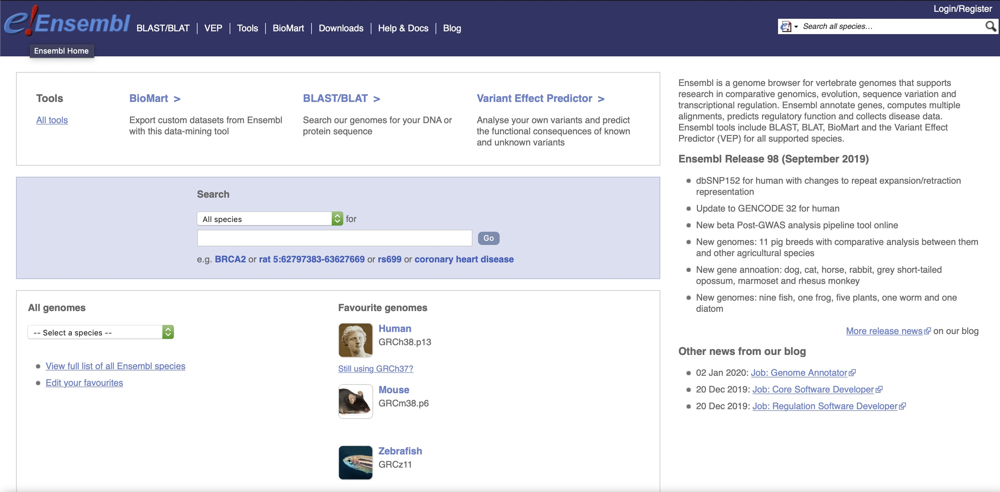
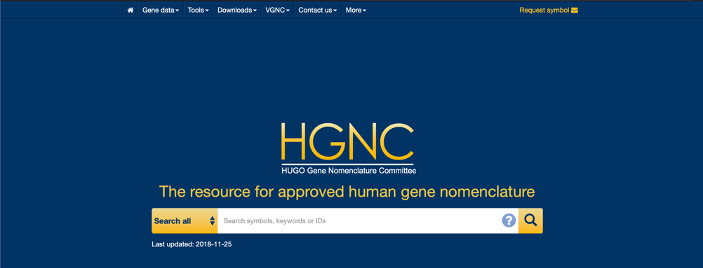

#ENSEMBL
I dati dei principali progetti genomici sono organizzati in banche dati specializzate che integrano tutta una serie di annotazioni, di natura eterogenea, in modo che il ricercatore, utilizzando un apposito **"browser"**, ottenga facilmente tutte le informazioni disponibili relative ad una determinata regione genomica.  
I due browser genomici più diffusi sono **ENSEMBL** e **UCSC**, di cui vedremo le principali caratteristiche.  

Collegati al sito della banca dati Ensembl:
[http://www.ensembl.org](http://www.ensembl.org)  
Noterai che questa banca dati contiene i dati genomici e le relative annotazioni di diversi metazoi, dall'uomo al nematode *C. elegans* (apri il menu a tendina select a species).  

La banca dati **Ensembl** viene continuamente aggiornata e quindi è opportuno, quando la si consulta, **prendere nota della versione del genoma che stiamo consultando.**  
Cliccando sull’icona corrispondente al genoma umano si accede ad una pagina specifica dalla quale è possibile scaricare anche l’intera sequenza in formato FASTA.  

Alcuni dati statistici relativi all'attuale versione (release) del genoma sono accessibili al sito seguente: [http://www.ensembl.org/Homo_sapiens/Info/Annotation](http://www.ensembl.org/Homo_sapiens/Info/Annotation)  
Esamina con attenzione le informazioni contenute in questa pagina:
- Quanti geni codificanti per proteine sono annotati?  
- Quanti pseudogeni?  
- Qual è l’attuale lunghezza del genoma?  

Sono disponibili anche due versioni di Ensemble per:  
*	Piante: [http://plants.ensembl.org/index.html](http://plants.ensembl.org/index.html)   
*	Procarioti: [http://bacteria.ensembl.org/index.html](http://bacteria.ensembl.org/index.html)  

##Ricerca in Ensembl mediante parole chiave o coordinate genomiche.
A questo punto possiamo "*navigare*" nel *genoma umano* per esaminarne una particolare regione.  
Inizieremo ad esaminare la regione genomica nella quale è localizzato il gene che codifica per la **Subunità 4 della Citocromo C ossidasi**.  
La ricerca può essere effettuata utilizzando differenti modalotà di interrogazione della banca dati:  
* **parole chiave**  
* **similarità**  
* **coordinate genomiche**  
* **nome ufficiale del gene**  
* **accession number** di sequenze nucleotidiche e proteiche  

La denominazione dei geni presenta enormi problemi di standardizzazione della nomenclatura. Ad uno stesso gene vengono spesso assegnati nomi diversi in specie diverse e questo accade spesso anche all'interno della stessa specie.  
Nel caso dei geni umani è stata creata una nomenclatura ufficiale dei geni accessibile attraverso la pagina del consorzio internazionale [**Human Genome Organization (HuGO)**](http://www.genenames.org/).  

Consulta questo sito per ottenere il nome ufficiale del gene cox4, ed in particolare, il nome ufficiale associato all'isoforma 1:  
* Selezione **Genes**  
* Nella barra di ricerca scrivi **cox4**  
* Seleziona il risultato più appropriato.  

    

    <b>COX4I1</b>
    

    

Ritorna alla pagina di Ensembl relativa all' **Homo sapiens**, nel campo relativo ala ricerca inserisci il nome ufficiale (simbolo approvato) del gene appena determinato e limita la ricerca ai geni selezionando “Gene”.  
Cliccando su **go** esamina i risultati:  
- Quanti geni vengono trovati?  
- Quanti pseudogeni?  
- **Indica qual è l’accession del gene identificato.**  
Seguendo il link relativo al gene ENSEMBL si ottiene una scheda sul gene in esame nella quale sono riportate diverse informazioni circa:  
* la localizzazione del gene; 
* come pure i riferimenti incrociati a trascritti e proteine.    

Nella sezione **Summary** sono riportate delle informazioni relative all'annotazione del gene:
* Name: simbolo ufficiale;  
* [CCDS](http://www.ensembl.org/info/genome/genebuild/ccds.html):  
    > L'annotazione di geni sul genoma umano e di topo è fornita da più risorse pubbliche, usando metodi diversi e dando come risultato informazioni simili ma non sempre identiche.   
    > Attualmente, le sequenze del genomiche umane e dnurine sono sufficientemente stabili per iniziare a identificare quelle localizzazioni geniche identiche tra i tre principali browser pubblici del genoma.
    > A tal fine, è stato istituito il progetto **Consensus CDS (CCDS)**. Il progetto CCDS è uno sforzo collaborativo per identificare un insieme centrale di regioni codificanti proteine ​​che sono costantemente annotate e di alta qualità. 
    >I risultati iniziali del progetto Consensus CDS (CCDS) sono ora disponibili attraverso le pagine del gene Ensembl  e dalla pagina del progetto CCDS presso l'NCBI.
    > Il set CCDS è stato realizzato tra **Ensembl**, il **National Center for Biotechnology Information (NCBI)** e il **HUGO Gene Nomenclature Committee (HGNC)**.  
* UniProtKB  
* RefSeq  
* Ensembl version  
* Other assemblies  
* Gene type  
* Annotation method      

illustra schematicamente la struttura del gene e il suo contesto genomico.
Sono rappresentate entrambe le strand (bianco e nero) e al centro il contig genomico in cui si trovano. Relativamente ad entrambe le strand è riportata la posizione degli elementi trascritti ed eventualmente codificanti per proteine.
	Utilizzando il menù di configurazione  possiamo selezionare le “track” da visualizzare e gestirne le opzioni di visualizzazione (ad esempio possiamo includere la rappresentazione relativa alle modificazioni Istoniche: selezioniamo la modifica H3K27Ac)
Possiamo visualizzare a questo punto l'informazione relativa a trascritti e proteine, cliccando sui link corrispondenti. Poi se vogliamo avere indicazioni più dettagliate sulla struttura in esoni ed introni e sulla loro localizzazione, possiamo cliccare sul box 
a sinistra, dalla pagina relativa al trascritto:

