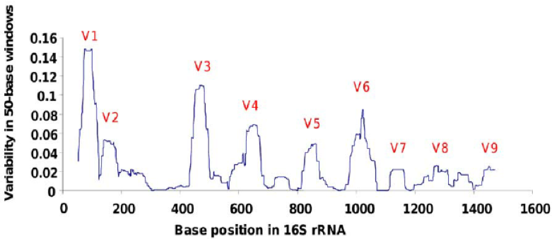

# Metabarcoding

## Introduzione
L'approccio metagenomico si basa sull'analisi del materiale genetico totale (**metagenoma**) direttamente estratto da un campione ambientale (Kunin et al., 2008; Wooley et al., 2010).  
Anche se il metagenoma consiste nell'intero contenuto genetico delle specie viventi in un determinato habitat, questo nuovo approccio è applicato principalmente per indagare sulle comunità microbiche.  
Considerando che circa il **99%** delle specie batteriche non possono essere isolate e coltivate mediante tecniche standard di laboratorio (Staley and Konopka, 1985), l'approccio metagenomico, che non prevede alcuna procedura di coltivazione, offre uno strumento senza precedenti per allargare la conoscenza del mondo microbico. L’importanza di poter di poter accedere alla porzione microbica “nascosta”  risiede nel fatto che circa i due terzi della biodiversità presente sulla terra siano composti da microorganismi (Singh et al., 2009).  
I microorganismi, i loro genomi e le iterazioni che tra loro stabiliscono in ogni ambiente che colonizzano sono definiti con il termine **microbioma**.  
Il grande interesse verso le comunità microbiche è dato dal fatto che esse sono capaci di colonizzare qualsiasi habitat, dal terreno alle acque oceaniche, compreso il corpo umano.  
Proprio considerando il corpo umano, la composizione del microbioma cambia a seconda del sito anatomico o dell’età del soggetto (Turnbaugh et al., 2013), ma anche in base allo stile di vita.   
Inoltre, l’avvento delle tecnologie di sequenziamento di nuova generazione ad elevato throughput (**Next-Generation Sequencing, NGS**) (Nowrousian, 2010) ha sostenuto lo studio di tutti i possibili habitat.  
La metagenomica può effettuare il profiling del microbioma mediante due approcci:  
1.	**Classificazione tassonomica**: in questo caso l'obiettivo principale è quello di identificare gli organismi viventi nell'ambiente (Simon and Daniel, 2011), possibilmente a livello di specie . Questa metodologia richiede, dopo il sequenziamento, una fase di classificazione per assegnare le read ai rispettivi gruppi tassonomici;  
2.	**Caratterizzazione funzionale**: l'obiettivo principale è quello di rivelare il repertorio di funzioni genetiche della comunità in oggetto d’indagine mediante analisi del DNA o RNA totale o sistemi di espressione eterologhi (solitamente E. coli) (Prakash and Taylor, 2012; Simon and Daniel, 2011).  
Quanto al metodo di sequenziamento, sono utilizzati due approcci principali:
•	L’analisi dell’intero metagenoma/metatranscrittoma basata sul sequenziamento **shotgun** del DNA/RNA totale estratto dal campione. Quest’approccio consente di ottenere sia informazioni tassonomiche che funzionali ma è notevolmente costoso in termini di sequenziamento e analisi computazionale.
•	La strategia **amplicon-based** o **metabarcoding** che si basa sull'amplificazione selettiva di specifici marcatori tassonomici utilizzando coppie di primer universali capaci di essere efficienti su grandi gruppi tassonomici (ad esempio batteri, funghi, ecc) ed il successivo sequenziamento high-throughput delle librerie di ampliconi ottenute. Quest’approccio può fornire informazioni solo sulla composizione tassonomica del campione ma con superiore capacità d’identificazione e risoluzione a livello di specie. Inoltre, risulta meno costoso in termini di sequenziamento e analisi computazionale.  
    Le regioni marker più utilizzate includono diverse combinazioni delle regioni iper-variabili del gene del rRNA 16S (nei batteri), gli spaziatori interni trascritti (ITS) dei geni del cluster degli RNA ribosomiali (nei funghi) o specifiche porzioni del gene della Citocromo c ossidasi 1 mitocondriale (nei Metazoa).  
    
## Metabarcoding approach
Scopo dell’esercitazione odierna è l’analisi del microbioma umano attraverso l’approccio di metabarconding, che possiamo idealmente suddividere in 5 step principali:  
1.	Raccolta dei campioni;  
2.	Estrazione del metagenoma (insieme dei genomi degli \[micro\]organismi che condividono lo stesso ambiente);  
3.	Amplificazione del marker tassonomico;  
4.	Sequenziamento;  
5.	Analisi bioinformatica dei dati.  
  
**Figura 1: rappresentazione schematica degli step che caratterizzano l’approccio metabercoding.**

Un marcatore genetico di specie ideale dovrebbe avere le seguenti caratteristiche:  
1.	essere ubiquitario, o almeno largamente condiviso nel range tassonomico di interesse;  
2.	essere abbastanza variabile da consentire la discriminazione ai più profondi livelli tassonomici;  
3.	essere affiancato per regioni altamente conservate adatte per il disegno primer universali;  
4.	avere una dimensione paragonabile ai limiti di lunghezza delle piattaforme NGS attuali.  
  
*Figura 2: rappresentazione della variabilità del gene per l’rRNA 16S nei procarioti.*

Il tutorial che andremo a completare riguarda lo studio del microbioma orale.  
Lo studio dei microorganismi che compongono queste comunità è fondamentale per capire sia i meccanismi fisiologici in cui sono coinvolti (digestione, addestramento del sistema immunitario adattivo (Human Microbiome Project, 2012)) che quelli patologici (Brennan and Garrett, 2016).  
I dati che analizzeremo oggi sono disponibile nel repository [SRA (Sequence Read Archive)](https://trace.ncbi.nlm.nih.gov/Traces/sra/sra.cgi?).  
In particolare, i campioni analizzati fanno riferimento ai seguenti progetti:
1.	Studio del microbioma orale in bambini obesi affetti da diabete di tipo 2 o non affetti ([PRJEB16156](./https://www.ebi.ac.uk/ena/data/view/PRJEB16156));

I dati sono stati ottenuti amplificando la regione iper-variabile V3-V4 del rRNA 16S e successivamente sequenziando gli ampliconi in modalità paired-end (PE) 2x250 con piattaforma Illumina MiSeq®.

