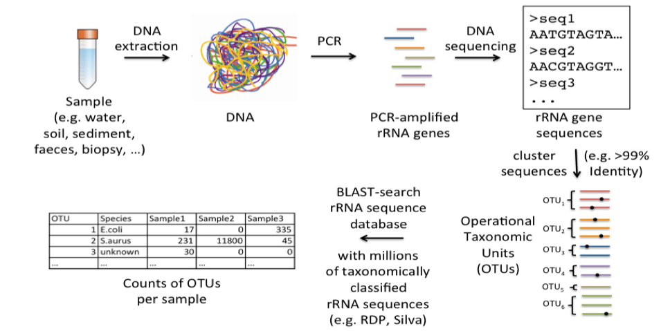
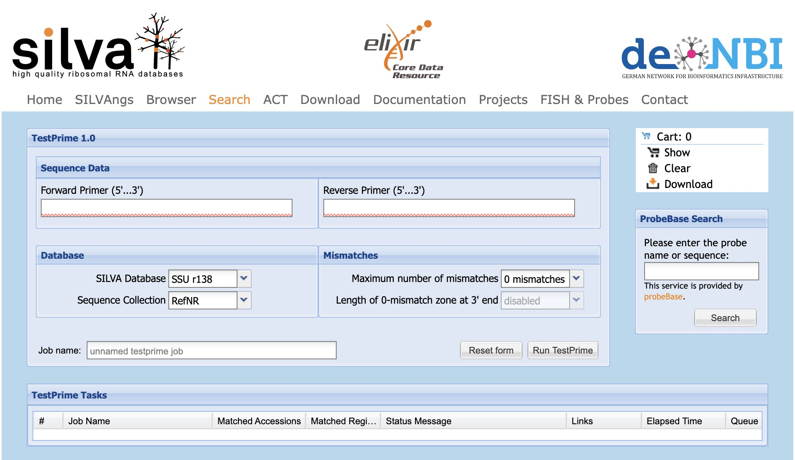
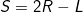
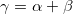
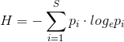

# Metabarcoding

## Introduzione
L'approccio metagenomico si basa sull'analisi del materiale genetico totale (**metagenoma**) direttamente estratto da un campione ambientale (Kunin et al., 2008; Wooley et al., 2010).  
Anche se il metagenoma consiste nell'intero contenuto genetico delle specie viventi in un determinato habitat, questo nuovo approccio è applicato principalmente per indagare sulle comunità microbiche.  
Considerando che circa il **99%** delle specie batteriche non possono essere isolate e coltivate mediante tecniche standard di laboratorio (Staley and Konopka, 1985), l'approccio metagenomico, che non prevede alcuna procedura di coltivazione, offre uno strumento senza precedenti per allargare la conoscenza del mondo microbico. L’importanza di poter di poter accedere alla porzione microbica “nascosta”  risiede nel fatto che circa i due terzi della biodiversità presente sulla terra siano composti da microorganismi (Singh et al., 2009).  
I microorganismi, i loro genomi e le iterazioni che tra loro stabiliscono in ogni ambiente che colonizzano sono definiti con il termine **microbioma**.  
Il grande interesse verso le comunità microbiche è dato dal fatto che esse sono capaci di colonizzare qualsiasi habitat, dal terreno alle acque oceaniche, compreso il corpo umano.  
Proprio considerando il corpo umano, la composizione del microbioma cambia a seconda del sito anatomico o dell’età del soggetto (Turnbaugh et al., 2013), ma anche in base allo stile di vita.   
Inoltre, l’avvento delle tecnologie di sequenziamento di nuova generazione ad elevato throughput (**Next-Generation Sequencing, NGS**) (Nowrousian, 2010) ha sostenuto lo studio di tutti i possibili habitat.  
La metagenomica può effettuare il profiling del microbioma mediante due approcci:  
1.	**Classificazione tassonomica**: in questo caso l'obiettivo principale è quello di identificare gli organismi viventi nell'ambiente (Simon and Daniel, 2011), possibilmente a livello di specie . Questa metodologia richiede, dopo il sequenziamento, una fase di classificazione per assegnare le read ai rispettivi gruppi tassonomici;  
2.	**Caratterizzazione funzionale**: l'obiettivo principale è quello di rivelare il repertorio di funzioni genetiche della comunità in oggetto d’indagine mediante analisi del DNA o RNA totale o sistemi di espressione eterologhi (solitamente E. coli) (Prakash and Taylor, 2012; Simon and Daniel, 2011).  
  
Quanto al metodo di sequenziamento, sono utilizzati due approcci principali:  
•	L’analisi dell’intero metagenoma/metatranscrittoma basata sul sequenziamento **shotgun** del DNA/RNA totale estratto dal campione. Quest’approccio consente di ottenere sia informazioni tassonomiche che funzionali ma è notevolmente costoso in termini di sequenziamento e analisi computazionale.  
•	La strategia **amplicon-based** o **metabarcoding** che si basa sull'amplificazione selettiva di specifici marcatori tassonomici utilizzando coppie di **primer universali** capaci di essere efficienti su grandi gruppi tassonomici (ad esempio batteri, funghi, ecc) ed il successivo sequenziamento high-throughput delle librerie di ampliconi ottenute.  
    Quest’approccio può fornire informazioni solo sulla composizione tassonomica del campione ma con superiore capacità d’identificazione e risoluzione a livello di specie.  
    Inoltre, risulta meno costoso in termini di sequenziamento e analisi computazionale.    
    Le regioni marker più utilizzate includono:  
    * diverse combinazioni delle regioni iper-variabili del gene del **rRNA 16S (nei batteri)**;  
    * gli **spaziatori interni trascritti (ITS) dei geni del cluster degli RNA ribosomiali (nei funghi)**;  
    * specifiche porzioni del gene della Citocromo c ossidasi 1 mitocondriale (nei Metazoa).  
    
## Metabarcoding approach
Scopo dell’esercitazione odierna è l’analisi del microbioma umano attraverso l’approccio di metabarconding, che possiamo idealmente suddividere in 5 step principali:  
1.	Raccolta dei campioni;  
2.	Estrazione del metagenoma (insieme dei genomi degli \[micro\]organismi che condividono lo stesso ambiente);  
3.	Amplificazione del marker tassonomico;  
4.	Sequenziamento;  
5.	Analisi bioinformatica dei dati.  
  
**Figura 1: rappresentazione schematica degli step che caratterizzano l’approccio metabercoding.**

Un marcatore genetico di specie ideale dovrebbe avere le seguenti caratteristiche:  
1.	essere ubiquitario, o almeno largamente condiviso nel range tassonomico di interesse;  
2.	essere abbastanza variabile da consentire la discriminazione ai più profondi livelli tassonomici;  
3.	essere affiancato per regioni altamente conservate adatte per il disegno primer universali;  
4.	avere una dimensione paragonabile ai limiti di lunghezza delle piattaforme NGS attuali.  
  
*Figura 2: rappresentazione della variabilità del gene per l’rRNA 16S nei procarioti.*

Come detto per selezionare il marcatore di interesse utilizziamo una **coppia di primer universali** capace di amplificare l'intero range tassonomico di interesse.    
***Ma come facciamo a valutare che una coppia di primer sia realmente universale?***    
Possiamo testare i nostri primer in silico e valutare come si comportano sui dati ad oggi conosciuti.  
Per il 16S possiamo utilizzare uno dei servizi messi a disposizione dalla database [**SILVA**], chiamto **TestPrime**:  
1. Collegatevi a TestPrime utilizzando il seguente [link](https://www.arb-silva.de/search/testprime/);    
  

2. Vogliamo testare la seguente coppia di primer per la regione V4:  
    * Forward: `GTGCCAGCMGCCGCGGTAA`  
    * Reverse:  `GGACTACNVGGGTWTCTAAT`  
3. Impostiamo 4 mismatch.  
All'avvio dell'esecuzione di aprirà una finestra che vi mostrerà tutti i possibili primer partendo da quelli contenenti le degenerazioni.  

Ripetete l'analisi ma in questo caso selesionate l'opzione `Length of 0-mismatch zone at 3' end` e indicate `5 bases`.  

***Summary dei risultati ottenuti***  

|Regno|No restrizione al 3'|Restrizione al 3'|
|:---:|:---:|:---:|
|Bacteria|96.6|91.7|
|Archaea|97.5|94.2|
Eukaryota|93.7|20.8|  

### Analisi di dati reali
I dati che analizzeremo oggi sono disponibile nel repository [SRA (Sequence Read Archive)](https://trace.ncbi.nlm.nih.gov/Traces/sra/sra.cgi?).    
In particolare, il tutorial che andremo a completare riguarda lo studio del microbioma orale [PRJEB16156](https://www.ebi.ac.uk/ena/data/view/PRJEB16156).  
Nel suddetto studio, trovate il lavoro a questo [link](https://journals.plos.org/plosone/article?id=10.1371/journal.pone.0172647), sono stati analizzati un totale di 37 campioni ma per i nostri scopi ne ho selezionati casualmente 15:
* 5 controlli sani;  
* 5 soggetti obesi;  
* 5 soggetti affetti da diabete mellito tipo 2.  

***Lo scopo di questa esercitazione è capire se via siano differenze tra il microbioma orale di soggetti sani, obesi ed affetti da diabete.***  
 
I dati sono stati ottenuti amplificando la regione iper-variabile V3-V4 del rRNA 16S e successivamente sequenziando gli ampliconi in modalità paired-end (PE) 2x300 con piattaforma Illumina MiSeq®.  
Effettueremo tutte le analisi utilizzando il tool [**QIIME2**](https://qiime2.org/). Questo tool implementa sia un sistema che traccia l'orgigine dei dati e la loro elaborazione che uno per la loro visuallizzazione, chiamato [**QIIME   2 View**](https://view.qiime2.org/).  

## Preparazione dell'area di lavoro
* Come prima operazione occore entrare nelle vostre cartelle:  
    `cd cognome_nome`  
* Successivamente va create la cartella `PRJEB16156` e bisogna posizionarsi al suo interno:  
    `mkdir PRJEB16156 && cd PRJEB16156`
* Adesso va attivato l'ambiente virtuale in cui è installato **QIIME2**:  
    `conda activate qiime2-2019.10` 
* Creiamo una cartella che mantenga i dati temporanei e indichiamo al sistema operativo di utilizzarla:  
    ```
    mkdir tmp
    export TMPDIR="$PWD/tmp"
    ```  
* Copiamo i dati all'interno della nostra cartella:  
    `cp -r /home/epigen/microbiome_analysis/input_data .`  
    `cp -r /home/epigen/microbiome_analysis/sample-metadata.tsv .`               
A questo punto abbiamo completato tutte le operazioni preliminari necessarie per preparare l'ambiente di lavoro. Possiamo procedere con le analisi.  

## Importazione dei dati
* Importiamo i dati in QIIME2:  
    ```
    qiime tools import \
    --type 'SampleData[PairedEndSequencesWithQuality]' \
    --input-path input_data \
    --input-format CasavaOneEightSingleLanePerSampleDirFmt \
    --output-path demux-paired-end.qza
    ```  
* Creiamo un file di visualizzazione (estensione *qzv*) per valutare la qualità dei nostri dati:  
    ```
    qiime demux summarize \
    --i-data  demux-paired-end.qza \
    --o-visualization demux-paired_end.qzv
    ```
* Scarchiamo il file `demux-paired_end.qzv` e visualizziamolo con QIIME2 view.  
    * Come valutiamo la qualità del sequenziamento?  

## Denoising
* Effettuiamo il **Denoising** dei dati:  
    Il **Denoising** (letteralmente eliminazione del rumore di fondo (*noise*)) è una procedura che permette di riconoscere il rumore introdotto dalla PCR e dal sequenziamento.    
    [Giusto un po' di teoria](https://drive.google.com/open?id=1NsN9iUI-UOP9M6n7HbJ32UaHgGIoBKkcqkjSX7hg2tU).  
    Il trimming delle sequenze PE: 
      
    
    Prima di decidere se trimmare le sequenze al 3' e di quanto trimmare dobbiamo valutare quanto le due read si sovrappongono. Per farlo possiamo tenere conto della formula:  
      
    Dove:  
        - R è la lunghezza nominale delle read;
        - L è la lunghezza media dell'amplicone.  
    Nel nostro caso l'amplicone ha una lunghezza media di 560 nt, per cui: **S = 2*300 - 560 = 600 - 560 = 40**.  
    
    <details><summary></summary>
    <p>
    <b>In considerazione della qualità delle sequenze conviene non effettuare il trimming al 3'.</b>
    </p>
    </details>
    
     >nohup qiime dada2 denoise-paired \
          --i-demultiplexed-seqs demux-paired-end.qza \
          --p-trunc-len-f 300 \
          --p-trunc-len-r 300 \
          --p-trim-left-f 17 \
          --p-trim-left-r 21 \
          --p-max-ee-f 5 \
          --p-max-ee-r 7 \
          --p-n-threads 10 \
          --o-table table_16S.qza \
          --o-representative-sequences rep-seqs_16S.qza \
          --o-denoising-stats denoising-stats_16S.qza &  
 
     Essendo una operazione molto lunga abbiamo già effettuato il denoising. Dovete solo copiare i file:  
    `cp -r /home/epigen/microbiome_analysis/{rep-seqs_16S.qza,denoising-stats_16S.qza,table_16S.qza} .`   

* Andiamo a creare dei file di visualizzazione per verificare come sia andata la procedura di **Denoising**:  
    ```
    qiime feature-table summarize \
       --i-table table_16S.qza \
       --o-visualization table_16S.qzv \
       --m-sample-metadata-file sample-metadata.tsv

    qiime feature-table tabulate-seqs \
        --i-data rep-seqs_16S.qza \
        --o-visualization rep-seqs.qzv

    qiime metadata tabulate \
        --m-input-file denoising-stats_16S.qza \
        --o-visualization denoising-stats_16S.qzv
    ```
  
* Scarchiamo i file `table_16S.qzv`, `denoising-stats_16S.qzv` e `rep-seqs.qzv` e visualizziamoli con QIIME2 view.  

## Classificazione tassonomica  
* Effettuaiamo la classificazione tassonomica:  
    >nohup qiime feature-classifier classify-sklearn \
      --i-classifier /home/epigen/microbiome_analysis/SILVA_ref/v3.v4.SILVA_132_NR_99_classifier.qza \
      --i-reads rep-seqs_16S.qza \
      --o-classification taxonomy_16S_SKLEARN.qza &
    
    Essendo una operazione molto lunga abbiamo già effettuato la classificazione tassonomica. Dovete solo copiare i file:  
    `cp -r /home/epigen/microbiome_analysis/taxonomy_16S_SKLEARN.qza .`
    
* Adesso andiamo a generare dei file *qzv* che ci permettano di valutare i risultati della classificazione tassonomica:  
    ```
     qiime metadata tabulate \
        --m-input-file taxonomy_16S_SKLEARN.qza \
        --o-visualization taxonomy_16S_SKLEARN.qzv
  
    qiime taxa barplot \
        --i-table table_16S.qza \
        --i-taxonomy taxonomy_16S_SKLEARN.qza \
        --m-metadata-file sample-metadata.tsv \
        --o-visualization taxa-bar-plots_16S_SKLEARN.qzv
    ```

* Scarchiamo i file `taxonomy_16S_SKLEARN.qzv` e `taxa-bar-plots_16S_SKLEARN.qzv` e visualizziamoli con QIIME2 view.  

## Alpha e Beta Diversità
La Diversità è una misura della complessità del sistema che stiamo osservando, in funzione del numero di oggetti e della loro abbondanza relativa.  


In particolare:  
    * **alpha**: diversità intra-campione. Si possono utillizzare diverse misure:  
        - *Richness*: rappresenta il numero di specie differenti osservate in una comunità biologica;  
        - *Eveness*: indica quanto sia uniforme la comunità osservata;  
        - *Shannon Index*: è una misura quantitativa della richezza di specie;  
              
        - *Faith's Phylogenetic Diversity*: una misura qualitativa della richness della comunità in esame che tiene conto delle relazioni filogenetiche.      
    * **beta**: diversità inter-campione: utilizziamo delle misure che indicano quanto differenti sono due comunità.  
     Queste misure non fanno altro che andare a compare i campioni a coppie, per cui alla fine dell'analisi si ottiene una matrice che indica la dissimilarità tra ciascuna coppia di campioni.  
     Esistno diverse tipologie di metriche per calcolare la Beta diversità:  
        - Distanza di **Jaccard**: una misura qualitativa della dissimilarità;  
            
            
          X e Y rappresentano i campioni in analisi ed in particolare le specie osservate. Quindi la misura tiene conto solo del fatto che una specie sia osservata o meno e non della sua abbondanza.   
        - Distanza di **Bray-Curtis**: una misura quantitiva della dissimilarità;  
            
          Dove:  
              - *i* e *j* sono i due campioni in analisi;  
              - S<sub>i</sub> e S<sub>j</sub> rappresentano la somma delle conte delle specie osservate nei siti *i* e *j*;  
              - C<sub>ij</sub>: E' la somma della conta più bassa delle specie osservate in entrambe i siti.  
          s distance (a quantitative measure of community dissimilarity)
        - Distanza *unweighted UniFrac*: una misura qualitativa della dissimilarità che incorpora le relazioni filogenetiche tra le ASV;  
        - Distanza *weighted UniFrac*: una misura quantitiva della dissimilarità che incorpora le relazioni filogenetiche tra le ASV;       
    * **gamma**: diversità totale.  
   
* Prima di procedere con le misure di diversità dobbiamo costruire un albero filogenetico a partire dalle ASV ottenute.  
    ```
    qiime phylogeny align-to-tree-mafft-fasttree \
      --i-sequences rep-seqs_16S.qza \
      --o-alignment aligned-rep-seqs_16S.qza \
      --o-masked-alignment masked-aligned-rep-seqs_16S.qza \
      --o-tree unrooted-tree_16S.qza \
      --o-rooted-tree rooted-tree_16S.qza
    ```  
* Al fine di poter comparare i dati ottenuti li dobbiamo **normalizzare**. La procedura di Normalizzazione utilizzata per i dati del microbioma è la **Rarefazione**.  
  Questa procedura si basa sulla scelta di un valore di rarefazione (*sampling depth*) a cui tutti i campioni saranno ricondotti. In pratica, si effettua un campionamento senza reimmissione, fino a raggiungere il valore di rarefazione prescelto.  
  Tutti i campioni con conte al di sotto del sampling depth saranno scartati.  
  ```
  qiime diversity alpha-rarefaction \
      --i-table table_16S.qza \
      --i-phylogeny rooted-tree_16S.qza \
      --p-max-depth 100000 \
      --m-metadata-file sample-metadata.tsv \
      --o-visualization alpha-rarefaction.qzv
  ```  
  
* Passiamo alla stima degli indici di diversità
    ```
    qiime diversity core-metrics-phylogenetic \
      --i-phylogeny rooted-tree_16S.qza \
      --i-table table_16S.qza \
      --p-sampling-depth 40000 \
      --m-metadata-file sample-metadata.tsv \
      --output-dir core-metrics-results_16S
    ```  
* Verifichiamo se vi siano delle differenze significative tra gli indici di alpha diversità:    
    ```  
    qiime diversity alpha-group-significance \
      --i-alpha-diversity core-metrics-results_16S/faith_pd_vector.qza \
      --m-metadata-file sample-metadata.tsv \
      --o-visualization core-metrics-results_16S/faith-pd-Condition-significance_16S.qzv
    
    qiime diversity alpha-group-significance \
      --i-alpha-diversity core-metrics-results_16S/evenness_vector.qza \
      --m-metadata-file sample-metadata.tsv \
      --o-visualization core-metrics-results_16S/evenness-Condition-significance.qzv
    ```  
* Verifichiamo se vi siano delle differenze significative tra gli indici di beta diversità:  
    ```
    qiime diversity beta-group-significance \
      --i-distance-matrix core-metrics-results_16S/unweighted_unifrac_distance_matrix.qza \
      --m-metadata-file sample-metadata.tsv \
      --m-metadata-column Condition \
      --o-visualization core-metrics-results_16S/unweighted-unifrac-Condition-significance.qzv \
      --p-pairwise
    
    qiime diversity beta-group-significance \
      --i-distance-matrix core-metrics-results_16S/weighted_unifrac_distance_matrix.qza \
      --m-metadata-file sample-metadata.tsv \
      --m-metadata-column Condition \
      --o-visualization core-metrics-results_16S/weighted-unifrac-Condition-significance.qzv \
      --p-pairwise
    ```  

***PER SCARICARE TUTTI I DATI PRODOTTI DURANTE L'ESERCITAZIONE UTILIZZATE IL LINK SOTTOSTANTE***  
:arrow_down_small: [**LINK**](https://drive.google.com/open?id=1tA2PmUEpD2x_Z-hZ1J6xqbxOrw1WQpUS)


[Back to the top](../README.md) 