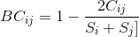

Metabarcoding
==============
- [Introduzione](#introduzione)
- [Metabarcoding approach](#metabarcoding-approach)
- [Analisi di dati reali](#analisi-di-dati-reali)
  - [Preparazione dell'area di lavoro](#preparazione-dellarea-di-lavoro)
  - [Importazione dei dati](#importazione-dei-dati)
  - [Denoising](#denoising)
  - [Classificazione tassonomica](#classificazione-tassonomica)
  - [Alpha e Beta Diversità](#alpha-e-beta-diversit)
  - [Analisi comparativa tra le condizioni](#analisi-comparativa-tra-le-due-condizioni)


# Introduzione
L'approccio metagenomico si basa sull'analisi del materiale genetico totale (**metagenoma**) direttamente estratto da un 
campione ambientale (Kunin et al., 2008; Wooley et al., 2010).  
Anche se il metagenoma consiste nell'intero contenuto genetico delle specie viventi in un determinato habitat, questo 
nuovo approccio è applicato principalmente per indagare sulle comunità microbiche.  
Considerando che circa il **99%** delle specie batteriche non possono essere isolate e coltivate mediante tecniche 
standard di laboratorio (Staley and Konopka, 1985), l'approccio metagenomico, che non prevede alcuna procedura di 
coltivazione, offre uno strumento senza precedenti per allargare la conoscenza del mondo microbico. L’importanza di 
poter di poter accedere alla porzione microbica “nascosta” risiede nel fatto che circa i due terzi della biodiversità 
presente sulla terra siano composti da microorganismi (Singh et al., 2009).  
I microorganismi, i loro genomi e le iterazioni che tra loro stabiliscono in ogni ambiente che colonizzano sono definiti con il termine **microbiota**.  
Il grande interesse verso le comunità microbiche è dato dal fatto che esse sono capaci di colonizzare qualsiasi habitat, dal terreno alle acque oceaniche, compreso il corpo umano.  
Proprio considerando il corpo umano, la composizione del microbioma cambia a seconda del sito anatomico o dell’età del soggetto (Turnbaugh et al., 2013), ma anche in base allo stile di vita.   
Inoltre, l’avvento delle tecnologie di sequenziamento di nuova generazione a elevato throughput (**Next-Generation Sequencing, NGS**) (Nowrousian, 2010) ha sostenuto lo studio di tutti i possibili habitat.  
La metagenomica può effettuare il profiling del microbioma mediante due approcci:  
1.	**Classificazione tassonomica**: in questo caso l'obiettivo principale è quello d' identificare gli organismi viventi nell' ambiente (Simon and Daniel, 2011), possibilmente a livello di specie. Questa metodologia richiede, dopo il sequenziamento, una fase di classificazione per assegnare le read ai rispettivi gruppi tassonomici;  
2.	**Caratterizzazione funzionale**: l'obbiettivo principale è quello di rivelare il repertorio di funzioni genetiche della comunità in oggetto d’indagine mediante analisi del DNA o RNA totale o sistemi di espressione eterologhi (solitamente E. coli) (Prakash and Taylor, 2012; Simon and Daniel, 2011).  
  
Quanto al metodo di sequenziamento, sono utilizzati due approcci principali:  
•	L’analisi dell’intero metagenoma/meta-trascrittoma basata sul sequenziamento **shotgun** del DNA/RNA totale estratto dal campione. Quest’approccio consente di ottenere sia informazioni tassonomiche che funzionali ma è notevolmente costoso in termini di sequenziamento e analisi computazionale.  
•	La strategia **amplicon-based** o **metabarcoding** che si basa sull' amplificazione selettiva di specifici marcatori tassonomici utilizzando coppie di **primer universali** capaci di essere efficienti su grandi gruppi tassonomici (ad esempio batteri, funghi, ecc) ed il successivo sequenziamento high-throughput delle librerie di ampliconi ottenute.  
    Quest’approccio può fornire informazioni solo sulla composizione tassonomica del campione ma con superiore capacità d’identificazione e risoluzione a livello di specie.  
    Inoltre, risulta meno costoso in termini di sequenziamento e analisi computazionale.  
    Le regioni marker più utilizzate includono:  
    * diverse combinazioni delle regioni iper-variabili del gene del **rRNA 16S (nei batteri)**;  
    * gli **spaziatori interni trascritti (ITS) dei geni del cluster degli RNA ribosomiali (nei funghi)**;  
    * specifiche porzioni del gene della Citocromo c ossidasi 1 mitocondriale (nei Metazoa).  
    
## Metabarcoding approach
[Giusto un po' di teoria](https://docs.google.com/presentation/d/1fP-sWpi_G3dnXOL_VB-ohXLCiaspA-NLwcgfB1BRckM/edit?usp=sharing).  
Scopo dell’esercitazione odierna è l’analisi del microbioma umano attraverso l’approccio di metabarconding, che possiamo idealmente suddividere in 5 step principali:  
1.	Raccolta dei campioni;  
2.	Estrazione del metagenoma (insieme dei genomi degli \[micro\]organismi che condividono lo stesso ambiente);  
3.	Amplificazione del marker tassonomico;  
4.	Sequenziamento;  
5.	Analisi bioinformatica dei dati.  
  
**Figura 1: rappresentazione schematica degli step che caratterizzano l’approccio metabarcoding.**

Un marcatore genetico di specie ideale dovrebbe avere le seguenti caratteristiche:  
1.	essere ubiquitario, o almeno largamente condiviso nel range tassonomico di interesse;  
2.	essere abbastanza variabile da consentire la discriminazione ai più profondi livelli tassonomici;  
3.	essere affiancato per regioni altamente conservate adatte per il disegno primer universali;  
4.	avere una dimensione paragonabile ai limiti di lunghezza delle piattaforme NGS attuali.  
  
*Figura 2: rappresentazione della variabilità del gene per l’rRNA 16S nei procarioti.*

# Analisi di dati reali
Per questa esercitazioni utilizzeremo dei dati relativi al lavoro [Keshavarzian et al. 2015](https://movementdisorders.onlinelibrary.wiley.com/doi/10.1002/mds.26307).  
I ricercatori sono partiti dall'osservazione della presenza di _alpha-sinucleina_ aggregata a livello del colon in soggetti
affetti da **Parkinson Disease (PD)**, con evidenza di infiammazione intestinale.  
Sulla base di questo dato si sono chiesti se vi fossero delle differenze nella composizione del microbioma intestinale di 
soggetti sani e affetti da PD.
Il dataset è composto da:  
* 31 controlli sani;
* 33 PD.  

***Lo scopo di questa esercitazione è capire se via siano differenze tra il microbioma intestinale di soggetti sani e PD.***  
 
I dati sono stati ottenuti amplificando la regione iper-variabile V4 del rRNA 16S e successivamente sequenziando gli ampliconi 
in modalità paired-end (PE) 2x150 con piattaforma Illumina MiSeq®.  
Effettueremo tutte le analisi utilizzando il tool [**QIIME2**](https://qiime2.org/).  
Questo tool implementa sia un sistema che traccia l'origine dei dati e la loro elaborazione che uno per la loro visuallizzazione, 
chiamato [**QIIME 2 View**](https://view.qiime2.org/).  

## Preparazione dell'area di lavoro
* Come prima operazione occorre accedere al server con le credenziali che vi sono state assegnate;
* Successivamente va create la cartella `PD_microbiome` e bisogna posizionarsi al suo interno:  
    `mkdir PD_microbiome && cd PD_microbiome`
* Adesso va attivato l'ambiente virtuale in cui è installato **QIIME2**:  
    `source /opt/miniconda3/bin/activate  qiime2-amplicon-2023.9` 
* Creiamo una cartella che mantenga i dati temporanei e indichiamo al sistema operativo di utilizzarla:  
    ```
    mkdir tmp
    export TMPDIR="$PWD/tmp"
    ```  
* Copiamo i dati all'interno della nostra cartella:  
    `cp /data/practices_data/microbiome/metadata.csv .`               
A questo punto abbiamo completato tutte le operazioni preliminari necessarie per preparare l'ambiente di lavoro.  
Possiamo procedere con le analisi.  

## Importazione dei dati
* Importiamo i dati in QIIME2. _Al fine di limitare la quantità di disco occupato non importerete i dati nella vostra cartella_:  
    - Inizialmente si genera un **manifest file**:
     > echo sample-id forward-absolute-filepath reverse-absolute-filepath > manifest_file.tsv  
       for sample in $(grep -v SampleID metadata.csv|cut -f1);do echo $sample $(pwd)/input_data/$sample* >> manifest_file.tsv ;done  
       sed -i -e 's/ /\t/g' manifest_file.tsv   
    - Successivamente creiamo l'artefatto qza di QIIME:
     > qiime tools import \
      --type 'SampleData[PairedEndSequencesWithQuality]' \
      --input-path manifest_file.tsv \
      --output-path pe-demux.qza \
      --input-format PairedEndFastqManifestPhred33V2
      
* Creiamo un file di visualizzazione (estensione *qzv*) per valutare la qualità dei nostri dati:  
    
    >  qiime demux summarize 
     --i-data  /data/practices_data/microbiome/pe-demux.qza \
     --o-visualization demux-paired_end.qzv

    `cp /data/practices_data/microbiome/demux-paired_end.qzv .`
    
* Scarichiamo il file `demux-paired_end.qzv` e visualizziamolo con QIIME2 view.  
    * Osservando il grafico relativo alla qualità dei dati come valutate il sequenziamento?  

## Denoising
* Effettuiamo il [**Denoising**](https://docs.google.com/presentation/d/1fP-sWpi_G3dnXOL_VB-ohXLCiaspA-NLwcgfB1BRckM/edit?usp=sharing) dei dati:  
    Il **Denoising** (letteralmente eliminazione del rumore di fondo (*noise*)) è una procedura che permette di riconoscere il rumore introdotto dalla PCR e dal sequenziamento.  
      
    Il trimming delle sequenze PE: 
      
    
    Prima di decidere se trimmare le sequenze al 3' e di quanto trimmare dobbiamo valutare quanto le due read si sovrappongono. Per farlo possiamo tenere conto della formula:  
      
    Dove:  
        - R è la lunghezza nominale delle read;
        - L è la lunghezza media dell' amplicone.  
    Nel nostro caso l' amplicone ha una lunghezza media di ~280 nt, per cui: **S = 2*150 - 280 = 300 - 280 = 20**.  
    
    <details><summary></summary>
    <p>
    <b>In considerazione della qualità delle sequenze e della possibile regione di sovrapposizione conviene limitare il trimming alle ultime posizioni delle reads.</b>
    </p>
    </details>
    
     >nohup qiime dada2 denoise-paired \
          --i-demultiplexed-seqs pe-demux.qza \
          --p-trunc-len-f 140 \
          --p-trunc-len-r 140 \
          --p-trim-left-f 20 \
          --p-trim-left-r 20 \
          --p-max-ee-f 3 \
          --p-max-ee-r 3 \
          --p-n-threads 15 \
          --o-table table_16S.qza \
          --o-representative-sequences rep-seqs_16S.qza \
          --o-denoising-stats denoising-stats_16S.qza &   
 
     Essendo una operazione molto lunga abbiamo già effettuato il denoising. Dovete solo copiare i file:  
    `cp -r /data/practices_data/microbiome/{rep-seqs_16S.qza,denoising-stats_16S.qza,table_16S.qza} .`   

* Andiamo a creare dei file di visualizzazione per verificare come sia andata la procedura di **Denoising**:  
    ```
    qiime feature-table summarize \
       --i-table table_16S.qza \
       --o-visualization table_16S.qzv \
       --m-sample-metadata-file metadata.csv 
    ```
    ```
    qiime feature-table tabulate-seqs \
        --i-data rep-seqs_16S.qza \
        --o-visualization rep-seqs.qzv
    ```
    ```
    qiime metadata tabulate \
        --m-input-file denoising-stats_16S.qza \
        --o-visualization denoising-stats_16S.qzv
    ```
  
* Scarichiamo i file `table_16S.qzv`, `denoising-stats_16S.qzv` e `rep-seqs.qzv` e visualizziamoli con QIIME2 view.  

## Classificazione tassonomica  
* Effettuiamo la classificazione tassonomica:  
    >nohup qiime feature-classifier classify-sklearn \
      --i-classifier /data/practices_data/microbiome/gg_2022_10_backbone.v4.nb.qza \
      --i-reads /data/practices_data/microbiome/rep-seqs_16S.qza \
      --o-classification taxonomy_16S_SKLEARN.qza &
    
    Essendo una operazione molto lunga abbiamo già effettuato la classificazione tassonomica. Dovete solo copiare i file:  
    `cp -r /data/practices_data/microbiome/taxonomy_16S_SKLEARN.qza .`
    
* Adesso andiamo a generare dei file *qzv* che ci permettano di valutare i risultati della classificazione tassonomica:  
    ```
    qiime metadata tabulate \
        --m-input-file taxonomy_16S_SKLEARN.qza \
        --o-visualization taxonomy_16S_SKLEARN.qzv
    ```
    ```
    qiime taxa barplot \
        --i-table table_16S.qza \
        --i-taxonomy taxonomy_16S_SKLEARN.qza \
        --m-metadata-file metadata.csv \
        --o-visualization taxa-bar-plots_16S_SKLEARN.qzv
    ```

* Scarichiamo i file `taxonomy_16S_SKLEARN.qzv` e `taxa-bar-plots_16S_SKLEARN.qzv` e visualizziamoli con QIIME2 view.  

## Alpha e Beta Diversità
La Diversità è una misura della complessità del sistema che stiamo osservando, in funzione del numero di oggetti e della loro abbondanza relativa.  


In particolare:  
- **alpha**: diversità intra-campione. Si possono utilizzare diverse metriche:  
  - *Richness*: rappresenta il numero di specie differenti osservate in una comunità biologica;  
  - *Eveness*: indica quanto sia uniforme la comunità osservata;  
  - *Shannon Index*: è una misura quantitativa della ricchezza di specie;  
                
  - *Faith's Phylogenetic Diversity*: una misura qualitativa della richness della comunità in esame che tiene conto delle relazioni filogenetiche.  

- **beta**: diversità inter-campione: utilizziamo delle misure che indicano quanto differenti sono due comunità. Queste misure non fanno altro che andare a compare i campioni a coppie, per cui alla fine dell'analisi si ottiene una matrice che indica la dissimilarità tra ciascuna coppia di campioni. Esistono diverse tipologie di metriche per calcolare la Beta diversità:   
  - Distanza di **Jaccard**: una misura qualitativa della dissimilarità;  
                
                
              X e Y rappresentano i campioni in analisi e in particolare le specie osservate. Quindi la misura tiene conto solo del fatto che una specie sia osservata o meno e non della sua abbondanza.   
  - Distanza di **Bray-Curtis**: una misura quantitativa della dissimilarità;  
                
              Dove:  
                  - *i* e *j* sono i due campioni in analisi;  
                  - S<sub>i</sub> e S<sub>j</sub> rappresentano la somma delle conte delle specie osservate nei siti *i* e *j*;  
                  - C<sub>ij</sub>: E' la somma delle conte più basse delle specie comuni a entrambi i siti.  
  - Distanza *unweighted UniFrac*: una misura qualitativa della dissimilarità che incorpora le relazioni filogenetiche tra le ASV;  
  - Distanza *weighted UniFrac*: una misura quantitativa della dissimilarità che incorpora le relazioni filogenetiche tra le ASV;  
- **gamma**: diversità totale.  
   
* Prima di procedere con le misure di diversità dobbiamo costruire un albero filogenetico a partire dalle ASV ottenute.  
    ```
    qiime phylogeny align-to-tree-mafft-fasttree \
      --i-sequences rep-seqs_16S.qza \
      --o-alignment aligned-rep-seqs_16S.qza \
      --o-masked-alignment masked-aligned-rep-seqs_16S.qza \
      --o-tree unrooted-tree_16S.qza \
      --p-n-threads 1 \
      --o-rooted-tree rooted-tree_16S.qza
    ```  
* Al fine di poter comparare i dati ottenuti li dobbiamo **normalizzare**. La procedura di Normalizzazione utilizzata per i dati del microbioma è la **Rarefazione**.  
  Questa procedura si basa sulla scelta di un valore di rarefazione (*sampling depth*) a cui tutti i campioni saranno ricondotti. In pratica, si effettua un campionamento senza reimmissione, fino a raggiungere il valore di rarefazione prescelto.  
  Tutti i campioni con conte al di sotto del sampling depth saranno scartati.  
  ```
  qiime diversity alpha-rarefaction \
      --i-table table_16S.qza \
      --i-phylogeny rooted-tree_16S.qza \
      --p-max-depth 70000 \
      --p-min-depth 1000\
      --m-metadata-file metadata.csv \
      --o-visualization alpha-rarefaction.qzv
  ```  
  
* Passiamo alla stima degli indici di diversità
    ```
    qiime diversity core-metrics-phylogenetic \
      --i-phylogeny rooted-tree_16S.qza \
      --i-table table_16S.qza \
      --p-sampling-depth 50000 \
      --m-metadata-file metadata.csv \
      --p-n-jobs-or-threads 1 \
      --output-dir core-metrics-results_16S
    ```  
  
* Verifichiamo se vi siano delle differenze significative tra gli indici di alpha diversità:
    ```  
    qiime diversity alpha-group-significance \
      --i-alpha-diversity core-metrics-results_16S/shannon_vector.qza \
      --m-metadata-file metadata.csv \
      --o-visualization core-metrics-results_16S/shannon-Condition-significance_16S.qzv
    ```
  
    ```
    qiime diversity alpha-group-significance \
      --i-alpha-diversity core-metrics-results_16S/faith_pd_vector.qza \
      --m-metadata-file metadata.csv \
      --o-visualization core-metrics-results_16S/faith_pd-Condition-significance.qzv
    ```  
  
* Verifichiamo se vi siano delle differenze significative tra gli indici di beta diversità:  
    ```
    qiime diversity beta-group-significance \
      --i-distance-matrix core-metrics-results_16S/unweighted_unifrac_distance_matrix.qza \
      --m-metadata-file metadata.csv \
      --m-metadata-column Condition \
      --o-visualization core-metrics-results_16S/unweighted-unifrac-Condition-significance.qzv \
      --p-pairwise
    ```
  
    ```
    qiime diversity beta-group-significance \
      --i-distance-matrix core-metrics-results_16S/weighted_unifrac_distance_matrix.qza \
      --m-metadata-file metadata.csv \
      --m-metadata-column Condition \
      --o-visualization core-metrics-results_16S/weighted-unifrac-Condition-significance.qzv \
      --p-pairwise
    ```
    
    ```
    qiime diversity beta-group-significance \
      --i-distance-matrix core-metrics-results_16S/bray_curtis_distance_matrix.qza \
      --m-metadata-file metadata.csv \
      --m-metadata-column Condition \
      --o-visualization core-metrics-results_16S/bray_curtis-Condition-significance.qzv \
      --p-pairwise
    ```  

## Analisi comparativa tra le due condizioni  
Utilizzeremo [**ANCOM-BC (analysis of composition of microbiomes with bias-correction)**](https://www.nature.com/articles/s41467-020-17041-7) per andare a effettuare una analisi comparativa tra le due tipologie tumorali analizzate.
1. effettuiamo l'analisi comparativa:  
    ```
    qiime composition ancombc \
    --i-table table_16S.qza \
    --m-metadata-file metadata.csv \
    --p-formula 'Gender + Condition' \
    --p-reference-levels Condition::Control \
    --o-differentials dataloaf.qza
    ```
2. Creiamo delle tabelle per visualizzare i risultati:
    ```
    qiime composition tabulate \
    --i-data dataloaf.qza \
    --o-visualization PD_ASV_condition.qzv
    ```
3. Creiamo dei barplot per i taxa statisticamente rilevanti:
    ```
    qiime composition da-barplot \
    --i-data dataloaf.qza \
    --p-significance-threshold 0.05 \
    --o-visualization PD_ASV_condition_barplot.qzv
    ```
Abbiamo effettuato la comparazione a livello di ASV ma potremmo essere interessati a comparare a livelli tassonomici superiori.  
4. Dobbiamo raggruppare i dati al livello tassonomico d' interesse. In questo caso il 6 livello della tassonomia **GreenGenes2** (genere).
    ```
    qiime taxa collapse 
      --i-table table_16S.qza 
      --i-taxonomy taxonomy_16S_SKLEARN.qza 
      --p-level 6 
      --o-collapsed-table table-l6.qza
    ```

5. effettuiamo l' analisi comparativa
    ```
    qiime composition ancombc \
    --i-table table-l6.qza \
    --m-metadata-file metadata.csv \
    --p-formula 'Gender + Condition' \
    --p-reference-levels Condition::Control \
    --o-differentials data_genus.qza
    ```
6. visualizziamo i risultati:
    ```
    qiime composition tabulate \
    --i-data data_genus.qza \
    --o-visualization PD_Genus_condition.qzv

    qiime composition da-barplot \
    --i-data data_genus.qza \
    --p-significance-threshold 0.05 \
    --o-visualization PD_Genus_condition_barplot.qzv

    ```
***Se volessimo effettuare la stessa analisi a livello di famiglia, cosa dovremmo fare?***  


## Letture consigliate    
- Michael C. Whitlock, Dolph Schluter ANALISI STATISTICA DEI DATI BIOLOGICI - Capitolo 13  

[Programma Esercitazioni](../README.md) 