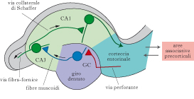
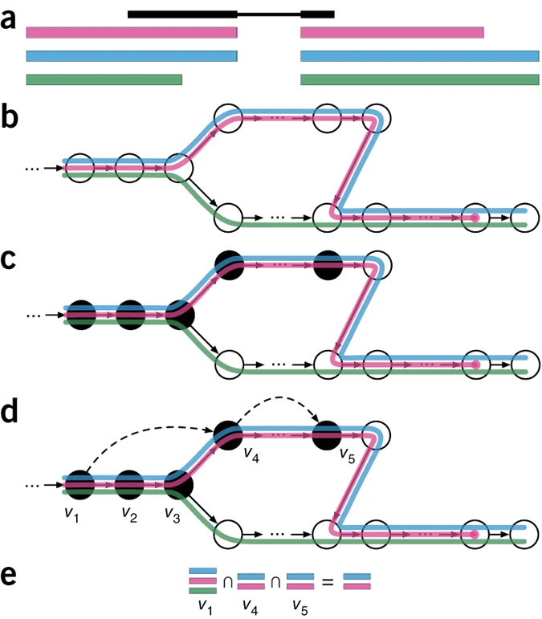

RNAseq
======

# Introduzione

L' identificazione dei trascritti e la quantificazione dell' espressione genica sono due attività fondamentali della biologia molecolare sin
dalla scoperta dell'RNA e della sua funzione d' intermediario tra il custode dell' informazione, _il genoma_, e l' applicazione delle specifiche
funzioni codificate all' interno di ciascun trascritto prodotto da ciascun gene [1].

L' avvento delle tecnologie di sequenziamento di nuova generazione ha permesso di mettere a punto delle metodiche per l'investigazione del
trascrittoma.

**NB: parte degli step presentati nella nostra procedura sono già stati effettuati. Inoltre, più che dell' analisi bioinformatica ci focalizzeremo
sull' analisi differenziale statistica dei dati di trascrittomica.**

L' analisi statistica dei dati che andremo ad analizzare sarà effettuata utilizzando R, un ambiente sviluppato appositamente per lo sviluppo e l' applicazione di pacchetti statistici.
Per semplicità utilizzeremo la versione di R già installata sulle macchine virtuali.  

# Caso Studio

Analizzeremo una parte dei dati discussi nel paper [Annese et al. 2018, Scientific Reports](https://www.nature.com/articles/s41598-018-22701-2).
Lo studio ha riguardato l' applicazione di metodologie NGS sia per l' analisi del trascrittoma che del _mirnoma_.  
Come potrete leggere il lavoro è molto complesso ed ha interessato diversi approcci sperimentali e bioinformatici. Noi ci focalizzeremo sull'analisi di una parte dei dati di trascrittomica.  
In generale, lo scopo del lavoro è stato quello di caratterizzare il profilo trascrittomico di tessuto celebrale di soggetti affetti da **Late Onset Alzheimer Disease (LOAD)**.  
L' AD è la maggiore forma di demenza senile progressiva cronica nel mondo. La neuropatologia della malattia è caratterizzata da perdita di neuroni associata a un diffuso stato infiammatorio e stress ossidativo. 
I marcatori per eccellenza sono gli aggregati intra-neuronali (NFT intraneural fibrillary tangles) della proteina associata ai microtubili **Tau**, che risulta essere iperfosforilata, e la deposizione di placche di
**B-Amiloide** extracellulari, dovute al taglio proteolitico della proteina transmembrana **Amyloid Precursor Protein, APP**.  

Nel lavoro è stato analizzato il profilo trascrittomico di 6 pazienti affetti da LOAD e 6 soggetti sani di sesso maschile e di comparabile età di morte. Inoltre, sono stati inclusi anche 6 campioni di soggetti affetti da *Parkinson Disease (PD)*, 
come una sorta di controllo di patologia neurodegenerativa e per capire quali sono le modificazioni specifiche dell' AD. I campioni utilizzati, ottenuti da una biobanca, riguardano la regione dell'Ippocampo CA1.  

_[](https://www.treccani.it/enciclopedia/memoria_%28Dizionario-di-Medicina%29/)_

Noi ci soffermeremo sulla comparazione dei dati di RNA-seq tra soggetti sani e affetti da Alzheimer.  
Analizzeremo 12 campioni:  

|Sample|Condition|  
|:---:|:----:|  
|SRR-10H_HD|HC|
|SRR-11H_HD|HC|
|SRR-6H_HD|HC|
|SRR-7H_HD|HC|
|SRR-8H_HD|HC|
|SRR-9H_HD|HC|
|SRR-1H_AD|AD|
|SRR-2H_AD|AD|
|SRR-32H_AD|AD|
|SRR-3H_AD|AD|
|SRR-4H_AD|AD|
|SRR-5H_AD|AD|  

La procedura di preparazione delle librerie di sequenziamento ha previsto l' utilizzo del kit **TruSeq Stranded Total RNA** dell'Illumina ed il sucessivo sequenziamento con piattaforma NextSeq 500 con layout 2x100.  
  
# Valutazione della qualità delle sequenze prodotte
Prima di procedere con l' analisi del trascrittoma dobbiamo valutare la qualità delle sequenze ed eventualmente optare per una procedura di trimming.  
Considerato che abbiamo sequenziato 12 campioni e che quindi abbiamo un totale di 24 file fastq da valutare, utilizzeremo, oltre al **FastQC**, un tool chiamato [**MultiQC**](https://multiqc.info).  

**Per questioni di spazio e tempo vedremo direttamente come generare il report prodotto da MultiQC**.  
:bangbang: **Quello che è riportato nel BOX 1 non va eseguito!!!** :bangbang:  

:heavy_minus_sign: :heavy_minus_sign: :heavy_minus_sign: :heavy_minus_sign: :heavy_minus_sign: :heavy_minus_sign: :heavy_minus_sign: :heavy_minus_sign: :heavy_minus_sign: :heavy_minus_sign: :heavy_minus_sign: :heavy_minus_sign: :heavy_minus_sign: :heavy_minus_sign: :heavy_minus_sign: :heavy_minus_sign: :heavy_minus_sign: :heavy_minus_sign: :heavy_minus_sign: :heavy_minus_sign: :heavy_minus_sign: :heavy_minus_sign: :heavy_minus_sign: :heavy_minus_sign: :heavy_minus_sign: :heavy_minus_sign:   
**BOX 1**  
Esecuzione del FastQC:
1. ``mkdir fastqc_output``
2. `fastqc input/*fastq.gz --noextract -o fastqc_output`  

:heavy_minus_sign: :heavy_minus_sign: :heavy_minus_sign: :heavy_minus_sign: :heavy_minus_sign: :heavy_minus_sign: :heavy_minus_sign: :heavy_minus_sign: :heavy_minus_sign: :heavy_minus_sign: :heavy_minus_sign: :heavy_minus_sign: :heavy_minus_sign: :heavy_minus_sign: :heavy_minus_sign: :heavy_minus_sign: :heavy_minus_sign: :heavy_minus_sign: :heavy_minus_sign: :heavy_minus_sign: :heavy_minus_sign: :heavy_minus_sign: :heavy_minus_sign: :heavy_minus_sign: :heavy_minus_sign: :heavy_minus_sign:   

Adesso possiamo procedere all' esecuzione di MultiQC:  
```
    mkdir RNAseq && cd RNAseq
    
    source /opt/miniconda3/bin/activate kallisto 

    multiqc /home/share/RNAseq/fastqc_output/
```

Nonostante siamo ampiamente soddisfatti della qualità dei dati effettuiamo comunque il trimming.  
:bangbang: **Quello che è riportato nel BOX 2 non va eseguito!!!** :bangbang:  

:heavy_minus_sign: :heavy_minus_sign: :heavy_minus_sign: :heavy_minus_sign: :heavy_minus_sign: :heavy_minus_sign: :heavy_minus_sign: :heavy_minus_sign: :heavy_minus_sign: :heavy_minus_sign: :heavy_minus_sign: :heavy_minus_sign: :heavy_minus_sign: :heavy_minus_sign: :heavy_minus_sign: :heavy_minus_sign: :heavy_minus_sign: :heavy_minus_sign: :heavy_minus_sign: :heavy_minus_sign: :heavy_minus_sign: :heavy_minus_sign: :heavy_minus_sign: :heavy_minus_sign: :heavy_minus_sign: :heavy_minus_sign:    
**BOX 2**  
Effettuiamo il trimming:  

```
cd input_data

mkdir ../trimmed

for sample in $(cat ../sample_list)
do
  echo $sample
  shopt -s nullglob
  array=($sample*)
  shopt -u nullglob
  echo "${array[@]}"
  sickle pe -f ${array[0]} -r ${array[1]} -o ../trimmed/${sample}_R1_trimmed.fastq.gz -p ../trimmed/${sample}_R2_trimmed.fastq.gz -s ../trimmed/${sample}_unpaired.fastq.gz -q 30 -l 50 -t sanger -g
  unset array
done

cd ..
```

:heavy_minus_sign: :heavy_minus_sign: :heavy_minus_sign: :heavy_minus_sign: :heavy_minus_sign: :heavy_minus_sign: :heavy_minus_sign: :heavy_minus_sign: :heavy_minus_sign: :heavy_minus_sign: :heavy_minus_sign: :heavy_minus_sign: :heavy_minus_sign:  


# Caratterizzazione dei trascritti espressi 
Nel lavoro da cui abbiamo preso i dati che stiamo analizzando è stato utilizzato un approccio bassato sull' allineamento delle reads sul genoma di riferimento.  
Successivamente è stato dedotto il livello di espressione a livello di trascritti e geni.  

Per questa esercitazione utilizzeremo un approccio basato sugli pseudo-allineamenti, con un tool chiamato [**Kallisto**](https://www.nature.com/articles/nbt.3519).  
Kallisto utilizza un approccio simile a quello visto per l'assemblaggio dei genomi, basato sui k-mer ed i grafici di de Bruijn, 
che in questo caso chiamiamo ***transcriptome de Bruijn Graph (T-DBG)***.  
Alla fine dell'analisi quello che otteniamo è una tabella dove per ogni trascritto è riportato il livello di espressione in [**TPM**](https://haroldpimentel.wordpress.com/2014/05/08/what-the-fpkm-a-review-rna-seq-expression-units/).


:bangbang: **Quello che è riportato nel BOX 3 non va eseguito!!!** :bangbang:  

:heavy_minus_sign: :heavy_minus_sign: :heavy_minus_sign: :heavy_minus_sign: :heavy_minus_sign: :heavy_minus_sign: :heavy_minus_sign: :heavy_minus_sign: :heavy_minus_sign: :heavy_minus_sign: :heavy_minus_sign: :heavy_minus_sign: :heavy_minus_sign:  
**BOX 3**  
Effettuiamo il trimming:  

```
cd ../trimmed

for sample in $(cat ../sample_list)
do 
    echo $sample
    kallisto quant -i /home/share/Kallisto_index/GRCh38_p13/Homo_sapiens_GRCh38_cdna_all_ncrna -o ../kallisto_quant/${sample} -b 100 --rf-stranded -t 20 ${sample}_R1_trimmed.fastq ${sample}_R2_trimmed.fastq
done
    
cd ..
```

:heavy_minus_sign: :heavy_minus_sign: :heavy_minus_sign: :heavy_minus_sign: :heavy_minus_sign: :heavy_minus_sign: :heavy_minus_sign: :heavy_minus_sign: :heavy_minus_sign: :heavy_minus_sign: :heavy_minus_sign: :heavy_minus_sign: :heavy_minus_sign:  

# Analisi statistica
Per l' analisi statistica utilizzeremo un tool chiamato [**sleuth**](nature.com/articles/nmeth.4324).  
Sleuth è disegnato per importare i dati prodotti da _Kallisto_ e procedere all' analisi differenziale tra le condizioni in analisi,
nel nostro caso HC e AD. 

:bangbang: <span style="color:red"> **Quello che è riportato nel BOX 4 non va eseguito!!!** text</span> :bangbang:  

:heavy_minus_sign: :heavy_minus_sign: :heavy_minus_sign: :heavy_minus_sign: :heavy_minus_sign: :heavy_minus_sign: :heavy_minus_sign: :heavy_minus_sign: :heavy_minus_sign: :heavy_minus_sign: :heavy_minus_sign: :heavy_minus_sign: :heavy_minus_sign:  
**BOX 4**  
Sleuth è un pachetto di R, una piattaforma che utilizziamo per l'analisi statistica:  
1. importazione della libreria di Sleuth:
```
library("sleuth")
```
2. Definiamo l'elenco dei campioni in analisi e associamo i file con le quantificazioni effettuate da kallisto:
```
sample_id <- dir(file.path(".", "kallisto_quant"))
sample_id

kal_dirs <- file.path("kallisto_quant", sample_id)
```
3. Importiamo il file con i metadata ed associamo a ciascun campione le conte generate da kallisto:
```
s2c <- read.table("metadata.csv", header = TRUE, stringsAsFactors=FALSE)

s2c <- dplyr::mutate(s2c, path = kal_dirs)
```
4. Costriuamo il modello statistico sui cui si basa Sleuth:
```
matrice = model.matrix(~condition,s2c) 

so <- sleuth_prep(s2c, extra_bootstrap_summary = TRUE,full_model = matrice, filter_fun=function(x){basic_filter(x, 5, 0.25)})

so <- sleuth_fit(so, ~condition, 'full')

so <- sleuth_fit(so, ~1, 'reduced')

so <- sleuth_lrt(so, 'reduced', 'full')
```
5. Raccogliamo i risultati a livello di Trascritti:
```
sleuth_table <- sleuth_results(so, 'reduced:full', 'lrt', show_all = FALSE)
sleuth_significant <- dplyr::filter(sleuth_table, qval <= 0.05)
head(sleuth_significant, 20)
```
6. Associamo ai trascritti i nomi dei geni ed aggiorniamo il modello:
```
mart <- biomaRt::useMart(biomart = "ENSEMBL_MART_ENSEMBL",
  dataset = "hsapiens_gene_ensembl",
  host = 'ensembl.org')
t2g <- biomaRt::getBM(attributes = c("ensembl_transcript_id", "ensembl_gene_id",
    "external_gene_name"), mart = mart)
t2g <- dplyr::rename(t2g, target_id = ensembl_transcript_id,
  ens_gene = ensembl_gene_id, ext_gene = external_gene_name)

so <- sleuth_prep(s2c, target_mapping = t2g)

so <- sleuth_fit(so, ~condition, 'full')

so <- sleuth_fit(so, ~1, 'reduced')

so <- sleuth_lrt(so, 'reduced', 'full')
```
:heavy_minus_sign: :heavy_minus_sign: :heavy_minus_sign: :heavy_minus_sign: :heavy_minus_sign: :heavy_minus_sign: :heavy_minus_sign: :heavy_minus_sign: :heavy_minus_sign: :heavy_minus_sign: :heavy_minus_sign: :heavy_minus_sign: :heavy_minus_sign: :heavy_minus_sign: :heavy_minus_sign: :heavy_minus_sign: :heavy_minus_sign: :heavy_minus_sign: :heavy_minus_sign: :heavy_minus_sign: :heavy_minus_sign: :heavy_minus_sign: :heavy_minus_sign: :heavy_minus_sign: :heavy_minus_sign: :heavy_minus_sign:   


Eseguiti tutte le applicazioni troverete nella cartella in cui avete
eseguito tutte le analisi il file gene_list.txt che contiene i dati che
analizzeremo utilizzando [AMIGO](http://amigo.geneontology.org/amigo),
per valutare l'arricchimento di specifici GO nei geni che risultano
variati in modo statisticamente significativo.

